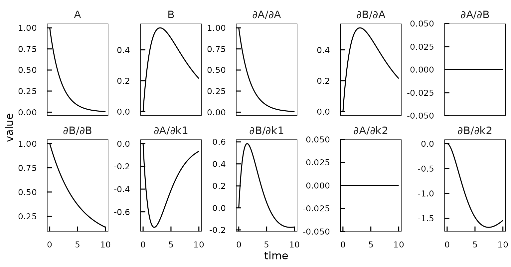

# Get started

A decay chain \\A \to B \to \emptyset\\ from equations to a fit. Code
generation needs a C++17 compiler and Python with SymPy
([Installation](https://dmodverse.github.io/cppDE/articles/installation.md));
models compile into [`tempdir()`](https://rdrr.io/r/base/tempfile.html),
the default `outdir`.

``` r

library(cppDE)
library(ggplot2)
```

## Model definition and solution

[`cppODE()`](https://dmodverse.github.io/cppDE/reference/cppODE.md)
generates and compiles the solver of the equations.
[`solveODE()`](https://dmodverse.github.io/cppDE/reference/solveODE.md)
returns the states and their sensitivities, the derivatives in every
initial value and parameter.

``` r

eqns  <- c(A = "-k1*A", B = "k1*A - k2*B")
parms <- c(A = 1, B = 0, k1 = 0.5, k2 = 0.2)
times <- seq(0, 10, by = 0.1)

chain <- cppODE(eqns, modelname = "chain")
out   <- solveODE(chain, times, parms)

dim(out$tangent)                       # [time, state, parameter]
#> [1] 101   2   4
out$tangent[101, "B", ]                # ∂B(10) / ∂(A, B, k1, k2)
#>          A          B         k1         k2 
#>  0.2143280  0.1353353 -0.1734757 -1.5411625
```

`longFormat()` ([listing](#helper-for-the-figures)) arranges states and
sensitivities for the figure.

``` r

ggplot(longFormat(out), aes(time, value)) +
  geom_line() +
  facet_wrap(~panel, scales = "free_y", ncol = 5) +
  scale_x_continuous(n.breaks = 3)
```



## Parameter estimation

The sensitivities give the gradient of a least-squares objective, here
for \\k_1\\ and \\k_2\\ from noisy readings of \\B\\. The output
includes \\t = 0\\ (`includeTimeZero = TRUE`), so the data grid starts
there.

``` r

set.seed(1)
tdata <- c(0, 1:10)
data  <- out$variable[match(tdata, times), "B"] + rnorm(length(tdata), sd = 0.01)

objective <- function(k) {
  sol <- solveODE(chain, tdata, c(A = 1, B = 0, k))
  res <- sol$variable[, "B"] - data
  structure(sum(res^2), gradient = 2 * colSums(res * sol$tangent[, "B", names(k)]))
}
fit <- optim(c(k1 = 1, k2 = 0.1), function(k) objective(k),
             function(k) attr(objective(k), "gradient"), method = "BFGS")
fit$par
#>        k1        k2 
#> 0.4985936 0.1972220
```

The [Guide](https://dmodverse.github.io/cppDE/articles/guide-model.md)
treats events, second-order and reverse-mode derivatives, steady states,
batches of conditions, algebraic functions and the SUNDIALS backend;
[dMod2](https://dmodverse.github.io/dMod2/) builds observation
functions, parameter transformations, objectives, optimizers and profile
likelihoods on cppDE.

## Helper for the figures

``` r

# states and sensitivities of a solveODE() result in long format, one panel per quantity
longFormat <- function(out, states = colnames(out$variable), sens = TRUE) {
  nt <- length(out$time)
  value <- data.frame(time = out$time, panel = rep(states, each = nt),
                      value = as.vector(out$variable[, states]))
  if (!sens) return(value)
  tangent <- out$tangent[, states, , drop = FALSE]
  grid <- expand.grid(time = out$time, state = states,
                      par = dimnames(tangent)[[3]], stringsAsFactors = FALSE)
  panels <- c(states, sprintf("∂%s/∂%s", grid$state, grid$par))
  long <- rbind(value, data.frame(time = grid$time,
                                  panel = sprintf("∂%s/∂%s", grid$state, grid$par),
                                  value = as.vector(tangent)))
  long$panel <- factor(long$panel, levels = unique(panels))
  long
}
```
