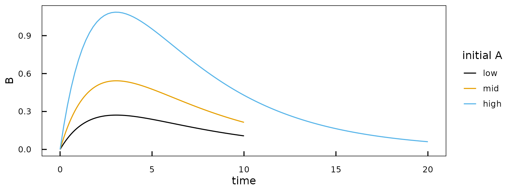

# 6. Batches of conditions

An experiment is a set of conditions: one model at different initial
values, doses or parameters.
[`solveODEBatch()`](https://dmodverse.github.io/cppDE/reference/solveODEBatch.md)
solves all conditions of one model in one `.Call`, on OpenMP threads
with dynamic scheduling and without the R API inside the parallel
region. The results equal those of a serial
[`solveODE()`](https://dmodverse.github.io/cppDE/reference/solveODE.md)
loop bit for bit, for any thread count.

``` r

library(cppDE)
library(ggplot2)
```

## Model definition

The decay chain, with forward sensitivities and in reverse mode,
compiled into one shared object.

``` r

eqns  <- c(A = "-k1*A", B = "k1*A - k2*B")
parms <- c(A = 1, B = 0, k1 = 0.5, k2 = 0.2)
times <- seq(0, 10, by = 0.1)

chain  <- cppODE(eqns, modelname = "g6_chain", compile = FALSE)
chainR <- cppODE(eqns, derivMode = "reverse", modelname = "g6_chainR", compile = FALSE)
compile(chain, chainR, output = "guide6", cores = 2)
```

## Solving a batch

`conditions` is a list of argument lists, one per condition. An element
of a condition overrides the batch-wide argument of the same name:
`times`, `parms`, `tangent`, `hessian`, `cotangent`, `curvature`,
`fixed`, `forcings`, the tolerances and step limits, `keepStore`,
`store`, `sensErrCon`, `adjoint`, `maxOrder` and `stald`, each as in
[`solveODE()`](https://dmodverse.github.io/cppDE/reference/solveODE.md).
Here three initial amounts of \\A\\, the last on a longer grid.

``` r

conditions <- list(
  low  = list(parms = c(A = 0.5, B = 0, k1 = 0.5, k2 = 0.2)),
  mid  = list(parms = c(A = 1,   B = 0, k1 = 0.5, k2 = 0.2)),
  high = list(parms = c(A = 2,   B = 0, k1 = 0.5, k2 = 0.2), times = seq(0, 20, by = 0.2)))

batch <- solveODEBatch(chain, conditions, times = times, cores = 2)
names(batch)
#> [1] "low"  "mid"  "high"
attr(batch, "threads")
#> [1] 2
```

Each element is a
[`solveODE()`](https://dmodverse.github.io/cppDE/reference/solveODE.md)
result.

``` r

long <- do.call(rbind, lapply(names(batch), function(cn)
  cbind(longFormat(batch[[cn]], "B", sens = FALSE), condition = cn)))
long$condition <- factor(long$condition, c("low", "mid", "high"))

ggplot(long, aes(time, value, color = condition)) +
  geom_line() +
  labs(y = "B", color = "initial A")
```



``` r

serial <- lapply(conditions, function(cond)
  solveODE(chain, if (is.null(cond$times)) times else cond$times, cond$parms))
identical(lapply(batch, `[[`, "tangent"), lapply(serial, `[[`, "tangent"))
#> [1] TRUE
```

`fixed` restricts the sensitivities per call, without recompiling.

``` r

dimnames(solveODEBatch(chain, conditions, times = times, fixed = c("A", "B"))$low$tangent)[[3]]
#> [1] "k1" "k2"
```

## Failed conditions

All conditions run, then `onFailure` decides: `"stop"` (default) raises
one error naming the failed conditions, `"warn"` and `"silent"` return
the partial results. `$diagnostics` holds the return code of each
condition.

``` r

limited <- list(ok  = list(parms = parms),
                bad = list(parms = c(A = 1, B = 0, k1 = 1e8, k2 = 0.2), maxsteps = 10))
res <- solveODEBatch(chain, limited, times = times, onFailure = "warn")
#> Warning: 1 of 2 conditions did not complete: bad
#>   Returning partial results.
sapply(res, function(r) r$diagnostics$return_code)
#>  ok bad 
#>   0  -1
res$bad$diagnostics$message
#> [1] "Maximum number of steps exceeded (10)."
```

`traceFile` writes the step trace of each condition, for a model built
with `stepTrace = TRUE`.

## Threads and BLAS

`cores` sets the thread count. The default is the first of
`getOption("cppDE.cores")`, `getOption("Ncpus")` and the number of
physical cores that is set; `cores = 1` forces the serial loop.

| Threads | Value |
|:---|:---|
| default | `cores`, capped at the processor count, also for fewer conditions (the team persists between calls) |
| single condition, enclosing OpenMP region, `fork()` child | one |
| BLAS during a batch | one |
| BLAS and OpenMP across `fork()` | one in the child, restored in the parent |

Thread counts of a batch. {.table}

`attr(, "threads")` reports the count used.
[`batchAvailable()`](https://dmodverse.github.io/cppDE/reference/batchAvailable.md)
reports whether a model solves batches in parallel: the batch entry
point, OpenMP in cppDE and OpenMP in the shared object of the model.
[`forkGuard()`](https://dmodverse.github.io/cppDE/reference/forkGuard.md)
reports the BLAS whose thread count cppDE steers, so that a threaded
BLAS does not deadlock in a child of
[`parallel::mclapply()`](https://rdrr.io/r/parallel/mclapply.html).

``` r

unlist(batchAvailable(chain))
#>      symbol      openmp modelOpenmp    parallel 
#>        TRUE        TRUE        TRUE        TRUE
str(forkGuard())
#> List of 3
#>  $ api    : chr "OpenBLAS"
#>  $ threads: int 4
#>  $ guard  : logi TRUE
```

## Prepared batches

[`prepareBatch()`](https://dmodverse.github.io/cppDE/reference/prepareBatch.md)
validates and converts the conditions once.
[`solveBatch()`](https://dmodverse.github.io/cppDE/reference/solveBatch.md)
then takes new numbers per condition, matched by position: `parms`,
`tangent`, `hessian`, `cotangent`, `curvature`, `adjoint` and `store`,
each a list with one element per condition and of the prepared shape.
Times, tolerances and every other argument need a new
[`prepareBatch()`](https://dmodverse.github.io/cppDE/reference/prepareBatch.md),
here also the grid of the third condition.

A fit of \\k_1\\ and \\k_2\\, shared by the three conditions, to noisy
readings of \\B\\:

``` r

set.seed(2)
tdata <- 0:10
data  <- lapply(batch, function(r)
  r$variable[match(tdata, r$time), "B"] + rnorm(length(tdata), sd = 0.01))
x0    <- lapply(conditions, function(cond) cond$parms[c("A", "B")])

h <- prepareBatch(chain, lapply(conditions, `[`, "parms"), times = tdata)

objective <- function(k) {
  sol <- solveBatch(h, parms = lapply(x0, c, k), cores = 2)
  res <- Map(function(r, d) r$variable[, "B"] - d, sol, data)
  grad <- Reduce(`+`, Map(function(r, e) 2 * colSums(e * r$tangent[, "B", names(k)]), sol, res))
  structure(sum(unlist(res)^2), gradient = grad)
}
fit <- optim(c(k1 = 1, k2 = 0.1), function(k) objective(k),
             function(k) attr(objective(k), "gradient"), method = "BFGS")
fit$par
#>        k1        k2 
#> 0.4971094 0.1987894
fit$convergence
#> [1] 0
```

## Reverse mode in a batch

A reverse-mode model takes one cotangent per condition. With
`keepStore = TRUE` the forward passes keep their checkpoints; a prepared
batch then runs the backward sweeps alone, from the stores and new
cotangents. The gradient of the objective at the start values of the
fit, from the residuals as cotangents:

``` r

k0    <- c(k1 = 1, k2 = 0.1)
atK0  <- lapply(x0, function(x) list(parms = c(x, k0)))
fwd   <- solveODEBatch(chainR, lapply(atK0, c, keepStore = TRUE), times = tdata)

cotangent <- Map(function(r, d) cbind(A = 0, B = 2 * (r$variable[, "B"] - d)), fwd, data)
hr <- prepareBatch(chainR, atK0, times = tdata, cotangent = cotangent[[1]])
sweep <- solveBatch(hr, cotangent = cotangent, store = lapply(fwd, `[[`, "store"))

Reduce(`+`, lapply(sweep, function(r) r$cotangent[c("k1", "k2"), 1]))
#>         k1         k2 
#>   1.058904 -50.677950
attr(objective(k0), "gradient")
#>         k1         k2 
#>   1.058877 -50.678081
```

The two agree to the integration tolerance; [4. Reverse
mode](https://dmodverse.github.io/cppDE/articles/guide-reverse.md)
describes stores and cotangents. Models from
[`cvode()`](https://dmodverse.github.io/cppDE/articles/guide-cvode.md)
have the same batch entry.

[← 5. Steady
states](https://dmodverse.github.io/cppDE/articles/guide-steady-states.md)
\| [7. Algebraic functions
→](https://dmodverse.github.io/cppDE/articles/guide-functions.md)
