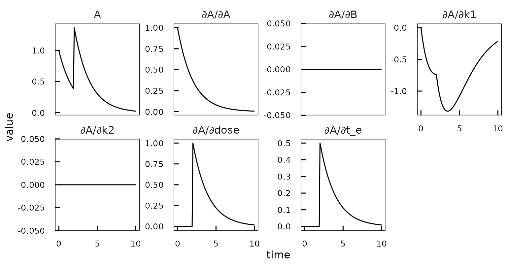

# 8. SUNDIALS backend

[`cvode()`](https://dmodverse.github.io/cppDE/reference/cvode.md) offers
SUNDIALS CVODES [\[1\]](#ref-hindmarsh2005sundials),
[\[2\]](#ref-serban2005cvodes), the long-established implementation of
BDF and Adams methods with forward and adjoint sensitivities, next to
the integrators of
[`cppODE()`](https://dmodverse.github.io/cppDE/reference/cppODE.md). It
generates the model from the same equations and links it against CVODES;
the result is solved by
[`solveODE()`](https://dmodverse.github.io/cppDE/reference/solveODE.md),
[`solveODEBatch()`](https://dmodverse.github.io/cppDE/reference/solveODEBatch.md)
and
[`prepareBatch()`](https://dmodverse.github.io/cppDE/reference/prepareBatch.md)
as a model from
[`cppODE()`](https://dmodverse.github.io/cppDE/reference/cppODE.md).
Forward sensitivities come from the CVODES sensitivity solver, reverse
mode from the CVODES adjoint, a continuous adjoint.

``` r

library(cppDE)
library(ggplot2)
```

## Availability of SUNDIALS

`codegenAvailable("cvode")` reports whether the SUNDIALS libraries were
found when cppDE was installed.

``` r

codegenAvailable("cvode")
#> [1] FALSE
```

Without SUNDIALS (\\\ge 6.0\\) from the system,
[`installLibs()`](https://dmodverse.github.io/cppDE/reference/installLibs.md)
downloads and builds SUNDIALS and SuiteSparse into a per-user cache;
`installLibs("suitesparse")` builds only KLU, the sparse linear solver
of `sparse = TRUE` in
[`cppODE()`](https://dmodverse.github.io/cppDE/reference/cppODE.md) and
[`cvode()`](https://dmodverse.github.io/cppDE/reference/cvode.md). cppDE
records the library paths at install time, so it is installed again
afterwards
([Installation](https://dmodverse.github.io/cppDE/articles/installation.md)).

``` r

installLibs("sundials")                       # SUNDIALS and SuiteSparse
devtools::install_github("dModverse/cppDE")   # links the new libraries
```

## Model definition

The arguments `events`, `rootfunc`, `fixed`, `forcings`, `sparse`,
`includeTimeZero`, `stepTrace`, `compile`, `modelname`, `outdir` and
`verbose` are those of
[`cppODE()`](https://dmodverse.github.io/cppDE/reference/cppODE.md).
`method` is `"bdf"` (default) or `"adams"`. Sensitivities are off by
default: `deriv = TRUE` selects first-order forward sensitivities,
`derivMode = "reverse"` the CVODES adjoint with a checkpoint every
`asaCheckpoints` steps. There are no second-order sensitivities.

The native models for comparison:

``` r

eqns   <- c(A = "-k1*A", B = "k1*A - k2*B")
parms  <- c(A = 1, B = 0, k1 = 0.5, k2 = 0.2)
times  <- seq(0, 10, by = 0.1)
events <- data.frame(var = "A", time = "t_e", value = "dose", method = "add")

chain  <- cppODE(eqns, modelname = "g8_chain", compile = FALSE)
dosed  <- cppODE(eqns, events = events, modelname = "g8_dosed", compile = FALSE)
chainR <- cppODE(eqns, derivMode = "reverse", modelname = "g8_chainR", compile = FALSE)
compile(chain, dosed, chainR, output = "guide8", cores = 2)
```

The same models on CVODES, compiled into a shared object of their own:

``` r

plainC <- cvode(eqns, modelname = "g8_plainC", compile = FALSE)
chainC <- cvode(eqns, deriv = TRUE, modelname = "g8_chainC", compile = FALSE)
dosedC <- cvode(eqns, events = events, deriv = TRUE, modelname = "g8_dosedC", compile = FALSE)
adjC   <- cvode(eqns, derivMode = "reverse", asaCheckpoints = 100, modelname = "g8_adjC",
                compile = FALSE)
compile(plainC, chainC, dosedC, adjC, output = "guide8cvode", cores = 2)
attr(chainC, "backend")
#> [1] "cvode"
```

## Comparison with `cppODE()`

|  | [`cppODE()`](https://dmodverse.github.io/cppDE/reference/cppODE.md) | [`cvode()`](https://dmodverse.github.io/cppDE/reference/cvode.md) |
|:---|:---|:---|
| `method` | `"bdf"`, `"adams"`, `"rb4"`, `"tsit5"` | `"bdf"`, `"adams"` |
| sensitivities | on by default; first and second order | `deriv = TRUE`; first order |
| reverse mode | discrete adjoint of the computed steps | continuous adjoint (CVODES) |
| reverse options | `keepStore`, `store`, [`adjointControl()`](https://dmodverse.github.io/cppDE/reference/adjointControl.md) | `asaCheckpoints`, `adjointControl(gradtol = )` |
| `sensErrCon` | `TRUE` or `FALSE` | `TRUE` |
| libraries | LAPACK; KLU optional | SUNDIALS; KLU optional |

The two backends; details in [cvode() and the CVODES
adjoint](https://dmodverse.github.io/cppDE/articles/methods-cvode.html#comparison).
{.table}

At tight tolerances the two backends agree in states and sensitivities
to the tolerance, with different step sequences.

``` r

solveODE(plainC, times, parms)$variable[101, ]
#>           A           B 
#> 0.006738371 0.214328186

outC <- solveODE(chainC, times, parms, abstol = 1e-10, reltol = 1e-10)
outN <- solveODE(chain, times, parms, abstol = 1e-10, reltol = 1e-10)
c(states = max(abs(outC$variable - outN$variable)),
  sensitivities = max(abs(outC$tangent - outN$tangent)))
#>        states sensitivities 
#>  1.321286e-10  8.817671e-10
sapply(list(cvode = outC, cppODE = outN),
       function(o) unlist(o$diagnostics[c("accepted", "rejected", "fevals", "jevals")]))
#>          cvode cppODE
#> accepted   270    264
#> rejected     0      4
#> fevals    1706    291
#> jevals       5      5
```

## Events

Events, switches and forcings behave as in
[`cppODE()`](https://dmodverse.github.io/cppDE/reference/cppODE.md); the
sensitivities jump with the states, also in the dose and in the event
time.

``` r

pe   <- c(parms, t_e = 2, dose = 1)
outE <- solveODE(dosedC, times, pe, abstol = 1e-10, reltol = 1e-10)
rbind(cvode  = outE$tangent[101, "B", ],
      cppODE = solveODE(dosed, times, pe, abstol = 1e-10, reltol = 1e-10)$tangent[101, "B", ])
#>                A         B         k1        k2      dose        t_e
#> cvode  0.2143289 0.1353353 -0.3372217 -3.213218 0.3059681 0.05203581
#> cppODE 0.2143289 0.1353353 -0.3372217 -3.213218 0.3059681 0.05203581
```

``` r

ggplot(longFormat(outE, "A"), aes(time, value)) +
  geom_line() +
  facet_wrap(~panel, scales = "free_y", ncol = 4) +
  scale_x_continuous(n.breaks = 3)
```



## Adjoint sensitivities

`derivMode = "reverse"` integrates the adjoint equations backward, one
backward solve per cotangent column, and interpolates the forward state
between checkpoints. The result is the derivative of the exact solution
up to the tolerance; the reverse mode of
[`cppODE()`](https://dmodverse.github.io/cppDE/reference/cppODE.md) is
the exact derivative of the computed solution ([continuous and discrete
adjoint](https://dmodverse.github.io/cppDE/articles/methods-cvode.html#asa)).
`adjointControl(gradtol = )` sets the tolerance of the quadrature of the
gradient.

``` r

w <- matrix(0, length(times), 2, dimnames = list(NULL, c("A", "B")))
w[101, "B"] <- 1

cbind(cvode   = solveODE(adjC, times, parms, cotangent = w, abstol = 1e-10, reltol = 1e-10,
                         adjoint = adjointControl(gradtol = 1e-10))$cotangent[, 1],
      cppODE  = solveODE(chainR, times, parms, cotangent = w, abstol = 1e-10,
                         reltol = 1e-10)$cotangent[, 1],
      forward = outN$tangent[101, "B", ])
#>         cvode     cppODE    forward
#> A   0.2143289  0.2143289  0.2143289
#> B   0.1353353  0.1353353  0.1353353
#> k1 -0.1734727 -0.1734727 -0.1734727
#> k2 -1.5411584 -1.5411584 -1.5411584
```

## Batches of conditions

A [`cvode()`](https://dmodverse.github.io/cppDE/reference/cvode.md)
model has the batch entry of [6. Batches of
conditions](https://dmodverse.github.io/cppDE/articles/guide-batches.md).

``` r

conditions <- list(low  = list(parms = c(A = 1, B = 0, k1 = 0.5, k2 = 0.2)),
                   high = list(parms = c(A = 2, B = 0, k1 = 0.5, k2 = 0.2)))
batch <- solveODEBatch(chainC, conditions, times = times, cores = 2)
sapply(batch, function(r) r$tangent[101, "B", ])
#>           low       high
#> A   0.2143285  0.2143287
#> B   0.1353353  0.1353353
#> k1 -0.1734733 -0.3469461
#> k2 -1.5411591 -3.0823176
```

[← 7. Algebraic
functions](https://dmodverse.github.io/cppDE/articles/guide-functions.md)
\| [Installation
→](https://dmodverse.github.io/cppDE/articles/installation.md)

## References

\[1\]

A. C. Hindmarsh *et al.*, “SUNDIALS: Suite of nonlinear and
differential/algebraic equation solvers,” *ACM Transactions on
Mathematical Software (TOMS)*, vol. 31, no. 3, pp. 363–396, 2005, doi:
[10.1145/1089014.1089020](https://doi.org/10.1145/1089014.1089020).

\[2\]

R. Serban and A. C. Hindmarsh, “CVODES: The sensitivity-enabled ODE
solver in SUNDIALS,” in *Proceedings of IDETC/CIE 2005, volume 6: 5th
international conference on multibody systems, nonlinear dynamics, and
control*, Long Beach, CA: ASME, 2005, pp. 257–269. doi:
[10.1115/DETC2005-85597](https://doi.org/10.1115/DETC2005-85597).
