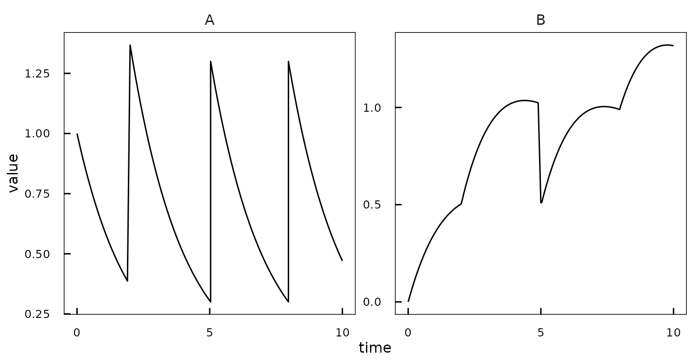
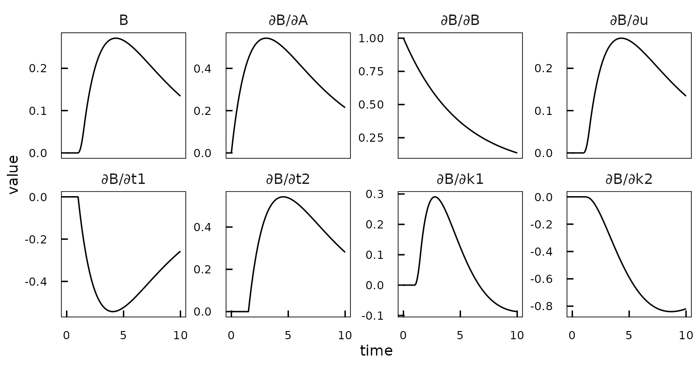
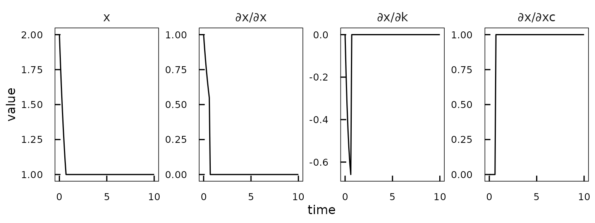
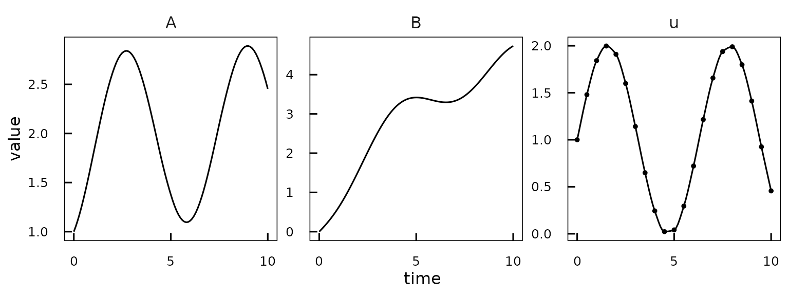

# 2. Events, switches and forcings

Discontinuities of the decay chain: resets of a state at a time or at a
root, switches of the right-hand side, a terminating root, and input
data. The sensitivities take every jump, also where a parameter moves
the time of the jump. Mechanism and transport of the sensitivities:
[Events, switches and
saltation](https://dmodverse.github.io/cppDE/articles/methods-events.md).

``` r

library(cppDE)
library(ggplot2)
```

## Model definition

`events` of
[`cppODE()`](https://dmodverse.github.io/cppDE/reference/cppODE.md) is a
data frame with one row per event:

| column | content |
|:---|:---|
| `var` | the state that is reset |
| `time` | the event time, a number or an expression of the parameters |
| `root` | a root expression of states, parameters and `time`; the event fires where it crosses zero |
| `value` | the value, a number or an expression of states, parameters and `time` |
| `method` | `"replace"` (default), `"add"` or `"multiply"` |

Each row has exactly one of `time` and `root`, the other `NA`. Below, a
dose of \\A\\ at `t_e`, a loss of \\B\\ by the factor `f` at
`t_e + delay`, and a refill of \\A\\ by `dose` whenever \\A\\ falls to
`Amin`.

``` r

eqns  <- c(A = "-k1*A", B = "k1*A - k2*B")
parms <- c(A = 1, B = 0, k1 = 0.5, k2 = 0.2)
times <- seq(0, 10, by = 0.1)

events <- data.frame(var    = c("A", "B", "A"),
                     time   = c("t_e", "t_e + delay", NA),
                     root   = c(NA, NA, "A - Amin"),
                     value  = c("dose", "f", "dose"),
                     method = c("add", "multiply", "add"))
dosed <- cppODE(eqns, events = events, modelname = "g2_dosed", compile = FALSE)
halved <- cppODE(eqns, events = data.frame(var = "B", time = "t_e", value = "B/2"),
                 modelname = "g2_halved", compile = FALSE)
```

`rootfunc`, a vector of expressions, ends the solve at the first zero
crossing of any of them. A switch is a comparison on a state or on
`time` in the right-hand side, also inside `piecewise()`,
[`ifelse()`](https://rdrr.io/r/base/ifelse.html), `Heaviside()` or
[`sign()`](https://rdrr.io/r/base/sign.html). `forcings` names input
data.

``` r

stopped <- cppODE(eqns, rootfunc = "B - Bmax", modelname = "g2_stopped", compile = FALSE)
pulse   <- cppODE(c(A = "piecewise(u, time >= t1 && time < t2, 0) - k1*A",
                    B = "k1*A - k2*B"), modelname = "g2_pulse", compile = FALSE)
slide   <- cppODE(c(x = "-k*x + p*(x < xc)"), modelname = "g2_slide", compile = FALSE)
forced  <- cppODE(c(A = "u - k1*A", B = "k1*A - k2*B"), forcings = "u",
                  modelname = "g2_forced", compile = FALSE)

compile(dosed, halved, stopped, pulse, slide, forced, output = "guide2", cores = 2)
attr(dosed, "parameters")
#> [1] "k1"    "k2"    "dose"  "f"     "t_e"   "delay" "Amin"
```

## Events

The symbols of the event columns are parameters of the model. `maxroot`
of
[`solveODE()`](https://dmodverse.github.io/cppDE/reference/solveODE.md)
caps the firings per root event (default 1), `roottol` is the tolerance
of the root location.

``` r

pE   <- c(parms, t_e = 2, dose = 1, delay = 3, f = 0.5, Amin = 0.3)
outE <- solveODE(dosed, times, pE, maxroot = 3)

ggplot(longFormat(outE, sens = FALSE), aes(time, value)) +
  geom_line() +
  facet_wrap(~panel, scales = "free_y") +
  scale_x_continuous(n.breaks = 3)
```



A time event inside the output window adds the event time to the output,
with the state after the event. A root event adds two rows, the states
before and after the reset.

``` r

nrow(outE$variable)
#> [1] 105
before <- which(diff(outE$time) < 1e-12)
cbind(time = outE$time, outE$variable)[sort(c(before, before + 1)), ]
#>          time   A         B
#> [1,] 5.034481 0.3 0.5112582
#> [2,] 5.034481 1.3 0.5112582
#> [3,] 7.967156 0.3 0.9895994
#> [4,] 7.967156 1.3 0.9895994
```

The sensitivities in the event parameters include the shift of the event
times:

``` r

outE$tangent[nrow(outE$variable), , c("t_e", "delay", "dose", "f", "Amin")]
#>         sens
#> variable         t_e       delay     dose         f       Amin
#>        A 0.171965226  0.00000000 1.067708 0.0000000 -2.4125907
#>        B 0.005718182 -0.02807061 1.030995 0.3749164  0.5796254
```

A `value` may read the states: `"B/2"` with `"replace"` halves \\B\\.

``` r

outH <- solveODE(halved, times, c(parms, t_e = 2))
outH$variable[outH$time == 2, ]
#>         A         B 
#> 0.3678790 0.2520342
```

A time event at the first output time applies before the solve starts;
one before the first or at or after the last output time is ignored.

## Terminating root

The solve ends at the first zero of a `rootfunc` expression, here when
\\B\\ reaches `Bmax`.

``` r

outR <- solveODE(stopped, times, c(parms, Bmax = 0.4))
tail(cbind(time = outR$time, outR$variable), 2)
#>           time         A         B
#> [13,] 1.200000 0.5488117 0.3963603
#> [14,] 1.218811 0.5436739 0.4000000
```

`rootfunc = "equilibrate"` ends at a steady state instead ([chapter
5](https://dmodverse.github.io/cppDE/articles/guide-steady-states.md)).

## Switches

The solver locates every switch of the right-hand side as a root and
continues on the other branch, so a short pulse is not stepped over. A
switch adds no output row and does not count towards `maxroot`. The
sensitivities in `t1` and `t2` come from the jump of the right-hand
side.

``` r

outP <- solveODE(pulse, times, c(A = 0, B = 0, k1 = 0.5, k2 = 0.2, u = 1, t1 = 1, t2 = 1.5))

ggplot(longFormat(outP, "B"), aes(time, value)) +
  geom_line() +
  facet_wrap(~panel, scales = "free_y", ncol = 4) +
  scale_x_continuous(n.breaks = 3)
```



Where both branches point onto the switching surface, the solution
slides along it
([sliding](https://dmodverse.github.io/cppDE/articles/methods-events.html#sliding)).
Above `xc` the state decays, below it grows towards `p/k`; it reaches
`xc` and stays, and depends on `xc` alone from then on. \\\partial
x/\partial p\\ is zero throughout and left out.

``` r

outS <- solveODE(slide, times, c(x = 2, k = 1, p = 3, xc = 1))

ggplot(subset(longFormat(outS), panel != "∂x/∂p"), aes(time, value)) +
  geom_line() +
  facet_wrap(~panel, scales = "free_y", ncol = 4) +
  scale_x_continuous(n.breaks = 3)
```



[`floor()`](https://rdrr.io/r/base/Round.html),
[`round()`](https://rdrr.io/r/base/Round.html),
[`abs()`](https://rdrr.io/r/base/MathFun.html),
[`max()`](https://rdrr.io/r/base/Extremes.html) and the other kinks and
steps take parameters and forcings only: on a state or on the time they
are an error, since no root locates them. Write such a step with
comparisons, see
[expressions](https://dmodverse.github.io/cppDE/reference/expressions.md).

## Forcings

A forcing is input data, given to
[`solveODE()`](https://dmodverse.github.io/cppDE/reference/solveODE.md)
as a named list of data frames with columns `time` and `value`. The
model sees the monotone cubic Hermite interpolant of the points,
constant outside them;
[`forcingValues()`](https://dmodverse.github.io/cppDE/reference/forcingValues.md)
evaluates it the same way.

``` r

tu   <- seq(0, 10, by = 0.5)
u    <- list(u = data.frame(time = tu, value = 1 + sin(tu)))
outF <- solveODE(forced, times, parms, forcings = u)
dimnames(outF$tangent)$sens
#> [1] "A"  "B"  "k1" "k2"

input <- data.frame(time = times, panel = "u", value = forcingValues(times, u)[, "u"])
ggplot(rbind(input, longFormat(outF, sens = FALSE)), aes(time, value)) +
  geom_line() +
  geom_point(data = transform(u$u, panel = "u"), size = 1) +
  facet_wrap(~panel, scales = "free_y") +
  scale_x_continuous(n.breaks = 3)
```



A forcing is data, not a parameter, and has no sensitivity.

[← 1. Model definition and
solution](https://dmodverse.github.io/cppDE/articles/guide-model.md) \|
[3. Sensitivities
→](https://dmodverse.github.io/cppDE/articles/guide-sensitivities.md)
