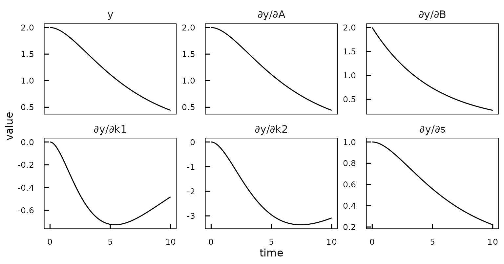

# 7. Algebraic functions

[`cppFUN()`](https://dmodverse.github.io/cppDE/reference/cppFUN.md)
compiles a system of algebraic equations \\y = g(x, p)\\, evaluated on
the rows of a matrix of variables \\x\\ with parameters \\p\\ shared by
all rows, with first and second derivatives. Typical uses are
observation functions and reparameterizations of the inputs of
[`solveODE()`](https://dmodverse.github.io/cppDE/reference/solveODE.md).
The equations follow the [expression
language](https://dmodverse.github.io/cppDE/reference/expressions.md) of
[`cppODE()`](https://dmodverse.github.io/cppDE/reference/cppODE.md); the
generated code is described in [Derivative directions of
cppFUN()](https://dmodverse.github.io/cppDE/articles/methods-cppfun.md).

``` r

library(cppDE)
library(ggplot2)
```

## Function definition

`variables` are given per row, `parameters` once; `variables` defaults
to all symbols of the equations not in `parameters`
([`getSymbols()`](https://dmodverse.github.io/cppDE/reference/getSymbols.md)).
`derivMode` names the derivative products built, any of `"forward"`
(default: `jac`, `hess`, `evaluate`, `evaluateBatch`), `"reverse"`
(`vjp`) and `"forward-reverse"` (`vjp` with curvature); `deriv2 = TRUE`
adds the second derivatives, `deriv = FALSE` builds `func` alone, and
`fixed` excludes symbols from differentiation at compile time. As with
[`cppODE()`](https://dmodverse.github.io/cppDE/reference/cppODE.md),
`compile = FALSE` (here the default) writes the source to `outdir` for a
joint
[`compile()`](https://dmodverse.github.io/cppDE/reference/compile.md).

The guide uses an observable \\y = s(A + B)\\ of the decay chain and the
fraction \\z = B/(A + B)\\, a reparameterization \\k_i =
\exp(\lambda_i)\\, and an error model \\\sigma = \sqrt{a^2 + b^2 B^2}\\.

``` r

eqns  <- c(A = "-k1*A", B = "k1*A - k2*B")
parms <- c(A = 1, B = 0, k1 = 0.5, k2 = 0.2)
times <- seq(0, 10, by = 0.1)

chain  <- cppODE(eqns, modelname = "g7_chain", compile = FALSE)
chainR <- cppODE(eqns, derivMode = "reverse", modelname = "g7_chainR", compile = FALSE)

obs   <- c(y = "s*(A + B)", z = "B/(A + B)")
g     <- cppFUN(obs, variables = c("A", "B"), parameters = "s", deriv2 = TRUE,
                derivMode = c("forward", "forward-reverse"), modelname = "g7_obs")
gM    <- cppFUN(obs, variables = c("A", "B"), parameters = "s", convenient = FALSE,
                modelname = "g7_obsM")
trafo <- cppFUN(c(k1 = "exp(lk1)", k2 = "exp(lk2)"), variables = character(0),
                parameters = c("lk1", "lk2"), modelname = "g7_trafo")
err   <- cppFUN(c(sigma = "sqrt(a^2 + b^2*B^2)"), variables = "B", parameters = c("a", "b"),
                modelname = "g7_err")

compile(chain, chainR, g, gM, trafo, err, output = "guide7", cores = 2)
```

## Values and derivatives

The returned list holds `func`, `jac`, `hess`, `evaluate`,
`evaluateBatch` and `vjp`, each `NULL` when not built. They take the
inputs as named arguments, a variable as a vector with one element per
row. `func` returns the outputs, \[row, output\].

``` r

g$func(A = c(0.2, 0.1), B = c(0.5, 0.4), s = 2)
#>        y         z
#> [1,] 1.4 0.7142857
#> [2,] 1.0 0.8000000
```

`jac` returns the first derivatives, \[row, output, direction\], by
default in the variables and the parameters; `fixed` excludes parameters
at run time.

``` r

g$jac(A = 0.2, B = 0.5, s = 2)[1, , ]
#>           A         B   s
#> y  2.000000 2.0000000 0.7
#> z -1.020408 0.4081633 0.0
dimnames(g$jac(A = 0.2, B = 0.5, s = 2, fixed = "s"))[[3]]
#> [1] "A" "B"
```

`hess` returns the second derivatives, \[row, output, direction,
direction\]; `evaluate` returns value, first and, with `deriv2 = TRUE`,
second derivatives from one pass.

``` r

g$hess(A = 0.2, B = 0.5, s = 2)[1, "z", , ]
#>           A          B s
#> A 2.9154519  0.8746356 0
#> B 0.8746356 -1.1661808 0
#> s 0.0000000  0.0000000 0
names(g$evaluate(A = 0.2, B = 0.5, s = 2, deriv2 = TRUE))
#> [1] "y"       "tangent" "hessian"
```

## Chain rule with ODE sensitivities

`tangentX`, \[row, variable, direction\], and `tangentP`, \[parameter,
direction\], are the derivatives of the inputs in the directions
\\\theta\\; `hessianX` and `hessianP` are the second derivatives. The
results are then derivatives in \\\theta\\. With the sensitivities of
the chain as `tangentX` and a unit row for \\s\\ as `tangentP`,
`evaluate` returns the observables with their derivatives in \\\theta =
(A_0, B_0, k_1, k_2, s)\\:

``` r

out    <- solveODE(chain, times, parms)
theta  <- c(dimnames(out$tangent)[[3]], "s")
tangX  <- array(0, c(length(out$time), 2, length(theta)),
                dimnames = list(NULL, c("A", "B"), theta))
tangX[, , 1:4] <- out$tangent
tangP  <- matrix(c(0, 0, 0, 0, 1), 1, dimnames = list("s", theta))

obsOut <- g$evaluate(A = out$variable[, "A"], B = out$variable[, "B"], s = 2,
                     tangentX = tangX, tangentP = tangP)
obsOut$tangent[101, , ]
#>               A          B         k1        k2         s
#> y  4.421330e-01 0.27067062 -0.4817043 -3.082325 0.2210665
#> z -2.883861e-17 0.01866078  0.2715690 -0.212504 0.0000000
```

``` r

traj <- list(time = out$time, variable = obsOut$y, tangent = obsOut$tangent)
ggplot(longFormat(traj, "y"), aes(time, value)) +
  geom_line() +
  facet_wrap(~panel, scales = "free_y", ncol = 3) +
  scale_x_continuous(n.breaks = 3)
```



A tangent not given as an argument is taken from attribute `"deriv"` of
the variables or parameters, a second derivative from attribute
`"deriv2"`.

## Reparameterization

A function of the parameters alone has no variables and one row. The
Jacobian, rows named by the outputs, is a partial `tangent` of
[`solveODE()`](https://dmodverse.github.io/cppDE/reference/solveODE.md):
the sensitivities are then derivatives in the logarithms \\\lambda_i\\
of the rate constants.

``` r

k <- trafo$evaluate(lk1 = log(0.5), lk2 = log(0.2))
k$y
#>       k1  k2
#> [1,] 0.5 0.2
outL <- solveODE(chain, times, c(A = 1, B = 0, k$y[1, ]), tangent = k$tangent[1, , ])
outL$tangent[101, "B", ]
#>         lk1         lk2 
#> -0.08673693 -0.30823163
out$tangent[101, "B", c("k1", "k2")] * c(0.5, 0.2)
#>          k1          k2 
#> -0.08673784 -0.30823251
```

## Vector-Jacobian products

`vjp` contracts a cotangent of the outputs, \[row, output\] or \[row,
output, seed\], with the Jacobian in one reverse sweep. It returns
`cotangentX`, \[row, variable, seed\], and `cotangentP`, \[parameter,
seed\], summed over the rows because the parameters are shared.
`cotangentX` is the cotangent of the states for a reverse-mode
[`solveODE()`](https://dmodverse.github.io/cppDE/reference/solveODE.md),
so the gradient of \\\sum_t y(t)\\ in \\\theta\\ takes two backward
sweeps:

``` r

x <- out$variable
v <- g$vjp(vars = x, params = c(s = 2), cotangent = cbind(y = rep(1, nrow(x)), z = 0))
c(solveODE(chainR, times, parms, cotangent = v$cotangentX[, , 1])$cotangent[, 1],
  v$cotangentP[, 1])
#>          A          B         k1         k2          s 
#>  118.84394   87.60472  -52.92147 -236.89158   59.42208
colSums(obsOut$tangent[, "y", ])
#>          A          B         k1         k2          s 
#>  118.84416   87.60469  -52.92081 -236.89013   59.42208
```

Under `"forward-reverse"`, `vjp` also takes `tangentX`, `tangentP` and
`curvature`, the derivative of the cotangent along the tangent, and
returns `curvatureX` and `curvatureP`, the derivative of the contraction
along the tangent ([forward over
reverse](https://dmodverse.github.io/cppDE/articles/methods-forward-reverse.md)).
These seeds are positional. Along \\k_1\\:

``` r

vk <- g$vjp(vars = x, params = c(s = 2), cotangent = cbind(y = rep(1, nrow(x)), z = 0),
            tangentX = tangX[, , "k1", drop = FALSE], tangentP = tangP[, "k1", drop = FALSE])
vk$curvatureP[, , 1]
#> [1] -26.4604
sum(out$tangent[, c("A", "B"), "k1"])
#> [1] -26.4604
```

## Matrix interface

With `convenient = FALSE`, `func`, `jac`, `hess` and `evaluate` take a
matrix `vars`, columns named by the variables, and a named vector
`params`; `evaluateBatch` and `vjp` always do. `attach.input = TRUE`
appends the inputs that are neither variables nor parameters to the
result.

``` r

gM$func(vars = cbind(x[1:3, ], time = out$time[1:3]), params = c(s = 2, dose = 1),
        attach.input = TRUE)
#>             y          z time dose
#> [1,] 2.000000 0.00000000  0.0    1
#> [2,] 1.999024 0.04830638  0.1    1
#> [3,] 1.996182 0.09343231  0.2    1
```

## Argument sets in one call

`evaluateBatch(sets, cores, deriv2)` runs `evaluate` over a list of
argument sets, each with `vars`, `params` and optionally the seeds,
`fixed` and `attach.input`, in one call and on `cores` threads. Here the
observables at three scales:

``` r

sets <- lapply(c(1, 2, 4), function(s) list(vars = x[c(11, 51, 101), ], params = c(s = s)))
sapply(g$evaluateBatch(sets, cores = 2), function(r) r$y[, "y"])
#>           [,1]     [,2]     [,3]
#> [1,] 0.9601974 1.920395 3.840790
#> [2,] 0.5584095 1.116819 2.233638
#> [3,] 0.2210665 0.442133 0.884266
```

[`evaluateMany()`](https://dmodverse.github.io/cppDE/reference/evaluateMany.md)
evaluates one argument set for each of several functions, here
observable and error model, in one call and one parallel region.

``` r

many <- evaluateMany(list(g$evaluateBatch, err$evaluateBatch),
                     list(list(vars = x[c(11, 51, 101), ], params = c(s = 2)),
                          list(vars = x[c(11, 51, 101), "B", drop = FALSE],
                               params = c(a = 0.01, b = 0.1))),
                     cores = 2)
many[[2]]$y
#>           sigma
#> [1,] 0.03675324
#> [2,] 0.04867090
#> [3,] 0.02365089
many[[2]]$tangent[, "sigma", ]
#>               B         a         b
#> [1,] 0.09622733 0.2720848 0.3403240
#> [2,] 0.09786652 0.2054616 0.4661628
#> [3,] 0.09062151 0.4228170 0.1942272
```

[← 6. Batches of
conditions](https://dmodverse.github.io/cppDE/articles/guide-batches.md)
\| [8. SUNDIALS backend
→](https://dmodverse.github.io/cppDE/articles/guide-cvode.md)
