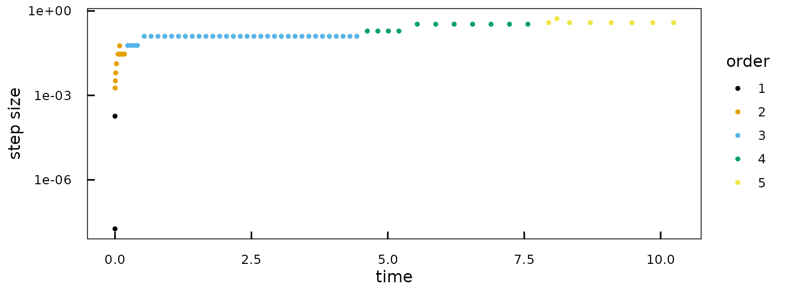

# 1. Model definition and solution

The chapter builds the decay chain \\A \to B \to \emptyset\\ of [Get
started](https://dmodverse.github.io/cppDE/articles/cppDE.md) with
several integrators, compiles the variants together and reads the result
of
[`solveODE()`](https://dmodverse.github.io/cppDE/reference/solveODE.md).

``` r

library(cppDE)
library(ggplot2)
```

## Model definition

[`cppODE()`](https://dmodverse.github.io/cppDE/reference/cppODE.md)
takes the right-hand sides as a named character vector, the names being
the states. Every other symbol is a parameter. `modelname` names the
source file and the exported C symbols, `outdir` the directory of the
source (default [`tempdir()`](https://rdrr.io/r/base/tempfile.html)).
With `compile = FALSE` the source is written and nothing is compiled.

``` r

eqns  <- c(A = "-k1*A", B = "k1*A - k2*B")
parms <- c(A = 1, B = 0, k1 = 0.5, k2 = 0.2)
times <- seq(0, 10, by = 0.1)

chain <- cppODE(eqns, modelname = "g1_chain", outdir = tempdir(), compile = FALSE)
attr(chain, "variables")
#> [1] "A" "B"
attr(chain, "parameters")
#> [1] "k1" "k2"
basename(attr(chain, "srcfile"))
#> [1] "g1_chain.cpp"
```

`method` selects the integrator, `stepTrace = TRUE` records every step
attempt (see [Diagnostics](#diagnostics)).

``` r

adams <- cppODE(eqns, method = "adams", modelname = "g1_adams", compile = FALSE)
rb4   <- cppODE(eqns, method = "rb4",   modelname = "g1_rb4",   compile = FALSE)
tsit5 <- cppODE(eqns, method = "tsit5", modelname = "g1_tsit5", compile = FALSE)
traced <- cppODE(eqns, deriv = FALSE, stepTrace = TRUE, modelname = "g1_traced",
                 compile = FALSE)
```

Further arguments of
[`cppODE()`](https://dmodverse.github.io/cppDE/reference/cppODE.md):
`events`, `forcings` and `rootfunc` ([chapter
2](https://dmodverse.github.io/cppDE/articles/guide-events.md), [chapter
5](https://dmodverse.github.io/cppDE/articles/guide-steady-states.md));
`deriv`, `deriv2` and `fixed` ([chapter
3](https://dmodverse.github.io/cppDE/articles/guide-sensitivities.md));
`derivMode` ([chapter
4](https://dmodverse.github.io/cppDE/articles/guide-reverse.md));
`profile = TRUE` compiles timers that print a summary per category to
the standard error stream after each solve; `verbose = TRUE` reports the
steps of code generation.

## Expression language

Right-hand sides, event values, roots and the equations of
[`cppFUN()`](https://dmodverse.github.io/cppDE/reference/cppFUN.md)
share one [expression
language](https://dmodverse.github.io/cppDE/reference/expressions.md): R
syntax with `+`, `-`, `*`, `/`, `^`, the common elementary functions,
comparisons and logical operators that give 1 or 0, and the switches
`piecewise()`, [`ifelse()`](https://rdrr.io/r/base/ifelse.html),
`Heaviside()` and [`sign()`](https://rdrr.io/r/base/sign.html). `time`
is the independent variable and `pi` the number.

## Joint compilation

[`compile()`](https://dmodverse.github.io/cppDE/reference/compile.md)
builds the generated sources. With `output` they link into one shared
object in the directory of the first source; `cores` runs the compiler
jobs in parallel, `args` appends compiler or linker flags,
`verbose = TRUE` shows the commands.

``` r

compile(chain, adams, rb4, tsit5, traced, output = "guide1", cores = 2)
```

The flags of a model, such as the step trace, apply to the source of
that model only.

The environment variables `CPPDE_EXTRA_CXXFLAGS` and `CPPDE_EXTRA_LIBS`
add flags to every compilation of the session. A model recompiled into a
shared object of another name needs
[`clearNativeSymbols()`](https://dmodverse.github.io/cppDE/reference/clearNativeSymbols.md);
[`compile()`](https://dmodverse.github.io/cppDE/reference/compile.md)
calls it itself.

## Solution and output

[`solveODE()`](https://dmodverse.github.io/cppDE/reference/solveODE.md)
takes the model, the output times and a named vector of initial values
and parameters.

``` r

out <- solveODE(chain, times, parms)
str(out[c("time", "variable", "tangent")])
#> List of 3
#>  $ time    : num [1:101] 0 0.1 0.2 0.3 0.4 0.5 0.6 0.7 0.8 0.9 ...
#>  $ variable: num [1:101, 1:2] 1 0.951 0.905 0.861 0.819 ...
#>   ..- attr(*, "dimnames")=List of 2
#>   .. ..$ : NULL
#>   .. ..$ : chr [1:2] "A" "B"
#>  $ tangent : num [1:101, 1:2, 1:4] 1 0.951 0.905 0.861 0.819 ...
#>   ..- attr(*, "dimnames")=List of 3
#>   .. ..$ time    : NULL
#>   .. ..$ variable: chr [1:2] "A" "B"
#>   .. ..$ sens    : chr [1:4] "A" "B" "k1" "k2"
out$variable[101, ]
#>           A           B 
#> 0.006738521 0.214327979
```

| element | content |
|:---|:---|
| `time` | output times, `n_t` |
| `variable` | states, `[n_t, n_x]` |
| `tangent` | first-order sensitivities, `[n_t, n_x, n_s]` ([chapter 3](https://dmodverse.github.io/cppDE/articles/guide-sensitivities.md)) |
| `hessian` | second-order sensitivities, `[n_t, n_x, n_s, n_s]` ([chapter 3](https://dmodverse.github.io/cppDE/articles/guide-sensitivities.md)) |
| `cotangent`, `curvature`, `correction`, `store`, `adjoint` | reverse mode ([chapter 4](https://dmodverse.github.io/cppDE/articles/guide-reverse.md)) |
| `diagnostics` | solver statistics |
| `trace` | step trace, with `stepTrace = TRUE` |

The initial values hold at time 0. With `includeTimeZero = TRUE`
(default of
[`cppODE()`](https://dmodverse.github.io/cppDE/reference/cppODE.md)) the
time 0 is added to the output grid, so a grid that starts later still
starts from them.

``` r

solveODE(chain, c(5, 10), parms)$time
#> [1]  0  5 10
```

## Tolerances and step control

`abstol` and `reltol` (default `1e-6`) bound the local error of every
step. `hini` sets the first step (default `0`, estimated), `maxsteps`
the total number of steps, `maxattempts` the number of attempts without
progress. `onFailure` decides what an unsuccessful solve returns:
`"stop"` (default) is an error, `"warn"` and `"silent"` return the rows
up to the time reached.

``` r

part <- solveODE(chain, times, parms, maxsteps = 20, onFailure = "warn")
#> Warning: Solver did not complete: Maximum number of steps exceeded (20).
#>   Reached t = 0.3 (4 of 101 time points).
#>   Returning partial results.
part$diagnostics[c("return_code", "t_reached")]
#> $return_code
#> [1] -1
#> 
#> $t_reached
#> [1] 0.3
```

## Diagnostics

[`diagnostics()`](https://dmodverse.github.io/cppDE/reference/diagnostics.md)
prints the statistics of a solve; the list itself is `$diagnostics`.

``` r

diagnostics(out)
#> ----------------------  NDF solver statistics  ----------------------
#>   Return code                  : 0
#>   Message                      : Integration was successful.
#> ---------------------------------------------------------------------
#>   Accepted steps               : 73
#>   Rejected steps               : 2
#>   Function evaluations         : 92
#>   Jacobian evaluations         : 2
#>   LU factorizations            : 16
#>   Last step size (successful)  : 0.363844
#>   Last method order            : 5
#>   Time reached                 : 10
#> ---------------------------------------------------------------------
```

A model compiled with `stepTrace = TRUE` returns one row per step
attempt as `$trace`, with step size `h`, order `q` and error test value
`dsm`; `traceFile` writes the same to a CSV file.

``` r

tr <- solveODE(traced, times, parms)$trace
head(tr[, c("t", "h", "q", "dsm", "mode")], 4)
#>              t            h q          dsm mode
#> 1 1.825377e-08 1.825377e-08 1 2.327654e-11  NDF
#> 2 1.825559e-04 1.825377e-04 1 2.327493e-03  NDF
#> 3 2.007933e-03 1.825377e-03 2 6.558959e-02  NDF
#> 4 3.833310e-03 1.825377e-03 2 2.863520e-02  NDF

ggplot(tr, aes(t, h, color = factor(q))) +
  geom_point(size = 1) +
  scale_y_log10() +
  labs(x = "time", y = "step size", color = "order")
```



The first step of `"bdf"` and `"adams"` follows CVODES: a state that
starts at zero with a non-zero rate bounds it by about `abstol` over
that rate, here \\B\\. From there the step grows by up to a factor of
\\10^4\\, so the small start costs two or three steps ([the first
step](https://dmodverse.github.io/cppDE/articles/methods-stepping.html#the-first-step)).

## Integration methods

The chain is solved with every method, once as given and once stiff,
with `k1 = 1000`.

``` r

models <- list(bdf = chain, adams = adams, rb4 = rb4, tsit5 = tsit5)
stiff  <- replace(parms, "k1", 1000)
count  <- function(p) sapply(models, function(m)
  unlist(solveODE(m, times, p)$diagnostics[c("accepted", "fevals", "setups")]))
count(parms)
#>          bdf adams rb4 tsit5
#> accepted  73    41  44    25
#> fevals    92    54 264   151
#> setups    16    14  44     0
count(stiff)
#>          bdf adams rb4 tsit5
#> accepted 147   461  69  2876
#> fevals   186   657 414 17264
#> setups    28    94  69     0
```

Further arguments of
[`solveODE()`](https://dmodverse.github.io/cppDE/reference/solveODE.md)
and [`cppODE()`](https://dmodverse.github.io/cppDE/reference/cppODE.md)
adjust the integrator:

- `maxOrder` bounds the order of `"bdf"` (1 to 5) and `"adams"` (1 to
  12).
- `stald = TRUE` lowers the BDF order when the step leaves the stability
  region of the order.
- `useNDF = FALSE` (in
  [`cppODE()`](https://dmodverse.github.io/cppDE/reference/cppODE.md))
  takes the classical BDF coefficients instead of the NDF ones.
- `sparse` (in
  [`cppODE()`](https://dmodverse.github.io/cppDE/reference/cppODE.md))
  chooses sparse LU by KLU (`TRUE`), dense LU (`FALSE`) or decides from
  the sparsity of the Jacobian (`NULL`, default). KLU is optional at
  install time,
  [Installation](https://dmodverse.github.io/cppDE/articles/installation.md).
- `useDenseOutput = FALSE` (in
  [`cppODE()`](https://dmodverse.github.io/cppDE/reference/cppODE.md))
  makes `"rb4"` and `"tsit5"` land on every output time instead of
  interpolating.

``` r

sapply(1:5, function(q) solveODE(chain, times, parms, maxOrder = q)$diagnostics$accepted)
#> [1] 4088  332  126   82   73
```

### Choice of integrator

| situation | choice | details |
|:---|:---|:---|
| stiff or unknown | `"bdf"` (default) | [Stepping: BDF](https://dmodverse.github.io/cppDE/articles/methods-stepping.html#backward-differentiation-formula-bdf) |
| large, sparse Jacobian | `"bdf"` with `sparse = TRUE` | [Installation](https://dmodverse.github.io/cppDE/articles/installation.md) |
| stiff, frequent events or switches, moderate size | `"rb4"`, one-step, restarts at full order | [Stepping: Rosenbrock](https://dmodverse.github.io/cppDE/articles/methods-stepping.html#rosenbrock-rb4), [Events](https://dmodverse.github.io/cppDE/articles/methods-events.html#restart-after-an-event) |
| non-stiff | `"tsit5"` | [Stepping: Tsitouras](https://dmodverse.github.io/cppDE/articles/methods-stepping.html#tsitouras-tsit5) |
| non-stiff, smooth, long horizon | `"adams"` | [Stepping: Adams-Moulton](https://dmodverse.github.io/cppDE/articles/methods-stepping.html#adams-moulton-adams) |
| BDF unstable at high order on oscillating modes | `stald = TRUE` or `maxOrder` | [Step-size control](https://dmodverse.github.io/cppDE/articles/methods-stepping.html#adaptive-step-size-control) |
| the CVODES implementation of SUNDIALS | [`cvode()`](https://dmodverse.github.io/cppDE/reference/cvode.md) | [chapter 8](https://dmodverse.github.io/cppDE/articles/guide-cvode.md), [cvode()](https://dmodverse.github.io/cppDE/articles/methods-cvode.md) |

[← Get started](https://dmodverse.github.io/cppDE/articles/cppDE.md) \|
[2. Events, switches and forcings
→](https://dmodverse.github.io/cppDE/articles/guide-events.md)
