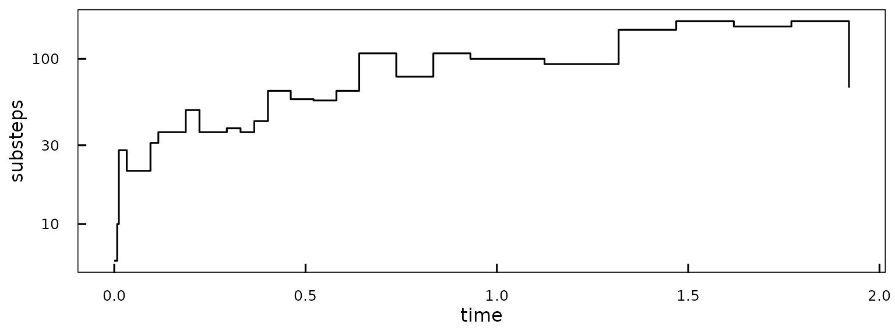

# 4. Reverse mode

Reverse mode returns the gradient of a functional of the trajectory in
one backward sweep, at a cost independent of the number of parameters.
cppDE differentiates the discretization itself ([discrete
adjoint](https://dmodverse.github.io/cppDE/articles/methods-reverse.md)):
forward and reverse derivatives agree to the integration tolerance, and
to rounding with `sensErrCon = FALSE` in forward mode, which puts both
on the step grid of the values.

``` r

library(cppDE)
library(ggplot2)
```

## Model definition

`derivMode` of
[`cppODE()`](https://dmodverse.github.io/cppDE/reference/cppODE.md)
selects the derivatives a model returns: `"forward"` (default) the
tangent, `"reverse"` the cotangent, `"forward-reverse"` the cotangent
together with tangent and curvature, `"forward-forward"` (the same as
`deriv2 = TRUE`) the Hessian of every state. The chapter compares the
reverse builds of the decay chain with a forward-forward build.

``` r

eqns  <- c(A = "-k1*A", B = "k1*A - k2*B")
parms <- c(A = 1, B = 0, k1 = 0.5, k2 = 0.2)
times <- seq(0, 10, by = 0.1)

fwd  <- cppODE(eqns, derivMode = "forward-forward", modelname = "g4_fwd", compile = FALSE)
rev  <- cppODE(eqns, derivMode = "reverse", modelname = "g4_rev", compile = FALSE)
fr   <- cppODE(eqns, derivMode = "forward-reverse", modelname = "g4_fr", compile = FALSE)
fast <- cppODE(c(x = "-k*x + sin(100*time)*q"), derivMode = "reverse",
               modelname = "g4_fast", compile = FALSE)

compile(fwd, rev, fr, fast, output = "guide4", cores = 2)
```

## Cotangents and gradients

A reverse model takes a `cotangent` \\w\\ of shape \[time, state\] in
[`solveODE()`](https://dmodverse.github.io/cppDE/reference/solveODE.md)
and returns `$cotangent`, the gradient

\\\frac{\partial}{\partial \theta} \sum\_{t, i} w\_{t,i}\\ x_i(t)\\

in the initial values and parameters \\\theta\\, one row each. A
cotangent with a single non-zero entry gives one row of the sensitivity
matrix.

``` r

w <- matrix(0, length(times), 2, dimnames = list(NULL, c("A", "B")))
w[101, "B"] <- 1
outR <- solveODE(rev, times, parms, cotangent = w)
outR$cotangent
#>          [,1]
#> A   0.2143297
#> B   0.1353352
#> k1 -0.1734738
#> k2 -1.5411580

outF <- solveODE(fwd, times, parms)
outF$tangent[101, "B", ]                # ∂B(10)/∂θ from forward mode
#>          A          B         k1         k2 
#>  0.2143280  0.1353353 -0.1734757 -1.5411625
outR$cotangent[, 1] - solveODE(fwd, times, parms, sensErrCon = FALSE)$tangent[101, "B", ]
#>             A             B            k1            k2 
#> -1.387779e-16 -8.326673e-17 -1.471359e-06  1.946064e-08
```

A third dimension holds several seeds, swept back together on one
forward pass; `$cotangent` then has one column per seed.

``` r

W <- array(0, c(length(times), 2, 2),
           dimnames = list(NULL, c("A", "B"), c("A10", "B10")))
W[101, "A", "A10"] <- 1
W[101, "B", "B10"] <- 1
solveODE(rev, times, parms, cotangent = W)$cotangent
#>             A10        B10
#> A   0.006737421  0.2143297
#> B   0.000000000  0.1353352
#> k1 -0.067379481 -0.1734738
#> k2  0.000000000 -1.5411580
```

## Gradient of an objective

For \\L = \sum_t (B(t) - y_t)^2\\ the cotangent is \\\partial L /
\partial B(t) = 2\\(B(t) - y_t)\\. It depends on the solution, so the
forward pass runs first: with `keepStore = TRUE` and no cotangent,
[`solveODE()`](https://dmodverse.github.io/cppDE/reference/solveODE.md)
returns the values and keeps the checkpoints as `$store`. A solve given
the `store` at the same `times` and `parms` integrates nothing and runs
the backward sweep alone.

``` r

y   <- 0.4 * exp(-0.3 * times) * (1 - exp(-times))
first <- solveODE(rev, times, parms, keepStore = TRUE)
res <- first$variable[, "B"] - y

wL <- cbind(A = 0, B = 2 * res)
grad <- solveODE(rev, times, parms, cotangent = wL, store = first$store)$cotangent
cbind(reverse = grad[, 1], forward = 2 * colSums(res * outF$tangent[, "B", ]))
#>       reverse   forward
#> A   25.009083  25.00933
#> B   23.696642  23.69663
#> k1   7.042708   7.04377
#> k2 -74.692436 -74.69188
```

A store may be reused for any number of cotangents and is freed at the
next garbage collection, which does not count the checkpoint memory.
[`releaseStore()`](https://dmodverse.github.io/cppDE/reference/releaseStore.md)
frees it at once; a solve given a released store integrates again.

``` r

releaseStore(first$store)
```

## Control of the backward sweep

By default the sweep runs on the step grid of the forward pass. A grid
that resolves the states need not resolve their derivatives: in \\\dot x
= -k x + \sin(100\\ t)\\ q\\ at \\q = 0\\ the state is smooth while
\\\partial x/\partial q\\ follows the fast forcing, and the exact
gradient of \\\sum_t x(t)\\ in \\q\\ has a closed form. Tighter
tolerances reduce the error of the sweep without removing it, since the
states set the grid.
[`adjointControl()`](https://dmodverse.github.io/cppDE/reference/adjointControl.md),
passed as `adjoint`, sets the sweep: `refine = TRUE` holds each step to
`reltol` and `abstol` and sweeps a failing step again in substeps,
`gradtol` adds an absolute tolerance on the contribution of each step to
the gradient, and `trace = TRUE` returns the grid as `$adjoint` ([Grid
and refinement of the
sweep](https://dmodverse.github.io/cppDE/articles/methods-reverse-checks.md)).

``` r

tf <- seq(0, 2, by = 0.1)
pf <- c(x = 1, k = 1, q = 0)
Wf <- cbind(x = rep(1, length(tf)))
exact <- sum((sin(100*tf) - 100*cos(100*tf) + 100*exp(-tf)) / 10001)

val <- solveODE(fast, tf, pf, cotangent = Wf)
tgt <- solveODE(fast, tf, pf, cotangent = Wf, abstol = 1e-12, reltol = 1e-12)
chk <- solveODE(fast, tf, pf, cotangent = Wf,
                adjoint = adjointControl(refine = TRUE, gradtol = 1e-9, trace = TRUE))
c(exact = exact, valueGrid = val$cotangent[["q", 1]], tight = tgt$cotangent[["q", 1]],
  refined = chk$cotangent[["q", 1]])
#>      exact  valueGrid      tight    refined 
#> 0.08342800 1.77299897 0.14272371 0.08366032
c(steps = length(chk$adjoint$h), substeps = sum(chk$adjoint$substeps))
#>    steps substeps 
#>       35     2104
```

The refined sweep differentiates a slightly different trajectory than
the one the forward pass computed. `$correction` is the first-order
change of each seeded functional between the two, so value plus
`correction` is the value whose gradient `$cotangent` is ([value
correction](https://dmodverse.github.io/cppDE/articles/methods-reverse-checks.html#value-correction)).

``` r

chk$correction
#> [1] 0.0001015525
```

`$adjoint` holds `time` and `h` of every step of the sweep, the adjoint
state `lambda` at each step start, and under `refine` the `substeps` and
`failures` per step.

``` r

ggplot(data.frame(time = chk$adjoint$time, substeps = chk$adjoint$substeps),
       aes(time, substeps)) +
  geom_step() +
  scale_y_log10()
```



## Hessian of an objective

`derivMode = "forward-reverse"` differentiates the sweep along the
`tangent` ([forward over
reverse](https://dmodverse.github.io/cppDE/articles/methods-forward-reverse.md)).
Besides `$tangent` and `$cotangent` it returns `$curvature`, \[state and
parameter, direction, seed\], the derivative of `$cotangent` along each
tangent direction: under the default identity tangent, the Hessian of
the seeded functional. A cotangent that depends on the solution, such as
\\2\\(B - y)\\, passes the cotangent derivative along the tangent as the
argument `curvature`, \[time, state, seed, direction\], here
\\2\\\partial B / \partial \theta\\; without it the Hessian misses that
term, the gradient not.

``` r

first <- solveODE(fr, times, parms, cotangent = wL)
res   <- first$variable[, "B"] - y
wL    <- cbind(A = 0, B = 2 * res)

cv <- array(0, c(length(times), 2, 1, 4), dimnames = list(NULL, c("A", "B"), NULL, NULL))
cv[, "B", 1, ] <- 2 * first$tangent[, "B", ]
outFR <- solveODE(fr, times, parms, cotangent = wL, curvature = cv)
H <- outFR$curvature[, , 1]
H
#>      sens
#> theta          A          B        k1         k2
#>    A    33.35838   34.25193  19.61416 -166.85157
#>    B    34.25193   50.10908  21.84923 -170.19220
#>    k1   19.61415   21.84922 -24.36335  -45.21294
#>    k2 -166.85170 -170.19226 -45.21335  678.74568
```

The same Hessian from the forward-forward model, Gauss-Newton term plus
residual term:

``` r

S  <- outF$tangent[, "B", ]
H2 <- 2 * crossprod(S) + 2 * apply(res * outF$hessian[, "B", , ], c(2, 3), sum)
max(abs(H - H2))
#> [1] 0.0004218381
```

The first call computes residual and tangent, any cotangent serves
there. `keepStore` is a reverse-only option, so a forward-reverse
objective solves twice. A `tangent` of fewer columns gives
Hessian-vector products, here the product with \\v = (0, 0, 1, -1)\\:

``` r

v  <- matrix(c(0, 0, 1, -1), 4, 1, dimnames = list(names(parms), "v"))
cv <- array(0, c(length(times), 2, 1, 1), dimnames = list(NULL, c("A", "B"), NULL, NULL))
cv[, "B", 1, 1] <- 2 * first$tangent[, "B", ] %*% v
Hv <- solveODE(fr, times, parms, tangent = v, cotangent = wL, curvature = cv)$curvature[, , 1]
cbind(Hv, H %*% v)
#>            Hv          v
#> A   186.46568  186.46574
#> B   192.04143  192.04143
#> k1   20.84939   20.84959
#> k2 -723.95912 -723.95903
```

`sensErrCon = TRUE` (default) includes the tangents in the error test of
the forward pass; `FALSE` gives a step grid that does not depend on the
directions.

## Choice of derivative mode

| need | `derivMode` | result | details |
|:---|:---|:---|:---|
| sensitivities of every state, Gauss-Newton | `"forward"` | `$tangent` | [Forward sensitivities](https://dmodverse.github.io/cppDE/articles/methods-forward.md) |
| gradient of one functional, many parameters | `"reverse"` | `$cotangent` | [Reverse mode](https://dmodverse.github.io/cppDE/articles/methods-reverse.md) |
| derivatives on a grid that misses them | `"reverse"`, `adjointControl(refine = TRUE)` | `$cotangent`, `$correction` | [Grid and refinement](https://dmodverse.github.io/cppDE/articles/methods-reverse-checks.md) |
| Hessian of one functional | `"forward-reverse"` | `$curvature` | [Forward over reverse](https://dmodverse.github.io/cppDE/articles/methods-forward-reverse.md) |
| Hessian of every state | `"forward-forward"`, `deriv2 = TRUE` | `$hessian` | [Sensitivities](https://dmodverse.github.io/cppDE/articles/guide-sensitivities.md) |
| events in reverse mode | any of the above |  | [Events in reverse mode](https://dmodverse.github.io/cppDE/articles/methods-reverse-events.md) |
| SUNDIALS adjoint | [`cvode()`](https://dmodverse.github.io/cppDE/reference/cvode.md) | `$cotangent` | [cvode() and the CVODES adjoint](https://dmodverse.github.io/cppDE/articles/methods-cvode.html#asa) |

[← 3.
Sensitivities](https://dmodverse.github.io/cppDE/articles/guide-sensitivities.md)
\| [5. Steady states
→](https://dmodverse.github.io/cppDE/articles/guide-steady-states.md)
