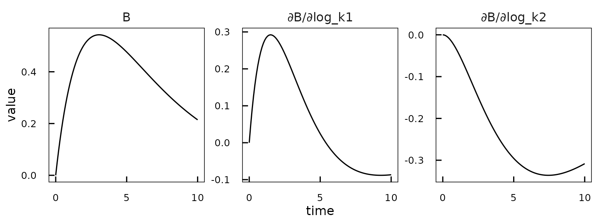

# 3. Sensitivities

Forward sensitivities of the decay chain, the derivatives of the states
in the initial values and parameters, of first and second order, and
their seeding by a tangent. The generated code evaluates the right-hand
side on dual numbers, the sensitivities are integrated together with the
states ([Forward
sensitivities](https://dmodverse.github.io/cppDE/articles/methods-forward.md)).

``` r

library(cppDE)
library(ggplot2)
```

## Model definition

`deriv = TRUE` (default of
[`cppODE()`](https://dmodverse.github.io/cppDE/reference/cppODE.md))
builds first-order sensitivities in every state and parameter not named
in `fixed`. `deriv2 = TRUE`, or `derivMode = "forward-forward"`, adds
the second order; `deriv = FALSE` builds the states alone.

``` r

eqns  <- c(A = "-k1*A", B = "k1*A - k2*B")
parms <- c(A = 1, B = 0, k1 = 0.5, k2 = 0.2)
times <- seq(0, 10, by = 0.1)

chain  <- cppODE(eqns, modelname = "g3_chain", compile = FALSE)
rates  <- cppODE(eqns, fixed = c("A", "B"), modelname = "g3_rates", compile = FALSE)
plain  <- cppODE(eqns, deriv = FALSE, modelname = "g3_plain", compile = FALSE)
chain2 <- cppODE(eqns, deriv2 = TRUE, modelname = "g3_chain2", compile = FALSE)

compile(chain, rates, plain, chain2, output = "guide3", cores = 2)
attr(chain, "dimNames")$sens
#> [1] "A"  "B"  "k1" "k2"
attr(rates, "dimNames")$sens
#> [1] "k1" "k2"
```

## First-order sensitivities

`$tangent` has the dimensions `[time, state, sensitivity]`; the entry
`[t, i, j]` is \\\partial x_i(t)/\partial \theta_j\\.

``` r

out <- solveODE(chain, times, parms)
dim(out$tangent)
#> [1] 101   2   4
out$tangent[101, , ]
#>         sens
#> variable           A         B          k1        k2
#>        A 0.006738521 0.0000000 -0.06737644  0.000000
#>        B 0.214327979 0.1353353 -0.17347569 -1.541163
```

`fixed` of
[`solveODE()`](https://dmodverse.github.io/cppDE/reference/solveODE.md)
holds sensitivities fixed in one call, without recompiling; `fixed` of
[`cppODE()`](https://dmodverse.github.io/cppDE/reference/cppODE.md)
leaves them out of the generated code.

``` r

dimnames(solveODE(chain, times, parms, fixed = c("A", "B"))$tangent)$sens
#> [1] "k1" "k2"
```

## Reparametrization by a tangent

`tangent` of
[`solveODE()`](https://dmodverse.github.io/cppDE/reference/solveODE.md)
is the Jacobian \\\partial(x_0, p)/\partial\theta\\ of a
reparametrization. The result is then \\\partial x/\partial\theta\\, one
column per direction, and the cost grows with the number of columns.
Three shapes are told apart by the rows:

| rows | meaning |
|:---|:---|
| a subset of states and parameters, by name | partial: the missing rows are zero |
| all states and parameters, states first | full: the whole Jacobian of the reparametrization |
| the states only | state-only: the parameter rows are the identity on the sensitivities |

A partial tangent with the unit vectors of `k1` and `k2` gives the
reduced sensitivities, a single column a directional derivative.

``` r

S <- diag(2)
dimnames(S) <- list(c("k1", "k2"), c("k1", "k2"))
solveODE(chain, times, parms, tangent = S)$tangent[101, , ]
#>         sens
#> variable          k1        k2
#>        A -0.06737644  0.000000
#>        B -0.17347569 -1.541163

v <- matrix(c(1, -1), 2, dimnames = list(c("k1", "k2"), "k1 - k2"))
solveODE(chain, times, parms, tangent = v)$tangent[101, , "k1 - k2"]
#>           A           B 
#> -0.06737592  1.36768749
out$tangent[101, , "k1"] - out$tangent[101, , "k2"]
#>           A           B 
#> -0.06737644  1.36768686
```

The two directional results agree to the integration tolerance: the step
grid follows the tangent, see [`sensErrCon`](#error-control).

A full tangent of the rate constants on the log scale, \\k_i =
e^{\theta_i}\\, has the column \\\partial k_i/\partial \theta_i = k_i\\.

``` r

Tlog <- rbind(matrix(0, 2, 2), diag(parms[c("k1", "k2")]))
dimnames(Tlog) <- list(names(parms), c("log_k1", "log_k2"))
outL <- solveODE(chain, times, parms, tangent = Tlog)

ggplot(longFormat(outL, "B"), aes(time, value)) +
  geom_line() +
  facet_wrap(~panel, scales = "free_y") +
  scale_x_continuous(n.breaks = 3)
```



A state-only tangent is the shape of `out$tangent[t, , ]`, so one solve
continues another, sensitivities included. The chain is autonomous, so
two solves over five time units agree with one over ten to the
integration tolerance.

``` r

first <- solveODE(chain, seq(0, 5, by = 0.1), parms)
x5    <- first$variable[51, ]
then  <- solveODE(chain, seq(0, 5, by = 0.1), c(x5, parms[c("k1", "k2")]),
                  tangent = first$tangent[51, , ])
max(abs(then$tangent[51, , ] - out$tangent[101, , ]))
#> [1] 5.918106e-06
```

## Solving without sensitivities

A model built with `deriv = FALSE` returns states and diagnostics only.

``` r

outV <- solveODE(plain, times, parms)
names(outV)
#> [1] "time"        "variable"    "diagnostics"
max(abs(outV$variable - out$variable))
#> [1] 1.221305e-05
```

## Error control of the sensitivities

With `sensErrCon = TRUE` (default) the sensitivities enter the error
test and the first step, so they are resolved to the tolerance like the
states. `sensErrCon = FALSE` takes the steps of a value run: cheaper,
less accurate, and the sensitivities are the exact derivative of the
computed solution, as in the [reverse
mode](https://dmodverse.github.io/cppDE/articles/guide-reverse.md).

``` r

ref <- solveODE(chain, times, parms, abstol = 1e-12, reltol = 1e-12)
off <- solveODE(chain, times, parms, sensErrCon = FALSE)
c(on = out$diagnostics$accepted, off = off$diagnostics$accepted,
  value = outV$diagnostics$accepted)
#>    on   off value 
#>    73    66    66
c(on = max(abs(out$tangent - ref$tangent)), off = max(abs(off$tangent - ref$tangent)))
#>           on          off 
#> 7.049412e-06 6.375120e-05
```

## Second-order sensitivities

A model built with `deriv2 = TRUE` returns `$hessian`,
`[time, state, sensitivity, sensitivity]`, the second derivatives of
every state.

``` r

out2 <- solveODE(chain2, times, parms)
dim(out2$hessian)
#> [1] 101   2   4   4
out2$hessian[101, "B", , ]
#>      sens2
#> sens1          A         B          k1          k2
#>    A   0.0000000  0.000000 -0.17347569 -1.54116254
#>    B   0.0000000  0.000000  0.00000000 -1.35335215
#>    k1 -0.1734757  0.000000  0.48269750  0.04777426
#>    k2 -1.5411625 -1.353352  0.04777426 12.28148382
```

`hessian` of
[`solveODE()`](https://dmodverse.github.io/cppDE/reference/solveODE.md)
is the second derivative of the reparametrization, with the rows of
`tangent` and two dimensions of directions; the default treats the
inputs as affine in \\\theta\\. On the log scale \\\partial^2
k_i/\partial\theta_i^2 = k_i\\:

``` r

Hlog <- array(0, c(4, 2, 2), dimnames = c(dimnames(Tlog), list(colnames(Tlog))))
Hlog["k1", "log_k1", "log_k1"] <- parms["k1"]
Hlog["k2", "log_k2", "log_k2"] <- parms["k2"]
solveODE(chain2, times, parms, tangent = Tlog, hessian = Hlog)$hessian[101, "B", , ]
#>         sens2
#> sens1         log_k1      log_k2
#>   log_k1 0.033937344 0.004778748
#>   log_k2 0.004778748 0.183027618
```

The diagonal agrees to the integration tolerance with
\\k_i^2\\\partial^2 B/\partial k_i^2 + k_i\\\partial B/\partial k_i\\
from the plain Hessian:

``` r

k <- parms[c("k1", "k2")]
k^2 * diag(out2$hessian[101, "B", c("k1", "k2"), c("k1", "k2")]) +
  k * out2$tangent[101, "B", c("k1", "k2")]
#>         k1         k2 
#> 0.03393653 0.18302684
```

The Hessian of one objective in many parameters is cheaper by forward
over reverse ([chapter
4](https://dmodverse.github.io/cppDE/articles/guide-reverse.md)).

[← 2. Events, switches and
forcings](https://dmodverse.github.io/cppDE/articles/guide-events.md) \|
[4. Reverse mode
→](https://dmodverse.github.io/cppDE/articles/guide-reverse.md)
