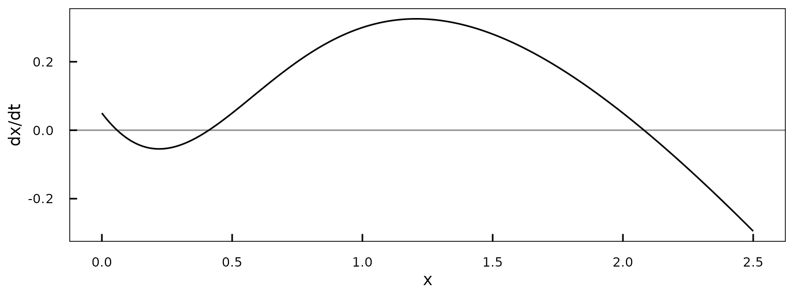

# 5. Steady states

cppDE reaches a steady state in two ways: by integrating the ODE until
the flow stops (`rootfunc = "equilibrate"`), with sensitivities, or by
solving \\f(x, p) = 0\\ directly with
[`ptc()`](https://dmodverse.github.io/cppDE/reference/ptc.md), under
conservation laws.

``` r

library(cppDE)
library(ggplot2)
```

## Model definition

The decay chain with production `k0` of \\A\\ has the steady state \\A =
k_0/k_1\\, \\B = k_0/k_2\\. `rootfunc` of
[`cppODE()`](https://dmodverse.github.io/cppDE/reference/cppODE.md) ends
the integration: `"equilibrate"` at steady state, a vector of
expressions at the first zero of any of them.
[`ptc()`](https://dmodverse.github.io/cppDE/reference/ptc.md) takes a
[`cppFUN()`](https://dmodverse.github.io/cppDE/reference/cppFUN.md)
object with forward derivatives, here the right-hand sides of an enzyme
\\E + S \rightleftharpoons ES \to E + P\\ with \\P \to S\\, and of a
bistable switch.

``` r

eqns  <- c(A = "k0 - k1*A", B = "k1*A - k2*B")
parms <- c(A = 1, B = 0, k0 = 1, k1 = 0.5, k2 = 0.2)

steady <- cppODE(eqns, rootfunc = "equilibrate", modelname = "g5_steady", compile = FALSE)
cross  <- cppODE(eqns, rootfunc = "A - B", modelname = "g5_cross", compile = FALSE)

enzyme <- c(E  = "-kon*E*S + (koff + kcat)*ES",
            S  = "-kon*E*S + koff*ES + kback*P",
            ES = " kon*E*S - (koff + kcat)*ES",
            P  = " kcat*ES - kback*P")
enz <- cppFUN(enzyme, variables = names(enzyme),
              parameters = c("kon", "koff", "kcat", "kback"), modelname = "g5_enzyme")
switch1 <- cppFUN(c(x = "a + b*x^2/(1 + x^2) - x"), variables = "x",
                  parameters = c("a", "b"), modelname = "g5_switch")

compile(steady, cross, enz, switch1, output = "guide5", cores = 2)
```

## Integration to steady state

Under `rootfunc = "equilibrate"`,
[`solveODE()`](https://dmodverse.github.io/cppDE/reference/solveODE.md)
stops once every \\\|\mathrm{d}x_i/\mathrm{d}t\| \le \mathtt{roottol}\\
\|x_i\| + \mathtt{abstol}\\, on the sensitivities as well. The last time
of `times` bounds the integration; the last row of the result is the
steady state with sensitivities.

``` r

outQ <- solveODE(steady, c(0, 1e4), parms, abstol = 1e-10, reltol = 1e-10, roottol = 1e-10)
n <- length(outQ$time)
outQ$time[n]
#> [1] 125.0591
outQ$variable[n, ]
#> A B 
#> 2 5
outQ$tangent[n, , ]
#>         sens
#> variable            A            B k0           k1  k2
#>        A 8.527872e-23 0.000000e+00  2 -4.00000e+00   0
#>        B 2.477571e-11 1.486542e-11  5  1.32137e-10 -25
```

\\\partial A/\partial k_0 = 1/k_1 = 2\\ and \\\partial B/\partial k_2 =
-k_0/k_2^2 = -25\\; the derivatives in the initial values vanish. A
smaller `roottol` integrates longer and leaves a smaller residual in
each derivative.

## Termination root

An expression as `rootfunc` stops at the first zero crossing, here where
\\A\\ and \\B\\ meet. The output ends at the crossing time.

``` r

outX <- solveODE(cross, seq(0, 10, by = 0.1), parms)
tail(outX$time, 2)
#> [1] 3.100000 3.146761
tail(outX$variable, 1)
#>              A        B
#> [33,] 1.792658 1.792658
```

## Pseudo-transient continuation

[`ptc()`](https://dmodverse.github.io/cppDE/reference/ptc.md) solves
\\f(x, p) = 0\\ for the variables `solve`, paired with the outputs
`rows`, by pseudo-transient continuation: implicit Euler steps on \\\dot
x = f\\ far from the root, Newton steps near it
([methods](https://dmodverse.github.io/cppDE/articles/methods-ptc.md)).
The enzyme conserves \\E + ES\\ and \\S + ES + P\\, so the Jacobian is
singular and the steady state is fixed by the totals: `C` holds the
conservation laws as rows, columns named by the solved variables, and
`total` the right-hand side of \\C x = \mathtt{total}\\.

``` r

C <- rbind(Etot = c(E = 1, S = 0, ES = 1, P = 0),
           Stot = c(E = 0, S = 1, ES = 1, P = 1))
pe <- c(kon = 1, koff = 0.5, kcat = 0.3, kback = 0.1)
ss <- ptc(enz, x = c(E = 1, S = 1, ES = 1, P = 1), parms = pe, C = C, total = c(1, 10))
ss$x
#>         E         S        ES         P 
#> 0.1104686 6.4418745 0.8895314 2.6685941
c(converged = ss$converged, iterations = ss$iterations)
#>  converged iterations 
#>          1          9
ss$message
#> [1] "converged"
drop(C %*% ss$x)
#> Etot Stot 
#>    1   10
do.call(enz$func, c(as.list(ss$x), as.list(pe)))
#>                  E            S           ES             P
#> [1,] -3.379727e-16 1.287859e-14 3.379727e-16 -1.329308e-14
```

Variables outside `solve` keep the values of `x`. With the substrate
clamped, the remaining variables are solved with the enzyme total alone.

``` r

ptc(enz, x = c(E = 1, S = 2, ES = 1, P = 1), parms = pe, solve = c("E", "ES", "P"),
    C = rbind(Etot = c(E = 1, ES = 1, P = 0)), total = 1)$x
#>         E         S        ES         P 
#> 0.2857143 2.0000000 0.7142857 2.1428571
```

## Stability of the steady state

With `flow = TRUE` (default), the outputs are the right-hand side of an
ODE and [`ptc()`](https://dmodverse.github.io/cppDE/reference/ptc.md)
returns a stable steady state: the real part of every Jacobian
eigenvalue on the kernel of `C` is non-positive ([stability
test](https://dmodverse.github.io/cppDE/articles/methods-ptc.html#stability)).
From an unstable root the search continues along the unstable direction.
`flow = FALSE` takes plain equations and returns any regular root. The
switch has a stable root on each side of an unstable one, near \\x =
0.41\\ for \\a = 0.05\\, \\b = 2.5\\.

``` r

ps <- c(a = 0.05, b = 2.5)
sapply(c(0.40, 0.42), function(x0) c(
  start  = x0,
  flow   = ptc(switch1, x = c(x = x0), parms = ps)$x,
  noFlow = ptc(switch1, x = c(x = x0), parms = ps, flow = FALSE)$x))
#>                [,1]      [,2]
#> start    0.40000000 0.4200000
#> flow.x   0.05853728 2.0810098
#> noFlow.x 0.41045292 0.4104529

xs <- seq(0, 2.5, by = 0.01)
ggplot(data.frame(x = xs, f = switch1$func(x = xs, a = 0.05, b = 2.5)[, "x"]), aes(x, f)) +
  geom_hline(yintercept = 0, color = "grey60") +
  geom_line() +
  labs(y = "dx/dt")
```



`controls = list(stability = FALSE)` accepts any root of the flow;
`stabilityTol` accepts a root whose leading eigenvalue is at most this
positive value, as near a Hopf bifurcation. `positive = TRUE` (default)
keeps the solved variables positive; they must start positive.

``` r

ptc(switch1, x = c(x = 0.42), parms = ps, controls = list(stability = FALSE))$x
#>         x 
#> 0.4104529
```

## Tolerances of ptc()

`controls` of
[`ptc()`](https://dmodverse.github.io/cppDE/reference/ptc.md) sets the
iteration:

| control | default | meaning |
|:---|:---|:---|
| `reltol` | `1e-10` | residual of each row relative to the turnover, the sum of the rates that cancel in it |
| `abstol` | `1e-14` | absolute floor, relative to the largest Jacobian entry of the row |
| `flowTol` | `1` | relative local error of a pseudo-time step |
| `maxit` | `400` | iterations of one descent |
| `dtInit` | `1e-2` | first pseudo-time step, relative to the fastest rate under `flow = TRUE` |
| `zmax` | `5` | largest change of the logarithm of a variable per step |
| `stability` | `TRUE` | require a stable root under `flow = TRUE` |
| `stabilityTol` | `0` | largest leading eigenvalue counted as stable |

After convergence, Newton steps bring each variable to within
`reltol * (abs(x) + abstol)` of the root. The result depends on the
start, the parameters and the controls only, so equal inputs return the
same root to the last digit.

``` r

sapply(c(1e-4, 1e-10), function(tol) {
  r <- ptc(enz, x = c(E = 1, S = 1, ES = 1, P = 1), parms = pe, C = C, total = c(1, 10),
           controls = list(reltol = tol))
  c(reltol = tol, iterations = r$iterations, deltaES = r$x[["ES"]] - ss$x[["ES"]])
})
#>                     [,1]  [,2]
#> reltol      1.000000e-04 1e-10
#> iterations  8.000000e+00 9e+00
#> deltaES    -5.534966e-09 0e+00
```

[`ptc()`](https://dmodverse.github.io/cppDE/reference/ptc.md) returns
the steady state without derivatives. dMod2 calls the same solver from
C++ for the steady states of `Pimpl()`, with sensitivities by the
implicit function theorem.

[← 4. Reverse
mode](https://dmodverse.github.io/cppDE/articles/guide-reverse.md) \|
[6. Batches of conditions
→](https://dmodverse.github.io/cppDE/articles/guide-batches.md)
