# Sensitivities across events, checked symbolically

First- and second-order sensitivities of
[`cppODE()`](https://dmodverse.github.io/cppDE/reference/cppODE.md)
across events, switches and sliding, forward and forward over reverse,
against symbolic solutions from SymPy. A parameter-dependent event time
adds a saltation term ([Events, switches and
saltation](https://dmodverse.github.io/cppDE/articles/methods-events.md));
an error in it shows as an offset from the symbolic curve. Figures:
solid line symbolic, forward result on top, circles forward over reverse
at each seeded output time. Printed lines give the largest difference
per derivative order. Results are read from `saltation/*.rds`, computed
if absent.

``` r

library(cppDE)
library(ggplot2)
sp <- reticulate::import("sympy")
```

## Symbolic solutions

One `dsolve()` per smooth segment, pinned to the state at the segment
start and glued to the next segment at the firing time.

``` r

sym  <- function(name, ...) sp$Symbol(name, real = TRUE, ...)
tSym <- sym("t")

# Integer exponents only. A float power blocks the simplifications that
# turn the solution of an oscillator back into a sine.
pow <- function(base, exponent) sp$Pow(base, as.integer(exponent))

# One smooth segment of a first order equation, pinned by y(t0) = y0.
segment <- function(fun, rhs, t0, y0)
  sp$dsolve(sp$Eq(sp$Derivative(fun(tSym), tSym), rhs), fun(tSym),
            ics = reticulate::py_dict(list(fun(t0)), list(y0)))$rhs

# The same for a second order equation, pinned by y(t0) and y'(t0).
segment2 <- function(fun, rhs, t0, y0, dy0)
  sp$dsolve(sp$Eq(sp$Derivative(fun(tSym), tSym, 2L), rhs), fun(tSym),
            ics = reticulate::py_dict(
              list(fun(t0), sp$Derivative(fun(tSym), tSym)$subs(tSym, t0)),
              list(y0, dy0)))$rhs

# Segments glued at their firing times, one branch longer than fires.
composed <- function(branches, fires) {
  pieces <- Map(function(branch, fire) reticulate::tuple(branch, sp$Lt(tSym, fire)),
                branches[seq_along(fires)], fires)
  do.call(sp$Piecewise,
          c(pieces, list(reticulate::tuple(branches[[length(branches)]], sp$`true`))))
}

# A parameter point: the symbols, their values, and the grid to compare on.
# The names are the ones solveODE() labels the sensitivity slices with, where
# a state name stands for that state's initial value.
point <- function(syms, pars, times)
  list(syms = syms, names = names(pars), values = as.list(unname(pars)),
       times = times)

toNumeric <- function(expr)
  suppressWarnings(as.numeric(reticulate::py_str(sp$N(expr))))

# Every parameter replaced by the value at the point, time left free.
atPoint <- function(expr, at) expr$subs(reticulate::py_dict(at$syms, at$values))

# SymPy's lambdify reads the frame of the caller for a docstring and a call from R
# has none, so it goes through a Python function. Compiling once per expression
# turns one round trip per time point into one per panel.
sympyGrid <- reticulate::py_run_string(
"import sympy
def over_grid(sym, expr, grid):
    f = sympy.lambdify(sym, expr, 'math')
    return [f(v) for v in grid]
")

# The expression, or a derivative of it, over the whole time grid. A constant
# expression still yields one value per time point.
series <- function(expr, at, wrt = list()) {
  for (s in wrt) expr <- sp$diff(expr, s)
  as.numeric(sympyGrid$over_grid(tSym, atPoint(expr, at), at$times))
}

# Numeric value of an expression that no longer depends on time.
value <- function(expr, at) toNumeric(atPoint(expr, at))

# The first zero after `after`, over one condition or several at once, picked
# numerically among the symbolic roots. Complex branches drop out as NA.
crossing <- function(conditions, at, after = 0) {
  if (!is.list(conditions)) conditions <- list(conditions)
  roots <- unlist(lapply(conditions,
                         function(g) sp$solve(sp$Eq(g, sp$Integer(0L)), tSym)),
                  recursive = FALSE)
  when <- vapply(roots, value, 0, at = at)
  roots[[which.min(ifelse(!is.na(when) & when > after + 1e-9, when, Inf))]]
}
```

## Comparison functions

`comparison()` pairs symbolic and forward derivatives, `reverseSeries()`
adds forward over reverse, `report()` prints the largest differences per
order, `comparisonPlot()` draws them.

``` r

# Panel labels use the partial derivative sign, U+2202.
lab1 <- function(var, a) sprintf("\u2202%s / \u2202%s", var, a)
lab2 <- function(var, a, b) {
  if (a == b) return(sprintf("\u2202\u00b2%s / \u2202%s\u00b2", var, a))
  sprintf("\u2202\u00b2%s / \u2202%s\u2202%s", var, a, b)
}

# The last row at a requested time holds the post-event state, whether
# or not a localized root inserted extra rows.
rowsAt <- function(res, times)
  vapply(times, function(s) max(which(abs(res$time - s) < 1e-9)), 1L)

# One panel per quantity: the state, the gradient, and each distinct
# second derivative, symbolic against what solveODE() returned.
comparison <- function(expr, at, res, var) {
  i  <- rowsAt(res, at$times)
  np <- length(at$syms)

  # One entry per panel, each holding both curves over the whole grid.
  panel <- function(order, quantity, symbolic, numeric)
    list(order = order, quantity = quantity,
         symbolic = symbolic, numeric = as.numeric(numeric))

  panels <- list(panel(0L, var, series(expr, at), res$variable[i, var]))
  for (a in seq_len(np))
    panels[[length(panels) + 1L]] <-
      panel(1L, lab1(var, at$names[a]), series(expr, at, at$syms[a]),
            res$tangent[i, var, at$names[a]])
  for (a in seq_len(np)) for (b in a:np)
    panels[[length(panels) + 1L]] <-
      panel(2L, lab2(var, at$names[a], at$names[b]),
            series(expr, at, at$syms[c(a, b)]),
            res$hessian[i, var, at$names[a], at$names[b]])

  labels <- vapply(panels, `[[`, "", "quantity")
  data.frame(
    order    = rep(vapply(panels, `[[`, 0L, "order"), each = length(at$times)),
    quantity = factor(rep(labels, each = length(at$times)), levels = labels),
    time     = rep(at$times, length(panels)),
    symbolic = unlist(lapply(panels, `[[`, "symbolic"), use.names = FALSE),
    numeric  = unlist(lapply(panels, `[[`, "numeric"), use.names = FALSE))
}

# The numeric side of the figures, one line per derivative order.
report <- function(df, title) {
  cat("\n", title, "\n", sep = "")
  for (o in sort(unique(df$order))) {
    d <- df[df$order == o, ]
    cat(sprintf("  %-13s max |solveODE - symbolic| = %.2e\n",
                c("state", "first order", "second order")[o + 1L],
                max(abs(d$numeric - d$symbolic))))
  }
}

# Forward over reverse at every `every`-th output time: a cotangent seeded on
# one row and state makes the gradient that state's row of the tangent and the
# curvature the Hessian of that state. Only requested times are seeded, since a row a root
# inserts moves with the parameters.
reverseSeries <- function(expr, at, res, model, pars, var, states,
                          opts = list(), every = 50L) {
  keep <- seq(1L, length(at$times), by = every)
  i    <- rowsAt(res, at$times)[keep]
  W    <- array(0, c(nrow(res$variable), length(states), length(keep)))
  for (r in seq_along(keep)) W[i[r], match(var, states), r] <- 1
  rev <- do.call(solveODE, c(list(model, at$times, pars, cotangent = W), opts))

  np  <- length(at$syms)
  out <- list()
  add <- function(order, quantity, symbolic, numeric)
    out[[length(out) + 1L]] <<- data.frame(
      order = order, quantity = quantity, time = at$times[keep],
      symbolic = symbolic, reverse = as.numeric(numeric))

  for (a in seq_len(np))
    add(1L, lab1(var, at$names[a]),
        series(expr, at, at$syms[a])[keep], rev$cotangent[at$names[a], ])
  for (a in seq_len(np)) for (b in a:np)
    add(2L, lab2(var, at$names[a], at$names[b]),
        series(expr, at, at$syms[c(a, b)])[keep],
        rev$curvature[at$names[a], at$names[b], ])

  df <- do.call(rbind, out)
  for (o in 1:2) {
    d <- df[df$order == o, ]
    cat(sprintf("  %-13s max |reverse - symbolic| = %.2e\n",
                c("reverse 1st", "reverse 2nd")[o],
                max(abs(d$reverse - d$symbolic))))
  }
  df
}

# `rev` draws forward over reverse on top, one point per seeded row.
comparisonPlot <- function(df, orders, title, rev = NULL) {
  p <- ggplot(df[df$order %in% orders, ], aes(x = time)) +
    # A quantity that vanishes identically leaves the solver a cancellation
    # residue of a few ulp, and a free y scale would blow that up into a
    # picture of the round-off. No panel is drawn tighter than this.
    expand_limits(y = c(-1e-10, 1e-10)) +
    geom_line(aes(y = symbolic, color = "symbolic", linetype = "symbolic"),
              linewidth = 1) +
    geom_line(aes(y = numeric, color = "forward", linetype = "forward"),
              linewidth = 1)
  if (!is.null(rev)) {
    rev$quantity <- factor(rev$quantity, levels = levels(df$quantity))
    p <- p + geom_point(data = rev[rev$order %in% orders, ],
                        aes(y = reverse, color = "reverse"),
                        shape = 21, fill = NA)
  }
  p + facet_wrap(~quantity, scales = "free_y", ncol = 5) +
    scale_x_continuous(n.breaks = 3) +
    scale_color_manual(values = c(symbolic = "#000000", forward = "#E69F00", reverse = "#0072B2"),
                       breaks = c("symbolic", "forward", "reverse")) +
    scale_linetype_manual(values = c(symbolic = "solid", forward = "dotdash"), guide = "none") +
    guides(color = guide_legend(override.aes = list(linetype = c("solid", "dotdash", "blank"),
                                                    shape = c(NA, NA, 21)))) +
    labs(title = title, x = "time", y = NULL, color = NULL) +
    theme(legend.position = "top")
}
```

## Root event on a coupled pair

The firing time depends on three parameters, and the crossing lands on
an output time.

``` r

events_pair <- data.frame(var = "C", time = NA, value = "d", method = "add",
                          root = "S - c", stringsAsFactors = FALSE)
model_pair  <- cppODE(c(S = "a", C = "-b * C"), events = events_pair,
                      deriv = TRUE, deriv2 = TRUE, modelname = "saltation_pair")

pars_pair  <- c(S = 2, C = 4, a = 1, b = 0.1, c = 14, d = 3)
times_pair <- seq(0, 20, len = 1000)
# Tight tolerances throughout, so what is left of the residual is the solver
# and not the saltation transport. roottol matters as much: the firing time
# enters the state through the velocity, so a loose root is a state error.
res_pair <- solveODE(model_pair, times_pair, pars_pair,
                     abstol = 1e-12, reltol = 1e-12, roottol = 1e-12)

S0 <- sym("S0"); C0 <- sym("C0"); a <- sym("a")
b  <- sym("b");  cc <- sym("c");  d <- sym("d")
Sfun <- sp$Function("S"); Cfun <- sp$Function("C")

point_pair <- point(list(S0, C0, a, b, cc, d),
                    pars_pair[c("S", "C", "a", "b", "c", "d")], times_pair)
S_of_t <- segment(Sfun, a, sp$Integer(0L), S0)
fire_pair <- crossing(S_of_t - cc, point_pair)
C_before  <- segment(Cfun, -b * Cfun(tSym), sp$Integer(0L), C0)
C_after   <- segment(Cfun, -b * Cfun(tSym), fire_pair,
                     C_before$subs(tSym, fire_pair) + d)
C_of_t    <- composed(list(C_before, C_after), list(fire_pair))

cmp_pair <- comparison(C_of_t, point_pair, res_pair, "C")
model_pair_r <- cppODE(c(S = "a", C = "-b * C"), events = events_pair,
                       derivMode = "forward-reverse", modelname = "saltation_pair_r")
rev_pair <- reverseSeries(C_of_t, point_pair, res_pair, model_pair_r, pars_pair,
                          "C", c("S", "C"),
                          opts = list(abstol = 1e-12, reltol = 1e-12,
                                      roottol = 1e-12))
```

    #> Warning: saltation/pair.rds was computed from other code or another cppDE
    #> version; delete it to compute it again

``` r

report(cmp_pair, "root event on a coupled pair")
#> 
#> root event on a coupled pair
#>   state         max |solveODE - symbolic| = 2.24e-11
#>   first order   max |solveODE - symbolic| = 1.01e-09
#>   second order  max |solveODE - symbolic| = 3.64e-08
plot_pair_1 <- comparisonPlot(cmp_pair, 0:1, "C and gradient across a root event",
                              rev_pair)
plot_pair_1
```

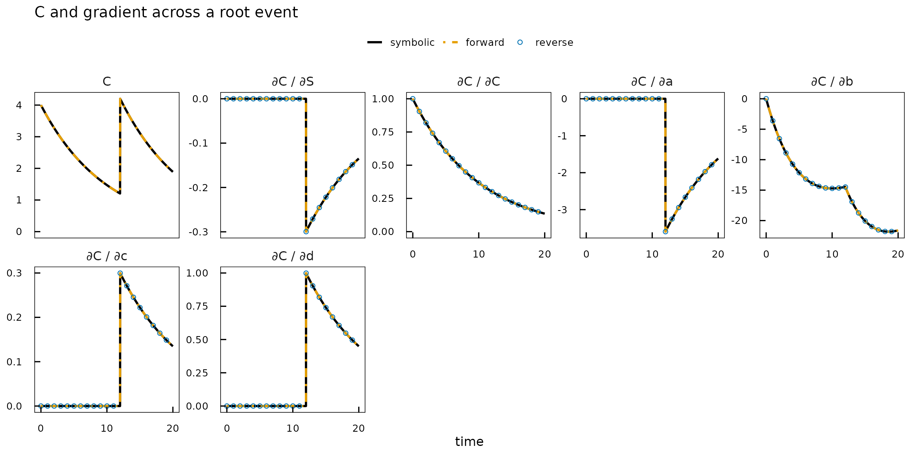

``` r

plot_pair_2 <- comparisonPlot(cmp_pair, 2L, "Second derivatives of C across a root event",
                              rev_pair)
plot_pair_2
```

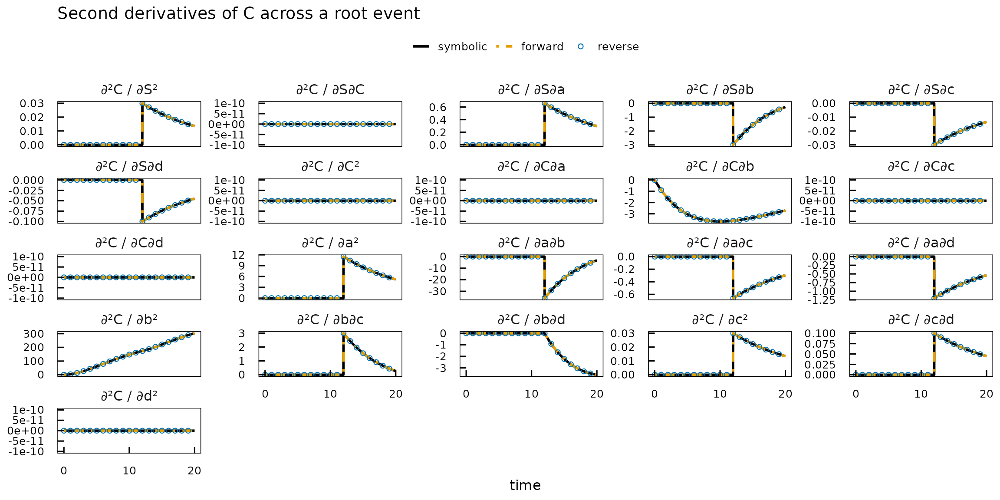

## Time-triggered event

\\\partial t^\*/\partial\theta\\ comes from the event-time expression,
not from a root.

``` r

events_dose <- data.frame(var = "x", time = "te", value = "v", method = "add",
                          root = NA, stringsAsFactors = FALSE)
model_dose  <- cppODE(c(x = "-k * x"), events = events_dose, deriv = TRUE,
                      deriv2 = TRUE, modelname = "saltation_dose")

pars_dose  <- c(x = 1, k = 0.3, v = 2, te = 4)
times_dose <- seq(0, 10, len = 1000)
res_dose   <- solveODE(model_dose, times_dose, pars_dose,
                       abstol = 1e-12, reltol = 1e-12)

x0 <- sym("x0"); k <- sym("k"); dose <- sym("v"); te <- sym("te")
xfun <- sp$Function("x")

point_dose <- point(list(x0, k, dose, te),
                    pars_dose[c("x", "k", "v", "te")], times_dose)
x_before <- segment(xfun, -k * xfun(tSym), sp$Integer(0L), x0)
x_after  <- segment(xfun, -k * xfun(tSym), te, x_before$subs(tSym, te) + dose)
x_dose   <- composed(list(x_before, x_after), list(te))

cmp_dose <- comparison(x_dose, point_dose, res_dose, "x")
model_dose_r <- cppODE(c(x = "-k * x"), events = events_dose,
                       derivMode = "forward-reverse", modelname = "saltation_dose_r")
rev_dose <- reverseSeries(x_dose, point_dose, res_dose, model_dose_r, pars_dose,
                          "x", "x", opts = list(abstol = 1e-12, reltol = 1e-12))
```

    #> Warning: saltation/dose.rds was computed from other code or another cppDE
    #> version; delete it to compute it again

``` r

report(cmp_dose, "time-triggered event")
#> 
#> time-triggered event
#>   state         max |solveODE - symbolic| = 4.59e-12
#>   first order   max |solveODE - symbolic| = 6.82e-11
#>   second order  max |solveODE - symbolic| = 7.96e-10
plot_dose_1 <- comparisonPlot(cmp_dose, 0:1, "x and gradient across a timed dose",
                              rev_dose)
plot_dose_1
```

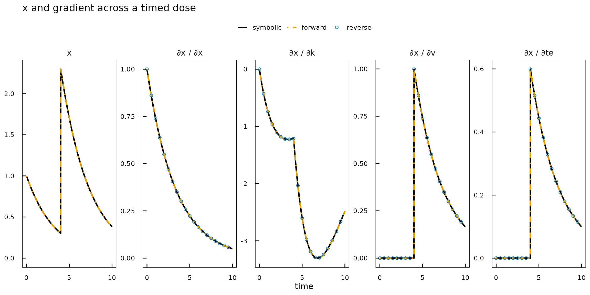

``` r

plot_dose_2 <- comparisonPlot(cmp_dose, 2L, "Second derivatives of x across a timed dose",
                              rev_dose)
plot_dose_2
```

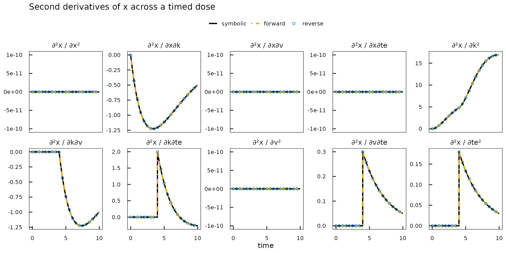

## Repeated root event

Three firings, each depending on the one before; the saltation terms
compose.

``` r

events_pulse <- data.frame(var = "x", time = NA, value = "v", method = "add",
                           root = "x - xc", stringsAsFactors = FALSE)
model_pulse  <- cppODE(c(x = "-k * x"), events = events_pulse, deriv = TRUE,
                       deriv2 = TRUE, modelname = "saltation_pulse")
model_pulse_r <- cppODE(c(x = "-k * x"), events = events_pulse,
                        derivMode = "forward-reverse",
                        modelname = "saltation_pulse_r")

pars_pulse  <- c(x = 1, k = 0.3, v = 1, xc = 0.4)
times_pulse <- seq(0, 12, len = 1000)
res_pulse   <- solveODE(model_pulse, times_pulse, pars_pulse, maxroot = 3L,
                        abstol = 1e-12, reltol = 1e-12, roottol = 1e-12)

xc <- sym("xc")
point_pulse <- point(list(x0, k, dose, xc),
                     pars_pulse[c("x", "k", "v", "xc")], times_pulse)

branches_pulse <- list(segment(xfun, -k * xfun(tSym), sp$Integer(0L), x0))
fires_pulse    <- list()
for (j in 1:3) {
  previous <- if (j == 1) 0 else value(fires_pulse[[j - 1]], point_pulse)
  fires_pulse[[j]] <- crossing(branches_pulse[[j]] - xc, point_pulse, previous)
  branches_pulse[[j + 1]] <- segment(xfun, -k * xfun(tSym), fires_pulse[[j]],
                                     xc + dose)
}
x_pulse <- composed(branches_pulse, fires_pulse)

cmp_pulse <- comparison(x_pulse, point_pulse, res_pulse, "x")
rev_pulse <- reverseSeries(x_pulse, point_pulse, res_pulse, model_pulse_r,
                           pars_pulse, "x", "x",
                           opts = list(maxroot = 3L, abstol = 1e-12,
                                       reltol = 1e-12, roottol = 1e-12))
```

    #> Warning: saltation/pulse.rds was computed from other code or another cppDE
    #> version; delete it to compute it again

``` r

report(cmp_pulse, "a root event that fires three times")
#> 
#> a root event that fires three times
#>   state         max |solveODE - symbolic| = 6.75e-11
#>   first order   max |solveODE - symbolic| = 4.74e-10
#>   second order  max |solveODE - symbolic| = 3.10e-09
plot_pulse_1 <- comparisonPlot(cmp_pulse, 0:1, "x and gradient over three firings",
                               rev_pulse)
plot_pulse_1
```

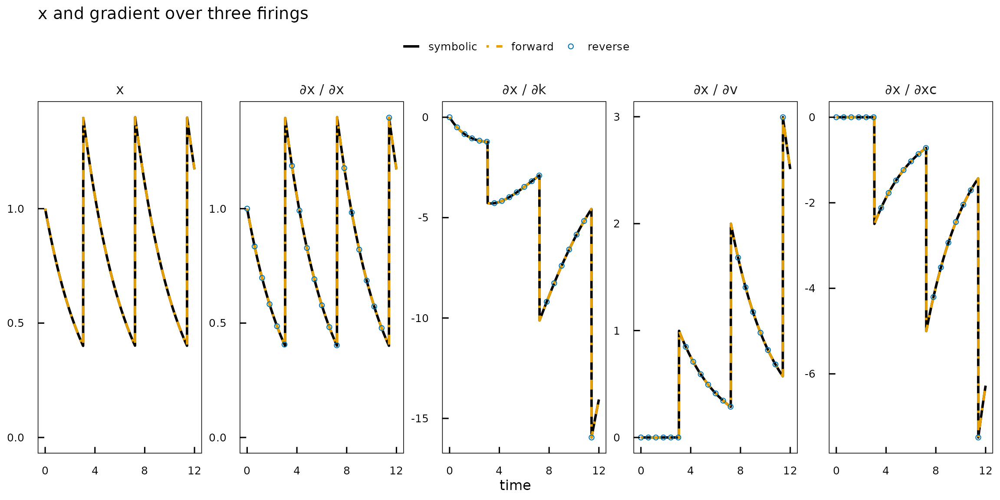

``` r

plot_pulse_2 <- comparisonPlot(cmp_pulse, 2L, "Second derivatives of x over three firings",
                               rev_pulse)
plot_pulse_2
```

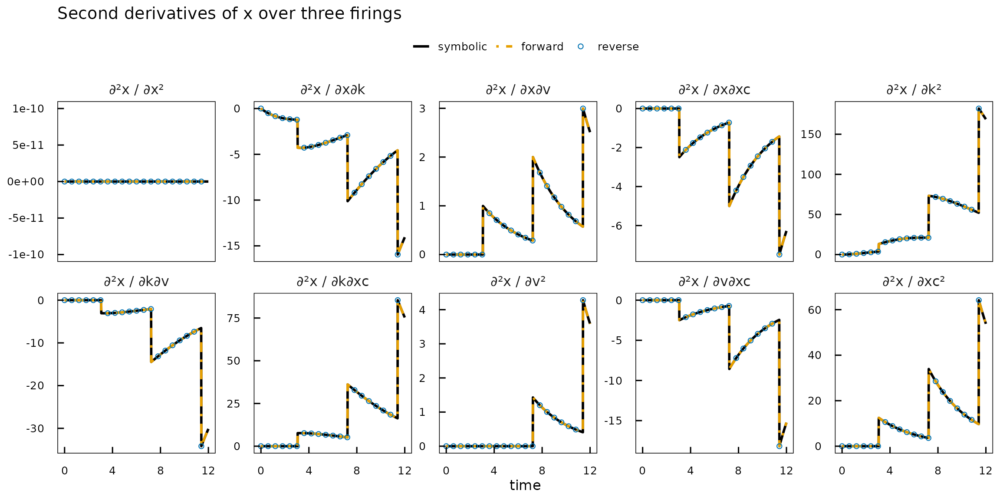

## Time-dependent right-hand side

The second-order transport needs the time argument of the Heun shifts,
not only the state.

``` r

events_drift <- data.frame(var = "x", time = NA, value = "v", method = "add",
                           root = "x - xc", stringsAsFactors = FALSE)
model_drift  <- cppODE(c(x = "-k * time * x"), events = events_drift,
                       deriv = TRUE, deriv2 = TRUE, modelname = "saltation_drift")
model_drift_r <- cppODE(c(x = "-k * time * x"), events = events_drift,
                        derivMode = "forward-reverse",
                        modelname = "saltation_drift_r")

pars_drift  <- c(x = 1, k = 0.2, v = 0.5, xc = 0.3)
times_drift <- seq(0, 6, len = 1000)
res_drift   <- solveODE(model_drift, times_drift, pars_drift,
                        abstol = 1e-12, reltol = 1e-12, roottol = 1e-12)

point_drift <- point(list(x0, k, dose, xc),
                     pars_drift[c("x", "k", "v", "xc")], times_drift)
drift_before <- segment(xfun, -k * tSym * xfun(tSym), sp$Integer(0L), x0)
fire_drift   <- crossing(drift_before - xc, point_drift)
drift_after  <- segment(xfun, -k * tSym * xfun(tSym), fire_drift, xc + dose)
x_drift      <- composed(list(drift_before, drift_after), list(fire_drift))

cmp_drift <- comparison(x_drift, point_drift, res_drift, "x")
rev_drift <- reverseSeries(x_drift, point_drift, res_drift, model_drift_r,
                           pars_drift, "x", "x",
                           opts = list(abstol = 1e-12, reltol = 1e-12,
                                       roottol = 1e-12))
```

    #> Warning: saltation/drift.rds was computed from other code or another cppDE
    #> version; delete it to compute it again

``` r

report(cmp_drift, "explicit time dependence in the right-hand side")
#> 
#> explicit time dependence in the right-hand side
#>   state         max |solveODE - symbolic| = 1.15e-11
#>   first order   max |solveODE - symbolic| = 2.47e-10
#>   second order  max |solveODE - symbolic| = 3.89e-09
plot_drift_1 <- comparisonPlot(cmp_drift, 0:1, "x and gradient, time-dependent decay",
                               rev_drift)
plot_drift_1
```

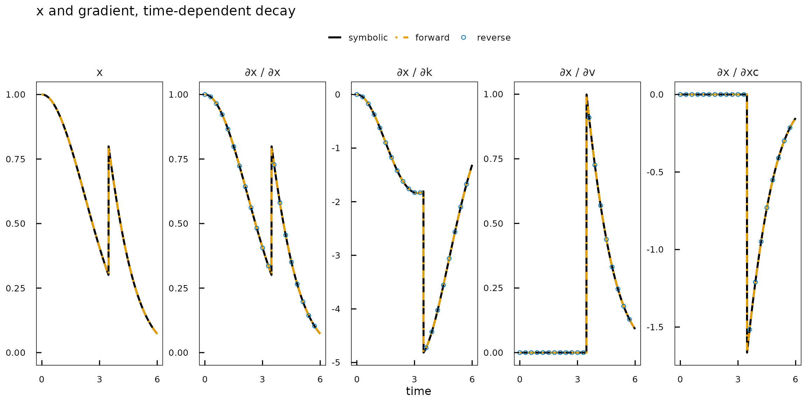

``` r

plot_drift_2 <- comparisonPlot(cmp_drift, 2L, "Second derivatives of x, time-dependent decay",
                               rev_drift)
plot_drift_2
```

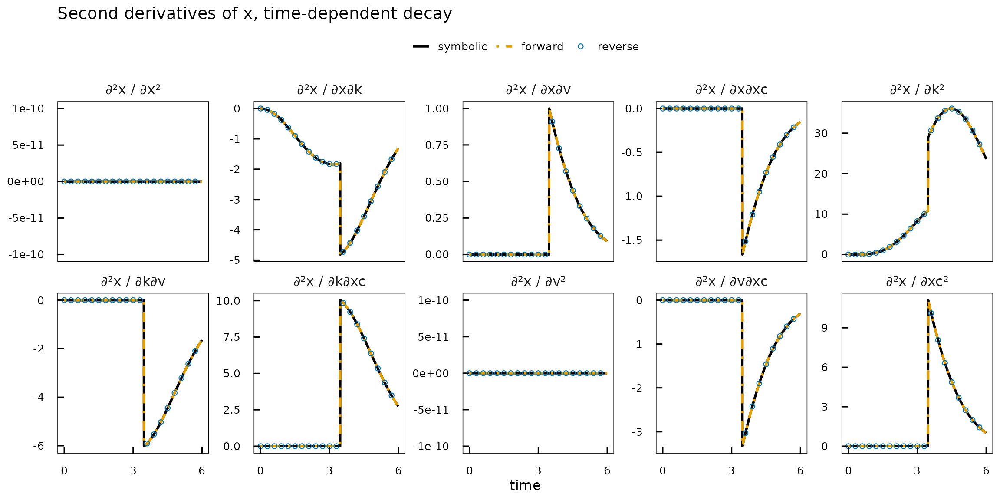

## Oscillator between elastic walls

Two root events reverse the velocity and fire alternately. The position
is continuous, so the events act on the sensitivities through saltation
only. The root of the wall just left, zero at the restart, is not
counted as a crossing.

``` r

events_wall <- data.frame(var = c("v", "v"), time = c(NA, NA),
                          value = c("-1", "-1"),
                          method = c("multiply", "multiply"),
                          root = c("x - L", "x + L"), stringsAsFactors = FALSE)
model_wall  <- cppODE(c(x = "v", v = "-w^2 * x"), events = events_wall,
                      deriv = TRUE, deriv2 = TRUE, modelname = "saltation_wall")
model_wall_r <- cppODE(c(x = "v", v = "-w^2 * x"), events = events_wall,
                       derivMode = "forward-reverse",
                       modelname = "saltation_wall_r")

pars_wall  <- c(x = 0.2, v = 1.2, w = 1, L = 0.8)
times_wall <- seq(0, 11, len = 1000)
# Two firings per wall, so 8 bounces before the grid ends.
res_wall <- solveODE(model_wall, times_wall, pars_wall, maxroot = 4L,
                     abstol = 1e-12, reltol = 1e-12, roottol = 1e-12)

x_ini <- sym("x0"); v_ini <- sym("v0")
freq  <- sp$Symbol("w", real = TRUE, positive = TRUE)
wall  <- sp$Symbol("L", real = TRUE, positive = TRUE)

point_wall <- point(list(x_ini, v_ini, freq, wall),
                    pars_wall[c("x", "v", "w", "L")], times_wall)
oscillation <- function(t0, y0, dy0)
  segment2(xfun, -pow(freq, 2) * xfun(tSym), t0, y0, dy0)

# From the initial state to whichever wall comes first.
approach   <- oscillation(sp$Integer(0L), x_ini, v_ini)
first_hit  <- crossing(list(approach - wall, approach + wall), point_wall)
first_side <- sign(value(approach$subs(tSym, first_hit), point_wall))

# The energy survives the reflection, so every flight between the walls is one
# arc up to a sign and a time shift. Solved once it stays small, while composing
# it bounce by bounce through dsolve() nests one inverse tangent per wall.
energy <- sp$simplify(pow(sp$diff(approach, tSym), 2) + pow(freq, 2) * pow(approach, 2))
speed  <- sp$sqrt(energy - pow(freq, 2) * pow(wall, 2))
stopifnot(isTRUE(all.equal(
  value(speed, point_wall),
  first_side * value(sp$diff(approach, tSym)$subs(tSym, first_hit), point_wall))))

# One arc, from the wall it leaves to the opposite one, in the time since
# that bounce.
flight_arc  <- oscillation(sp$Integer(0L), wall, -speed)
flight_time <- crossing(flight_arc + wall, point_wall)

branches_wall <- list(approach)
fires_wall    <- list(first_hit)
side          <- first_side
for (j in 1:8) {
  branches_wall[[j + 1]] <- sp$Integer(as.integer(side)) *
    flight_arc$subs(tSym, tSym - fires_wall[[j]])
  if (j < 8) fires_wall[[j + 1]] <- fires_wall[[j]] + flight_time
  side <- -side
}
x_wall <- composed(branches_wall, fires_wall)
v_wall <- sp$diff(x_wall, tSym)

cmp_wall_x <- comparison(x_wall, point_wall, res_wall, "x")
cmp_wall_v <- comparison(v_wall, point_wall, res_wall, "v")
rev_wall_x <- reverseSeries(x_wall, point_wall, res_wall, model_wall_r,
                            pars_wall, "x", c("x", "v"),
                            opts = list(maxroot = 4L, abstol = 1e-12,
                                        reltol = 1e-12, roottol = 1e-12))
rev_wall_v <- reverseSeries(v_wall, point_wall, res_wall, model_wall_r,
                            pars_wall, "v", c("x", "v"),
                            opts = list(maxroot = 4L, abstol = 1e-12,
                                        reltol = 1e-12, roottol = 1e-12))
```

    #> Warning: saltation/wall.rds was computed from other code or another cppDE
    #> version; delete it to compute it again

``` r

report(cmp_wall_x, "oscillator between elastic walls, position")
#> 
#> oscillator between elastic walls, position
#>   state         max |solveODE - symbolic| = 3.92e-10
#>   first order   max |solveODE - symbolic| = 5.17e-09
#>   second order  max |solveODE - symbolic| = 1.31e-07
report(cmp_wall_v, "oscillator between elastic walls, velocity")
#> 
#> oscillator between elastic walls, velocity
#>   state         max |solveODE - symbolic| = 3.40e-10
#>   first order   max |solveODE - symbolic| = 7.17e-09
#>   second order  max |solveODE - symbolic| = 7.03e-08
plot_wall_1 <- comparisonPlot(cmp_wall_x, 0:1, "Position and gradient over 8 bounces",
                              rev_wall_x)
plot_wall_1
```

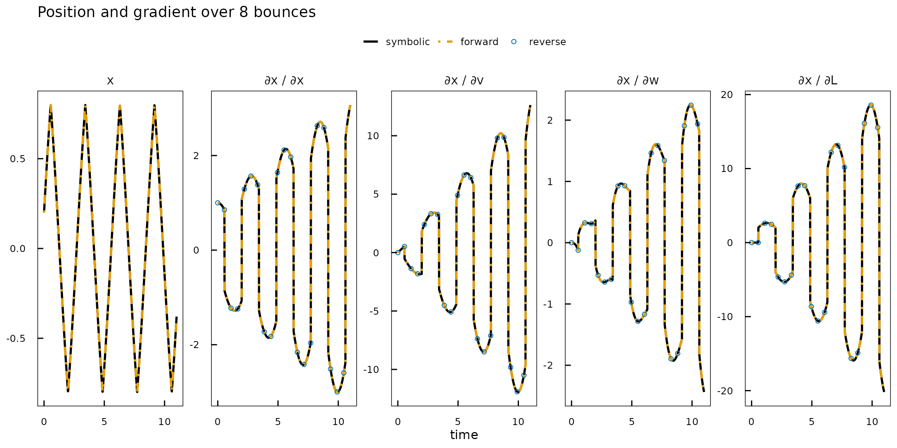

``` r

plot_wall_2 <- comparisonPlot(cmp_wall_x, 2L, "Second derivatives of the position",
                              rev_wall_x)
plot_wall_2
```

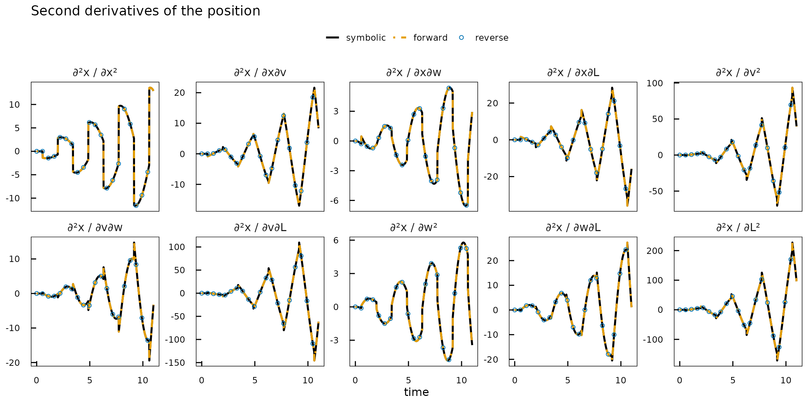

``` r

plot_wall_3 <- comparisonPlot(cmp_wall_v, 0:1, "Velocity and gradient over 8 bounces",
                              rev_wall_v)
plot_wall_3
```

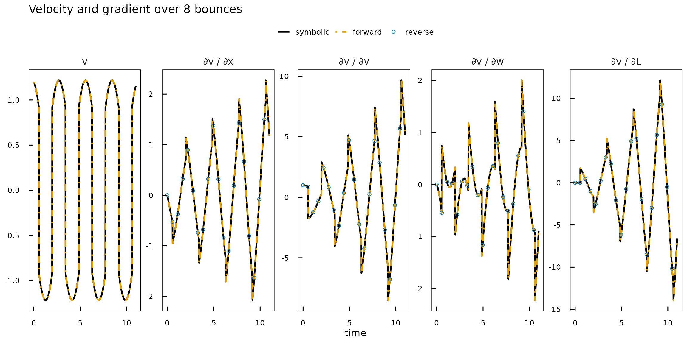

``` r

plot_wall_4 <- comparisonPlot(cmp_wall_v, 2L, "Second derivatives of the velocity",
                              rev_wall_v)
plot_wall_4
```

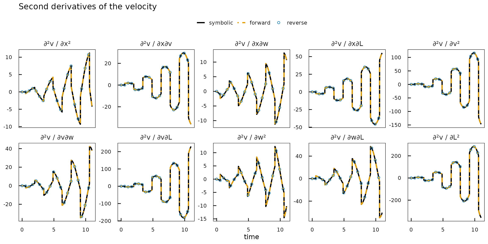

## Event time and height as expressions

The firing time is nonlinear in a parameter and the height depends on
time and state, so no term of the transport vanishes.

``` r

events_expr <- data.frame(var = "x", time = "0.5*te + 0.4*te*te",
                          value = "v * time + q * x", method = "add",
                          root = NA, stringsAsFactors = FALSE)
model_expr  <- cppODE(c(x = "-k * x"), events = events_expr, deriv = TRUE,
                      deriv2 = TRUE, modelname = "saltation_expr")
model_expr_r <- cppODE(c(x = "-k * x"), events = events_expr,
                       derivMode = "forward-reverse", modelname = "saltation_expr_r")

pars_expr  <- c(x = 1, k = 0.3, v = 0.5, q = 0.4, te = 1.6)
times_expr <- seq(0, 10, len = 1000)
res_expr   <- solveODE(model_expr, times_expr, pars_expr,
                       abstol = 1e-12, reltol = 1e-12)

vv <- sym("v"); qq <- sym("q"); tev <- sym("te")
point_expr <- point(list(x0, k, vv, qq, tev),
                    pars_expr[c("x", "k", "v", "q", "te")], times_expr)
fire_expr  <- sp$Rational(1L, 2L) * tev + sp$Rational(2L, 5L) * pow(tev, 2)
expr_before <- segment(xfun, -k * xfun(tSym), sp$Integer(0L), x0)
at_fire     <- expr_before$subs(tSym, fire_expr)
expr_after  <- segment(xfun, -k * xfun(tSym), fire_expr,
                       at_fire + vv * fire_expr + qq * at_fire)
x_expr      <- composed(list(expr_before, expr_after), list(fire_expr))

cmp_expr <- comparison(x_expr, point_expr, res_expr, "x")
rev_expr <- reverseSeries(x_expr, point_expr, res_expr, model_expr_r, pars_expr,
                          "x", "x", opts = list(abstol = 1e-12, reltol = 1e-12))
```

    #> Warning: saltation/expr.rds was computed from other code or another cppDE
    #> version; delete it to compute it again

``` r

report(cmp_expr, "a jump whose time and height are expressions")
#> 
#> a jump whose time and height are expressions
#>   state         max |solveODE - symbolic| = 5.34e-12
#>   first order   max |solveODE - symbolic| = 7.41e-11
#>   second order  max |solveODE - symbolic| = 8.59e-10
plot_expr_1 <- comparisonPlot(cmp_expr, 0:1, "x and gradient, expression-valued jump",
                              rev_expr)
plot_expr_1
```

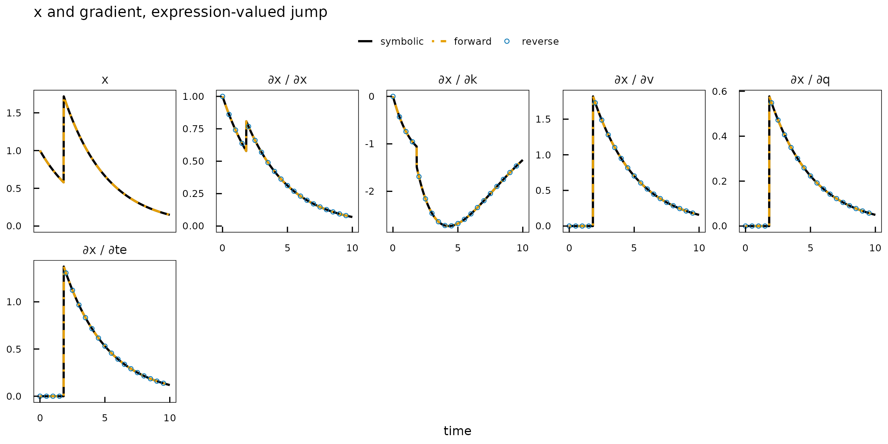

``` r

plot_expr_2 <- comparisonPlot(cmp_expr, 2L, "Second derivatives, expression-valued jump",
                              rev_expr)
plot_expr_2
```

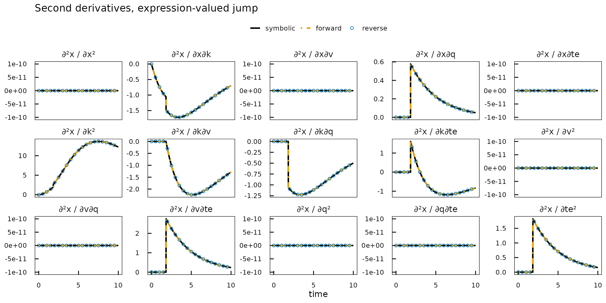

## Nonlinear time-dependent root

The derivative of the firing time in the state holds \\\nabla \dot g =
\nabla g_t + (\nabla^2 g)\\ f + J^\mathsf{T} \nabla g\\, here with no
zero term. The root is quadratic in \\t\\, so the crossing has a closed
form.

``` r

events_quad <- data.frame(var = "x", time = NA, value = "v * time",
                          method = "add", root = "x*x - xc - b*time",
                          stringsAsFactors = FALSE)
model_quad  <- cppODE(c(x = "r"), events = events_quad, deriv = TRUE,
                      deriv2 = TRUE, modelname = "saltation_quad")
model_quad_r <- cppODE(c(x = "r"), events = events_quad,
                       derivMode = "forward-reverse", modelname = "saltation_quad_r")

pars_quad  <- c(x = 0.5, r = 0.8, v = 0.3, xc = 1.2, b = 0.25)
times_quad <- seq(0, 4, len = 1000)
res_quad   <- solveODE(model_quad, times_quad, pars_quad,
                       abstol = 1e-12, reltol = 1e-12, roottol = 1e-12)

rr <- sym("r"); bb <- sym("b")
point_quad <- point(list(x0, rr, vv, xc, bb),
                    pars_quad[c("x", "r", "v", "xc", "b")], times_quad)
quad_before <- segment(xfun, rr, sp$Integer(0L), x0)
fire_quad   <- crossing(pow(quad_before, 2) - xc - bb * tSym, point_quad)
quad_after  <- segment(xfun, rr, fire_quad,
                       quad_before$subs(tSym, fire_quad) + vv * fire_quad)
x_quad      <- composed(list(quad_before, quad_after), list(fire_quad))

cmp_quad <- comparison(x_quad, point_quad, res_quad, "x")
rev_quad <- reverseSeries(x_quad, point_quad, res_quad, model_quad_r, pars_quad,
                          "x", "x", opts = list(abstol = 1e-12, reltol = 1e-12,
                                                roottol = 1e-12))
```

    #> Warning: saltation/quad.rds was computed from other code or another cppDE
    #> version; delete it to compute it again

``` r

report(cmp_quad, "a root nonlinear in the state and explicit in time")
#> 
#> a root nonlinear in the state and explicit in time
#>   state         max |solveODE - symbolic| = 1.78e-15
#>   first order   max |solveODE - symbolic| = 4.44e-15
#>   second order  max |solveODE - symbolic| = 6.00e-15
plot_quad_1 <- comparisonPlot(cmp_quad, 0:1, "x and gradient, nonlinear root",
                              rev_quad)
plot_quad_1
```

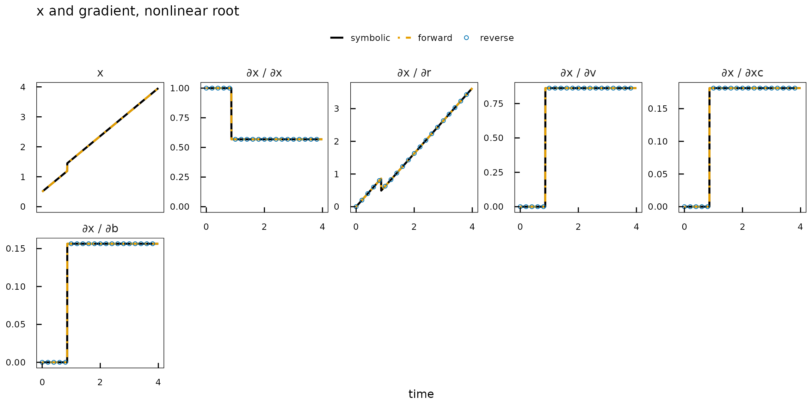

``` r

plot_quad_2 <- comparisonPlot(cmp_quad, 2L, "Second derivatives, nonlinear root",
                              rev_quad)
plot_quad_2
```

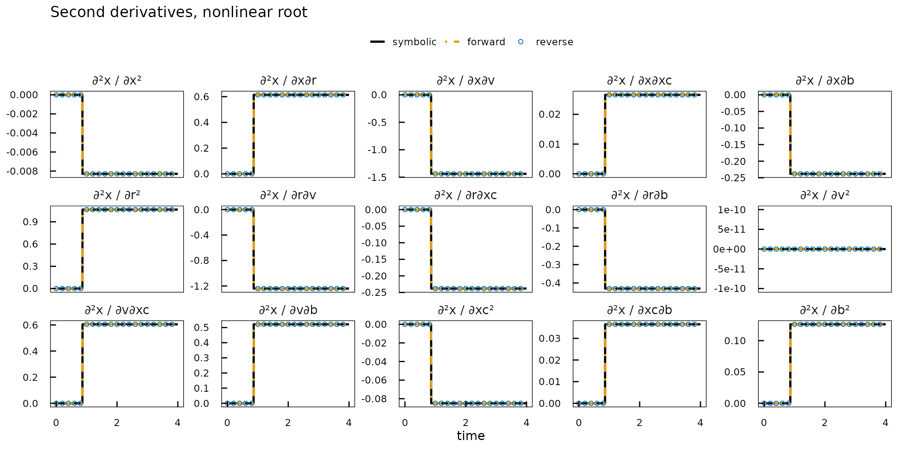

## Crossing a state switch

Below \\x_c\\ an inflow \\p \< k x_c\\ is added, so the solution crosses
\\x = x_c\\ once. The right-hand side jumps by \\p\\; the switching time
depends on \\x_0\\, \\k\\ and \\x_c\\.

``` r

model_cross   <- cppODE(c(x = "-k*x + p*(x < xc)"), deriv2 = TRUE,
                        modelname = "saltation_cross")
model_cross_r <- cppODE(c(x = "-k*x + p*(x < xc)"), derivMode = "forward-reverse",
                        modelname = "saltation_cross_r")

pars_cross  <- c(x = 2, k = 0.5, p = 0.3, xc = 1)
times_cross <- seq(0, 8, len = 1000)
res_cross   <- solveODE(model_cross, times_cross, pars_cross,
                        abstol = 1e-12, reltol = 1e-12, roottol = 1e-12)

pp <- sym("p")
point_cross  <- point(list(x0, k, pp, xc), pars_cross[c("x", "k", "p", "xc")],
                      times_cross)
cross_before <- segment(xfun, -k * xfun(tSym), sp$Integer(0L), x0)
fire_cross   <- crossing(cross_before - xc, point_cross)
cross_after  <- segment(xfun, -k * xfun(tSym) + pp, fire_cross, xc)
x_cross      <- composed(list(cross_before, cross_after), list(fire_cross))

cmp_cross <- comparison(x_cross, point_cross, res_cross, "x")
rev_cross <- reverseSeries(x_cross, point_cross, res_cross, model_cross_r,
                           pars_cross, "x", "x",
                           opts = list(abstol = 1e-12, reltol = 1e-12,
                                       roottol = 1e-12))
```

    #> Warning: saltation/cross.rds was computed from other code or another cppDE
    #> version; delete it to compute it again

``` r

report(cmp_cross, "a switch on a state, crossed")
#> 
#> a switch on a state, crossed
#>   state         max |solveODE - symbolic| = 2.88e-12
#>   first order   max |solveODE - symbolic| = 2.93e-11
#>   second order  max |solveODE - symbolic| = 2.09e-10
plot_cross_1 <- comparisonPlot(cmp_cross, 0:1, "x and gradient across a switch",
                               rev_cross)
plot_cross_1
```

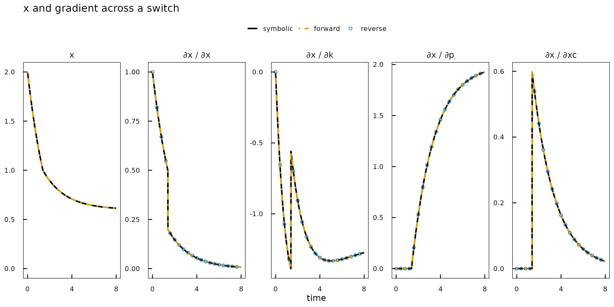

``` r

plot_cross_2 <- comparisonPlot(cmp_cross, 2L, "Second derivatives of x across a switch",
                               rev_cross)
plot_cross_2
```

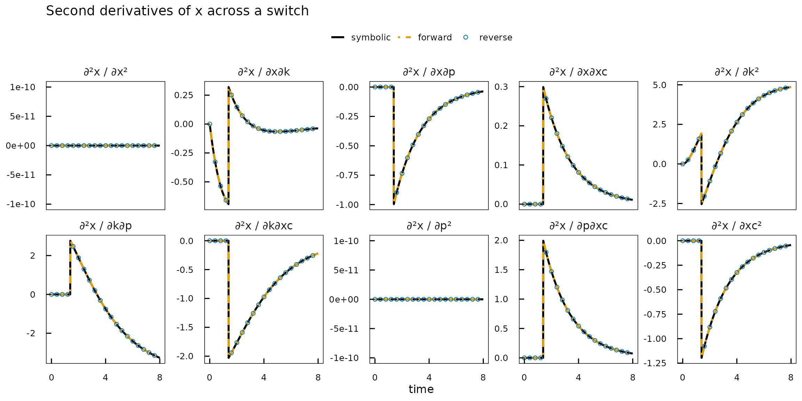

## Sliding along a switching surface

The inflow is \\p\\ e^{-rt}\\. While it exceeds \\k x_c\\ the solution
slides on \\x = x_c\\, with the sensitivities of \\x_c\\ alone; after
the exit they include the dependence of the exit time on \\p\\, \\r\\,
\\k\\ and \\x_c\\.

``` r

model_slide   <- cppODE(c(x = "-k*x + p*exp(-r*time)*(x < xc)"), deriv2 = TRUE,
                        modelname = "saltation_slide")
model_slide_r <- cppODE(c(x = "-k*x + p*exp(-r*time)*(x < xc)"),
                        derivMode = "forward-reverse",
                        modelname = "saltation_slide_r")

pars_slide  <- c(x = 2, k = 1, p = 4, r = 0.3, xc = 1)
times_slide <- seq(0, 10, len = 1000)
res_slide   <- solveODE(model_slide, times_slide, pars_slide,
                        abstol = 1e-12, reltol = 1e-12, roottol = 1e-12)

rs <- sym("r")
point_slide  <- point(list(x0, k, pp, rs, xc),
                      pars_slide[c("x", "k", "p", "r", "xc")], times_slide)
slide_before <- segment(xfun, -k * xfun(tSym), sp$Integer(0L), x0)
slide_enter  <- crossing(slide_before - xc, point_slide)
slide_exit   <- crossing(pp * sp$exp(-rs * tSym) - k * xc, point_slide)
slide_after  <- segment(xfun, -k * xfun(tSym) + pp * sp$exp(-rs * tSym),
                        slide_exit, xc)
x_slide      <- composed(list(slide_before, xc, slide_after),
                         list(slide_enter, slide_exit))

cmp_slide <- comparison(x_slide, point_slide, res_slide, "x")
rev_slide <- reverseSeries(x_slide, point_slide, res_slide, model_slide_r,
                           pars_slide, "x", "x",
                           opts = list(abstol = 1e-12, reltol = 1e-12,
                                       roottol = 1e-12))
```

    #> Warning: saltation/slide.rds was computed from other code or another cppDE
    #> version; delete it to compute it again

``` r

report(cmp_slide, "sliding along a switching surface")
#> 
#> sliding along a switching surface
#>   state         max |solveODE - symbolic| = 4.46e-12
#>   first order   max |solveODE - symbolic| = 4.83e-11
#>   second order  max |solveODE - symbolic| = 9.23e-10
plot_slide_1 <- comparisonPlot(cmp_slide, 0:1, "x and gradient, entering and leaving a slide",
                               rev_slide)
plot_slide_1
```

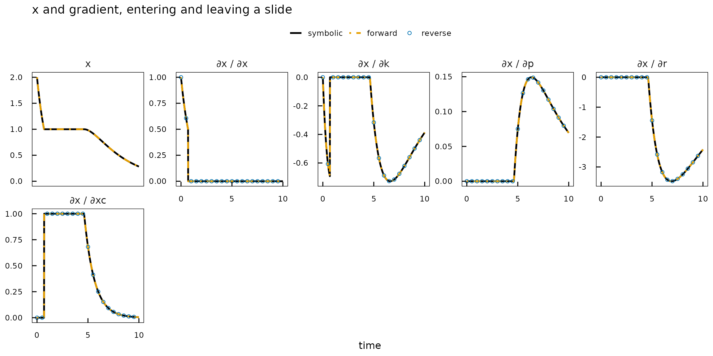

``` r

plot_slide_2 <- comparisonPlot(cmp_slide, 2L, "Second derivatives of x over a slide",
                               rev_slide)
plot_slide_2
```

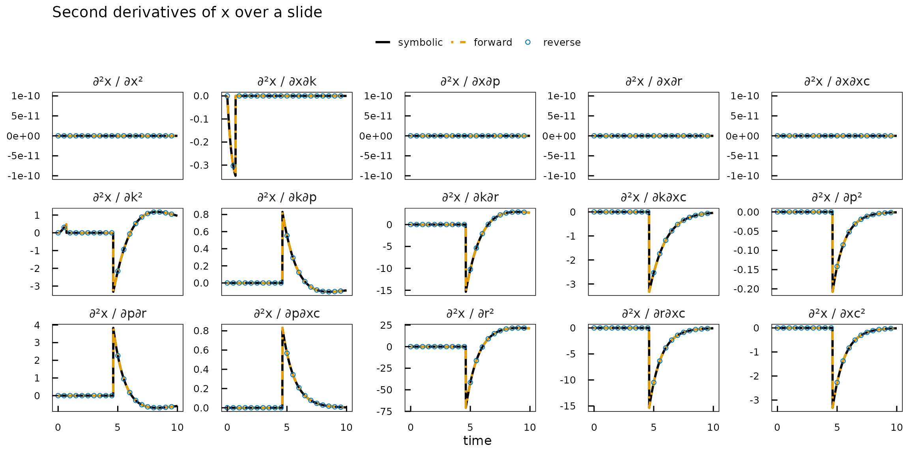
