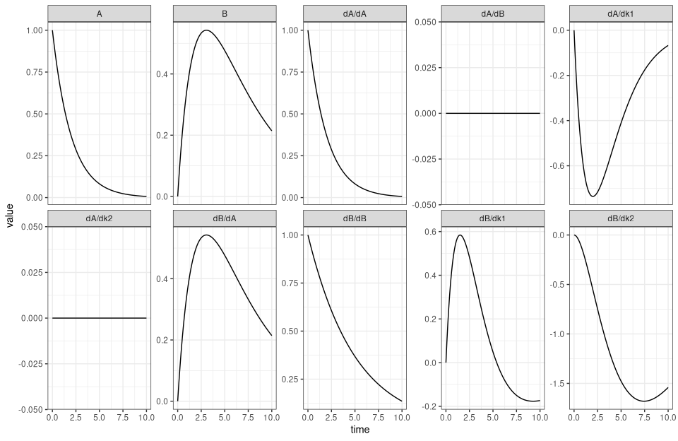
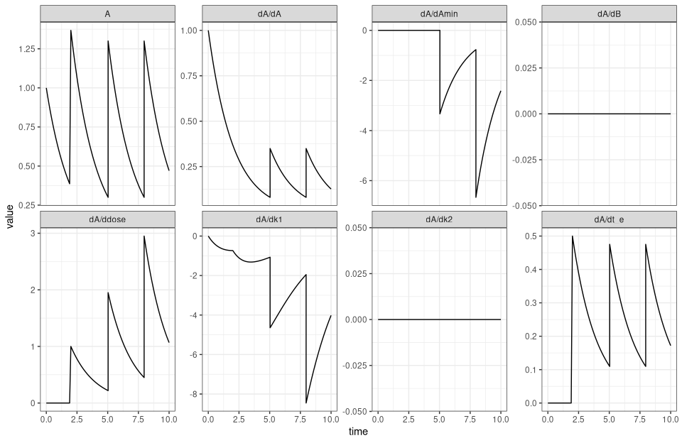
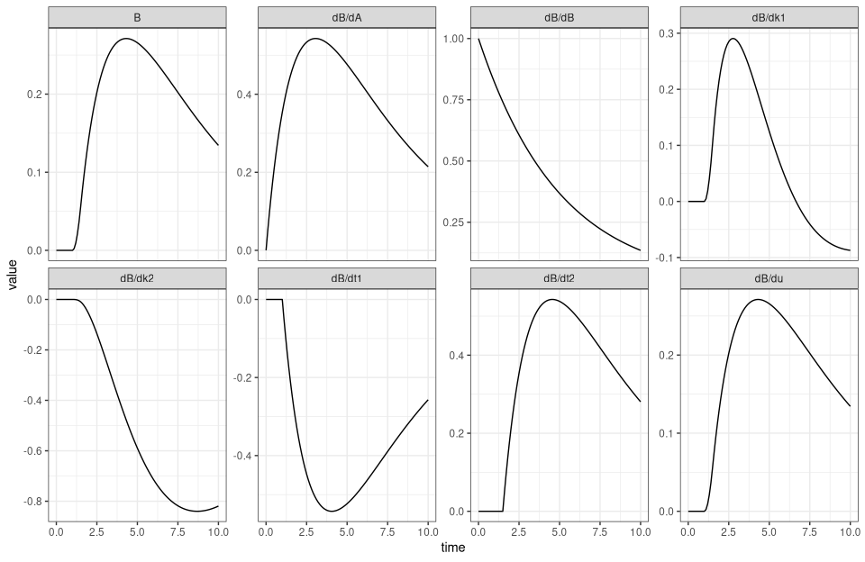
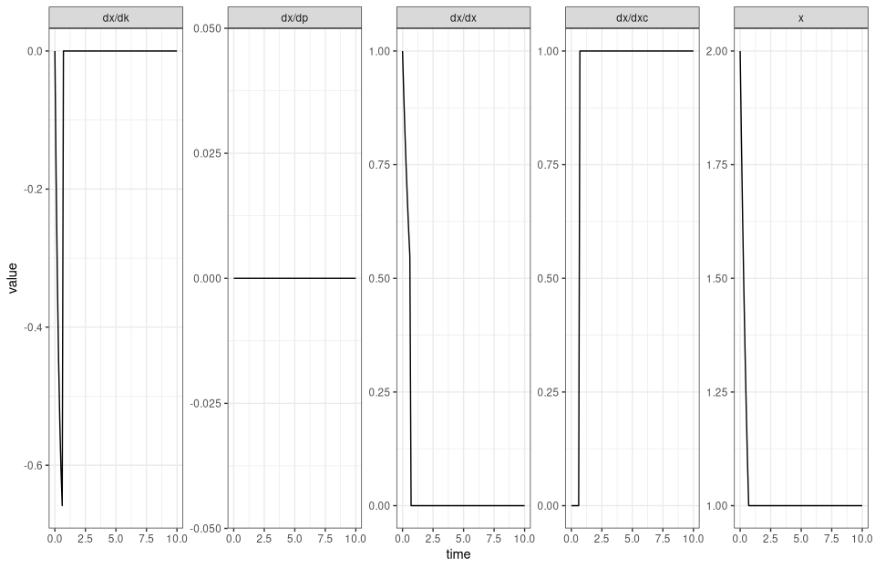
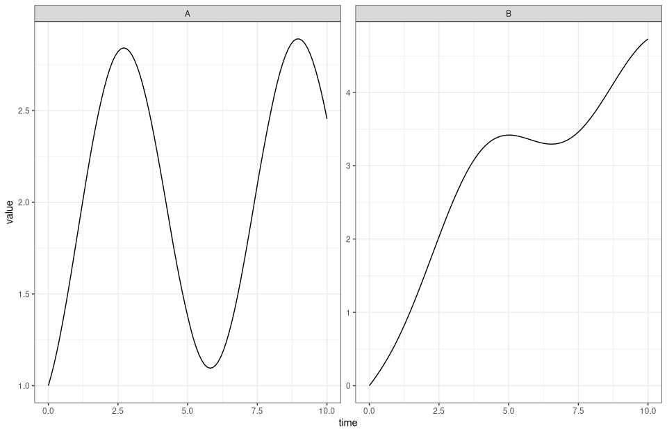

# `demo("basics")`

Rendered by `dev/render-demos.R`; run it with `demo("basics", package = "cppDE")`.

The main functions of cppDE on small models: sensitivities of first and second
order, reverse-mode gradients, events, switches, forcings, steady states, the
cvode() backend and cppFUN().


``` r
library(cppDE)
library(ggplot2)

theme_set(theme_bw(base_size = 11))
```

A trajectory and its sensitivities as one long data frame, one panel per
state and per derivative of a state.


``` r
longFormat <- function(out, states = colnames(out$variable), sens = TRUE) {
  nt <- length(out$time)
  value <- data.frame(time = out$time, panel = rep(states, each = nt),
                      value = as.vector(out$variable[, states]))
  if (!sens) return(value)
  tangent <- out$tangent[, states, , drop = FALSE]
  grid <- expand.grid(time = out$time, state = states,
                      par = dimnames(tangent)[[3]], stringsAsFactors = FALSE)
  rbind(value, data.frame(time = grid$time,
                          panel = sprintf("d%s/d%s", grid$state, grid$par),
                          value = as.vector(tangent)))
}
```

## Values and sensitivities
A decay chain A -> B. cppODE() generates and compiles the solver; solveODE()
returns the states and, by default, their derivatives in every initial value
and parameter.


``` r
eqns  <- c(A = "-k1*A", B = "k1*A - k2*B")
parms <- c(A = 1, B = 0, k1 = 0.5, k2 = 0.2)
times <- seq(0, 10, by = 0.1)

chain <- cppODE(eqns, modelname = "chain")
out   <- solveODE(chain, times, parms)

dim(out$tangent)                       # [time, state, parameter]
```

```
#> [1] 101   2   4
```

``` r
out$tangent[101, "B", ]                # dB(10) / d(A, B, k1, k2)
```

```
#>          A          B         k1         k2 
#>  0.2143285  0.1353353 -0.1734739 -1.5411595
```

``` r
ggplot(longFormat(out), aes(time, value)) +
  geom_line() +
  facet_wrap(~panel, scales = "free_y", ncol = 5)
```



## Second order
deriv2 = TRUE adds the Hessian of every state in the initial values and
parameters.


``` r
chain2 <- cppODE(eqns, deriv2 = TRUE, modelname = "chain2")
out2   <- solveODE(chain2, times, parms)
out2$hessian[101, "B", , ]             # Hessian of B(10)
```

```
#>      sens2
#> sens1          A         B          k1          k2
#>    A   0.0000000  0.000000 -0.17347368 -1.54115934
#>    B   0.0000000  0.000000  0.00000000 -1.35335267
#>    k1 -0.1734737  0.000000  0.48269589  0.04777665
#>    k2 -1.5411593 -1.353353  0.04777665 12.28149134
```

## Reverse mode
derivMode = "reverse" returns the gradient of a weighted sum of the states,
sum(cotangent * x), in one backward sweep. The cotangent below weights B at
t = 10 only, so the gradient is the row dB(10) / d(A, B, k1, k2) from above.


``` r
chainR <- cppODE(eqns, derivMode = "reverse", modelname = "chainR")
w <- matrix(0, length(times), 2, dimnames = list(NULL, c("A", "B")))
w[101, "B"] <- 1
solveODE(chainR, times, parms, cotangent = w)$cotangent
```

```
#>          [,1]
#> A   0.2143297
#> B   0.1353352
#> k1 -0.1734738
#> k2 -1.5411580
```

The gradient of a least-squares objective: the cotangent holds the residuals.


``` r
data  <- data.frame(time = times, B = 0.4 * exp(-0.3 * times) * (1 - exp(-times)))
res   <- out$variable[, "B"] - data$B
w[]   <- 0
w[, "B"] <- 2 * res
solveODE(chainR, times, parms, cotangent = w)$cotangent
```

```
#>          [,1]
#> A   25.009482
#> B   23.697091
#> k1   7.043063
#> k2 -74.692956
```

``` r
2 * colSums(res * out$tangent[, "B", ])          # the same from forward mode
```

```
#>         A         B        k1        k2 
#>  25.00975  23.69708   7.04420 -74.69240
```

## Events
Events are a data frame: which state, when or on which root, which value, and
how it is applied (replace, add, multiply). The sensitivities take each jump,
also where a parameter moves the event time.


``` r
events <- data.frame(var = c("A", "A"), time = c("t_e", NA), value = c("dose", "dose"),
                     method = c("add", "add"), root = c(NA, "A - Amin"))
dosed  <- cppODE(eqns, events = events, modelname = "dosed")
outE   <- solveODE(dosed, times, c(parms, t_e = 2, dose = 1, Amin = 0.3), maxroot = 3)

ggplot(longFormat(outE, "A"), aes(time, value)) +
  geom_line() +
  facet_wrap(~panel, scales = "free_y", ncol = 4)
```



## Switches
Comparisons and piecewise() switch the right-hand side. The solver locates the
switch as a root, so a short pulse is not stepped over. Below, a pulse of
inflow into A between t1 and t2.


``` r
pulse  <- cppODE(c(A = "u*(time >= t1 && time < t2) - k1*A", B = "k1*A - k2*B"),
                 modelname = "pulse")
outP   <- solveODE(pulse, times, c(A = 0, B = 0, k1 = 0.5, k2 = 0.2, u = 1, t1 = 1,
                                   t2 = 1.5))

ggplot(longFormat(outP, "B"), aes(time, value)) +
  geom_line() +
  facet_wrap(~panel, scales = "free_y", ncol = 4)
```



A switch on a state. Above xc, x decays; below, an inflow p > k*xc pushes it
back up. Both branches move onto x = xc, so x slides along it, and from then
on its only sensitivity is the one in xc.


``` r
slide  <- cppODE(c(x = "-k*x + p*(x < xc)"), modelname = "slide")
outS   <- solveODE(slide, times, c(x = 2, k = 1, p = 3, xc = 1))

ggplot(longFormat(outS), aes(time, value)) +
  geom_line() +
  facet_wrap(~panel, scales = "free_y", ncol = 5)
```



## Forcings
A forcing is an input given as data when solving. Between its points it is
interpolated monotonically.


``` r
forced <- cppODE(c(A = "u - k1*A", B = "k1*A - k2*B"), forcings = "u",
                 modelname = "forced")
u      <- list(u = data.frame(time = seq(0, 10, by = 0.5),
                              value = 1 + sin(seq(0, 10, by = 0.5))))
outF   <- solveODE(forced, times, parms, forcings = u)

ggplot(longFormat(outF, sens = FALSE), aes(time, value)) +
  geom_line() +
  facet_wrap(~panel, scales = "free_y")
```



## Steady states
rootfunc = "equilibrate" integrates until every derivative is negligible and
returns the steady state with its sensitivities.


``` r
steady <- cppODE(c(A = "k0 - k1*A", B = "k1*A - k2*B"), rootfunc = "equilibrate",
                 modelname = "steady")
outQ   <- solveODE(steady, c(0, 1e4), c(parms, k0 = 1), abstol = 1e-10,
                   reltol = 1e-10, roottol = 1e-10)
tail(outQ$time, 1)
```

```
#> [1] 125.6463
```

``` r
tail(outQ$variable, 1)                 # k0/k1 and k0/k2
```

```
#>      A B
#> [2,] 2 5
```

``` r
outQ$tangent[nrow(outQ$variable), , ]
```

```
#>         sens
#> variable            A           B k0            k1  k2
#>        A 2.514137e-21 0.00000e+00  2 -4.000000e+00   0
#>        B 2.705967e-11 1.62358e-11  5  1.443179e-10 -25
```

``` r
# ptc() solves for the steady state directly, by pseudo-transient continuation,
# with the conservation laws of the system as constraints. The right-hand side
# is a cppFUN() object.
enzyme <- c(E  = "-kon*E*S + (koff + kcat)*ES",
            S  = "-kon*E*S + koff*ES + kback*P",
            ES = " kon*E*S - (koff + kcat)*ES",
            P  = " kcat*ES - kback*P")
enz <- cppFUN(enzyme, variables = names(enzyme),
              parameters = c("kon", "koff", "kcat", "kback"), modelname = "enzyme",
              compile = TRUE)
C <- rbind(Etot = c(E = 1, S = 0, ES = 1, P = 0),
           Stot = c(E = 0, S = 1, ES = 1, P = 1))
ss <- ptc(enz, x = c(E = 1, S = 1, ES = 1, P = 1),
          parms = c(kon = 1, koff = 0.5, kcat = 0.3, kback = 0.1),
          C = C, total = c(1, 10))
ss$x
```

```
#>         E         S        ES         P 
#> 0.1104686 6.4418745 0.8895314 2.6685941
```

## The cvode() backend
The same equations on SUNDIALS CVODES, if cppDE was installed with it.


``` r
if (codegenAvailable("cvode")) {
  chainC <- cvode(eqns, deriv = TRUE, modelname = "chainC")
  outC   <- solveODE(chainC, times, parms, abstol = 1e-10, reltol = 1e-10)
  outN   <- solveODE(chain, times, parms, abstol = 1e-10, reltol = 1e-10)
  max(abs(outC$tangent - outN$tangent))
}
```

```
#> [1] 2.798571e-09
```

## Algebraic functions
cppFUN() compiles functions of variables and parameters with their Jacobian,
here an observable of the decay chain. The Jacobian is in the variables and
parameters together.


``` r
g <- cppFUN(c(y = "s*(A + B)", z = "log(B)"), variables = c("A", "B"),
            parameters = "s", modelname = "observable", compile = TRUE)
g$func(A = 0.2, B = 0.5, s = 2)
```

```
#>        y          z
#> [1,] 1.4 -0.6931472
```

``` r
g$jac(A = 0.2, B = 0.5, s = 2)[1, , ]
```

```
#>   A B   s
#> y 2 2 0.7
#> z 0 2 0.0
```

