# `demo("saltation")`

Rendered by `dev/render-demos.R`; run it with `demo("saltation", package = "cppDE")`.

Sensitivities across events and switches, checked against a symbolic solution.
Every model is solved by cppODE() with first- and second-order sensitivities,
forward and forward over reverse, and by SymPy through dsolve() per smooth
segment, glued at the event times and differentiated twice. Where an event
time depends on the parameters, the sensitivities after it hold a saltation
term; a wrong or missing one shows as an offset from the symbolic curve.

In every figure the symbolic solution is the solid line, the forward
sensitivities from solveODE() are drawn on top of it, and the circles are
forward over reverse, one per seeded output time. The printed lines give the
largest difference to the symbolic solution per derivative order.


``` r
library(cppDE)
library(ggplot2)
sp <- reticulate::import("sympy")
```

## Symbolic layer


``` r
sym  <- function(name, ...) sp$Symbol(name, real = TRUE, ...)
tSym <- sym("t")
```

Integer exponents only. A float power blocks the simplifications that
turn the solution of an oscillator back into a sine.


``` r
pow <- function(base, exponent) sp$Pow(base, as.integer(exponent))
```

One smooth segment of a first order equation, pinned by y(t0) = y0.


``` r
segment <- function(fun, rhs, t0, y0)
  sp$dsolve(sp$Eq(sp$Derivative(fun(tSym), tSym), rhs), fun(tSym),
            ics = reticulate::py_dict(list(fun(t0)), list(y0)))$rhs
```

The same for a second order equation, pinned by y(t0) and y'(t0).


``` r
segment2 <- function(fun, rhs, t0, y0, dy0)
  sp$dsolve(sp$Eq(sp$Derivative(fun(tSym), tSym, 2L), rhs), fun(tSym),
            ics = reticulate::py_dict(
              list(fun(t0), sp$Derivative(fun(tSym), tSym)$subs(tSym, t0)),
              list(y0, dy0)))$rhs
```

Segments glued at their firing times, one branch longer than fires.


``` r
composed <- function(branches, fires) {
  pieces <- Map(function(branch, fire) reticulate::tuple(branch, sp$Lt(tSym, fire)),
                branches[seq_along(fires)], fires)
  do.call(sp$Piecewise,
          c(pieces, list(reticulate::tuple(branches[[length(branches)]], sp$`true`))))
}
```

A parameter point: the symbols, their values, and the grid to compare on.
The names are the ones solveODE() labels its sensitivity slices with, where
a state name stands for that state's initial value.


``` r
point <- function(syms, pars, times)
  list(syms = syms, names = names(pars), values = as.list(unname(pars)),
       times = times)

toNumeric <- function(expr)
  suppressWarnings(as.numeric(reticulate::py_str(sp$N(expr))))
```

Every parameter replaced by its value, time left free.


``` r
atPoint <- function(expr, at) expr$subs(reticulate::py_dict(at$syms, at$values))
```

SymPy's lambdify reads its caller's frame for a docstring and a call from R
has none, so it goes through a Python function. Compiling once per expression
turns one round trip per time point into one per panel.


``` r
sympyGrid <- reticulate::py_run_string(
"import sympy
def over_grid(sym, expr, grid):
    f = sympy.lambdify(sym, expr, 'math')
    return [f(v) for v in grid]
")
```

The expression, or a derivative of it, over the whole time grid. A constant
expression still yields one value per time point.


``` r
series <- function(expr, at, wrt = list()) {
  for (s in wrt) expr <- sp$diff(expr, s)
  as.numeric(sympyGrid$over_grid(tSym, atPoint(expr, at), at$times))
}
```

Numeric value of an expression that no longer depends on time.


``` r
value <- function(expr, at) toNumeric(atPoint(expr, at))
```

The first zero after `after`, over one condition or several at once, picked
numerically among the symbolic roots. Complex branches drop out as NA.


``` r
crossing <- function(conditions, at, after = 0) {
  if (!is.list(conditions)) conditions <- list(conditions)
  roots <- unlist(lapply(conditions,
                         function(g) sp$solve(sp$Eq(g, sp$Integer(0L)), tSym)),
                  recursive = FALSE)
  when <- vapply(roots, value, 0, at = at)
  roots[[which.min(ifelse(!is.na(when) & when > after + 1e-9, when, Inf))]]
}
```

## Comparison and figures
Panel labels use the partial derivative sign, U+2202.


``` r
lab1 <- function(var, a) sprintf("\u2202%s / \u2202%s", var, a)
lab2 <- function(var, a, b) {
  if (a == b) return(sprintf("\u2202²%s / \u2202%s²", var, a))
  sprintf("\u2202²%s / \u2202%s\u2202%s", var, a, b)
}
```

The last row at a requested time holds the post-event state, whether
or not a localised root inserted rows of its own.


``` r
rowsAt <- function(res, times)
  vapply(times, function(s) max(which(abs(res$time - s) < 1e-9)), 1L)
```

One panel per quantity: the state, its gradient, and each distinct
second derivative, symbolic against what solveODE() returned.


``` r
comparison <- function(expr, at, res, var) {
  i  <- rowsAt(res, at$times)
  np <- length(at$syms)

  # One entry per panel, each holding both curves over the whole grid.
  panel <- function(order, quantity, symbolic, numeric)
    list(order = order, quantity = quantity,
         symbolic = symbolic, numeric = as.numeric(numeric))

  panels <- list(panel(0L, var, series(expr, at), res$variable[i, var]))
  for (a in seq_len(np))
    panels[[length(panels) + 1L]] <-
      panel(1L, lab1(var, at$names[a]), series(expr, at, at$syms[a]),
            res$tangent[i, var, at$names[a]])
  for (a in seq_len(np)) for (b in a:np)
    panels[[length(panels) + 1L]] <-
      panel(2L, lab2(var, at$names[a], at$names[b]),
            series(expr, at, at$syms[c(a, b)]),
            res$hessian[i, var, at$names[a], at$names[b]])

  labels <- vapply(panels, `[[`, "", "quantity")
  data.frame(
    order    = rep(vapply(panels, `[[`, 0L, "order"), each = length(at$times)),
    quantity = factor(rep(labels, each = length(at$times)), levels = labels),
    time     = rep(at$times, length(panels)),
    symbolic = unlist(lapply(panels, `[[`, "symbolic"), use.names = FALSE),
    numeric  = unlist(lapply(panels, `[[`, "numeric"), use.names = FALSE))
}
```

The numeric side of the figures, one line per derivative order.


``` r
report <- function(df, title) {
  cat("\n", title, "\n", sep = "")
  for (o in sort(unique(df$order))) {
    d <- df[df$order == o, ]
    cat(sprintf("  %-13s max |solveODE - symbolic| = %.2e\n",
                c("state", "first order", "second order")[o + 1L],
                max(abs(d$numeric - d$symbolic))))
  }
}
```

Forward over reverse at every `every`-th output time: a cotangent seeded on
one row and state makes the gradient that state's row of the tangent and the
curvature its Hessian. Only requested times are seeded, since a row a root
inserts moves with the parameters.


``` r
reverseSeries <- function(expr, at, res, model, pars, var, states,
                          opts = list(), every = 50L) {
  keep <- seq(1L, length(at$times), by = every)
  i    <- rowsAt(res, at$times)[keep]
  W    <- array(0, c(nrow(res$variable), length(states), length(keep)))
  for (r in seq_along(keep)) W[i[r], match(var, states), r] <- 1
  rev <- do.call(solveODE, c(list(model, at$times, pars, cotangent = W), opts))

  np  <- length(at$syms)
  out <- list()
  add <- function(order, quantity, symbolic, numeric)
    out[[length(out) + 1L]] <<- data.frame(
      order = order, quantity = quantity, time = at$times[keep],
      symbolic = symbolic, reverse = as.numeric(numeric))

  for (a in seq_len(np))
    add(1L, lab1(var, at$names[a]),
        series(expr, at, at$syms[a])[keep], rev$cotangent[at$names[a], ])
  for (a in seq_len(np)) for (b in a:np)
    add(2L, lab2(var, at$names[a], at$names[b]),
        series(expr, at, at$syms[c(a, b)])[keep],
        rev$curvature[at$names[a], at$names[b], ])

  df <- do.call(rbind, out)
  for (o in 1:2) {
    d <- df[df$order == o, ]
    cat(sprintf("  %-13s max |reverse - symbolic| = %.2e\n",
                c("reverse 1st", "reverse 2nd")[o],
                max(abs(d$reverse - d$symbolic))))
  }
  df
}
```

`rev` draws forward over reverse on top, one point per seeded row.


``` r
comparisonPlot <- function(df, orders, title, rev = NULL) {
  p <- ggplot(df[df$order %in% orders, ], aes(x = time)) +
    # A quantity that vanishes identically leaves the solver a cancellation
    # residue of a few ulp, and a free y scale would blow that up into a
    # picture of its own round-off. No panel is drawn tighter than this.
    expand_limits(y = c(-1e-10, 1e-10)) +
    geom_line(aes(y = symbolic, colour = "symbolic", linetype = "symbolic"),
              linewidth = 1) +
    geom_line(aes(y = numeric, colour = "forward", linetype = "forward"),
              linewidth = 1)
  if (!is.null(rev)) {
    rev$quantity <- factor(rev$quantity, levels = levels(df$quantity))
    p <- p + geom_point(data = rev[rev$order %in% orders, ],
                        aes(y = reverse, colour = "reverse"),
                        shape = 21, size = 1.6, stroke = 0.7, fill = NA)
  }
  p + facet_wrap(~quantity, scales = "free_y") +
    scale_colour_manual(values = c(symbolic = "#2166ac", forward = "#d6604d",
                                   reverse = "#1a9850")) +
    scale_linetype_manual(values = c(symbolic = "solid", forward = "dotdash")) +
    labs(title = title, x = "time", y = NULL, colour = NULL, linetype = NULL) +
    theme_bw(base_size = 9) +
    theme(legend.position = "top")
}
```

## Root event on a coupled pair
The firing time depends on three parameters, so every sensitivity after the
event contains a saltation term, and the crossing lands exactly on a
requested output time.


``` r
events_pair <- data.frame(var = "C", time = NA, value = "d", method = "add",
                          root = "S - c", stringsAsFactors = FALSE)
model_pair  <- cppODE(c(S = "a", C = "-b * C"), events = events_pair,
                      deriv = TRUE, deriv2 = TRUE, modelname = "saltation_pair")

pars_pair  <- c(S = 2, C = 4, a = 1, b = 0.1, c = 14, d = 3)
times_pair <- seq(0, 20, len = 1000)
# Tight tolerances throughout, so what is left of the residual is the solver
# and not the saltation transport. roottol matters as much: the firing time
# enters the state through the velocity, so a loose root is a state error.
res_pair <- solveODE(model_pair, times_pair, pars_pair,
                     abstol = 1e-12, reltol = 1e-12, roottol = 1e-12)

S0 <- sym("S0"); C0 <- sym("C0"); a <- sym("a")
b  <- sym("b");  cc <- sym("c");  d <- sym("d")
Sfun <- sp$Function("S"); Cfun <- sp$Function("C")

point_pair <- point(list(S0, C0, a, b, cc, d),
                    pars_pair[c("S", "C", "a", "b", "c", "d")], times_pair)
S_of_t <- segment(Sfun, a, sp$Integer(0L), S0)
fire_pair <- crossing(S_of_t - cc, point_pair)
C_before  <- segment(Cfun, -b * Cfun(tSym), sp$Integer(0L), C0)
C_after   <- segment(Cfun, -b * Cfun(tSym), fire_pair,
                     C_before$subs(tSym, fire_pair) + d)
C_of_t    <- composed(list(C_before, C_after), list(fire_pair))

cmp_pair <- comparison(C_of_t, point_pair, res_pair, "C")
report(cmp_pair, "root event on a coupled pair")
```

```
#> 
#> root event on a coupled pair
#>   state         max |solveODE - symbolic| = 1.07e-11
#>   first order   max |solveODE - symbolic| = 3.94e-10
#>   second order  max |solveODE - symbolic| = 1.17e-08
```

``` r
model_pair_r <- cppODE(c(S = "a", C = "-b * C"), events = events_pair,
                       derivMode = "forward-reverse", modelname = "saltation_pair_r")
rev_pair <- reverseSeries(C_of_t, point_pair, res_pair, model_pair_r, pars_pair,
                          "C", c("S", "C"),
                          opts = list(abstol = 1e-12, reltol = 1e-12,
                                      roottol = 1e-12))
```

```
#>   reverse 1st   max |reverse - symbolic| = 4.07e-09
#>   reverse 2nd   max |reverse - symbolic| = 1.43e-07
```

``` r
plot_pair_1 <- comparisonPlot(cmp_pair, 0:1, "C and its gradient across a root event",
                              rev_pair)
plot_pair_1
```

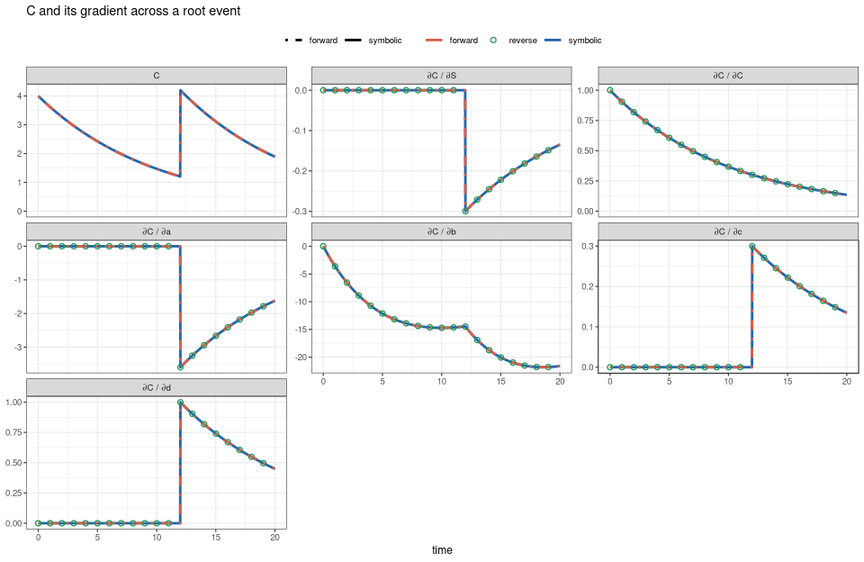

``` r
plot_pair_2 <- comparisonPlot(cmp_pair, 2L, "Second derivatives of C across a root event",
                              rev_pair)
plot_pair_2
```

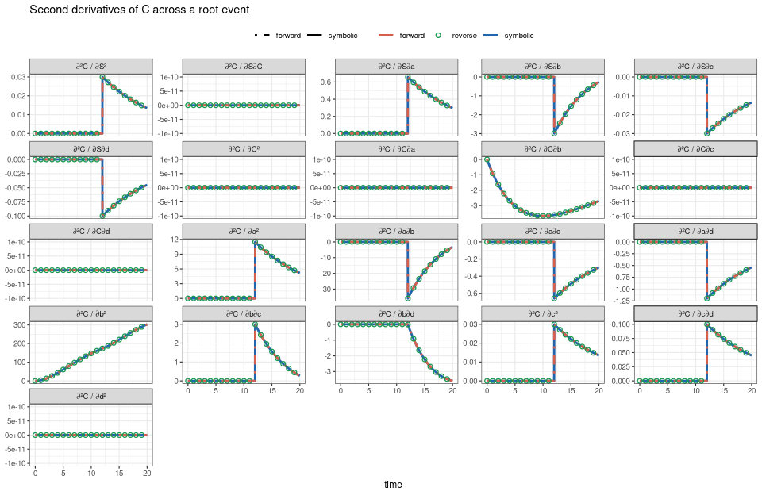

## Time-triggered event


``` r
# dt*/dtheta is supplied directly by the user expression rather than
# reconstructed from a root condition, which is the other saltation path.
events_dose <- data.frame(var = "x", time = "te", value = "v", method = "add",
                          root = NA, stringsAsFactors = FALSE)
model_dose  <- cppODE(c(x = "-k * x"), events = events_dose, deriv = TRUE,
                      deriv2 = TRUE, modelname = "saltation_dose")

pars_dose  <- c(x = 1, k = 0.3, v = 2, te = 4)
times_dose <- seq(0, 10, len = 1000)
res_dose   <- solveODE(model_dose, times_dose, pars_dose,
                       abstol = 1e-12, reltol = 1e-12)

x0 <- sym("x0"); k <- sym("k"); dose <- sym("v"); te <- sym("te")
xfun <- sp$Function("x")

point_dose <- point(list(x0, k, dose, te),
                    pars_dose[c("x", "k", "v", "te")], times_dose)
x_before <- segment(xfun, -k * xfun(tSym), sp$Integer(0L), x0)
x_after  <- segment(xfun, -k * xfun(tSym), te, x_before$subs(tSym, te) + dose)
x_dose   <- composed(list(x_before, x_after), list(te))

cmp_dose <- comparison(x_dose, point_dose, res_dose, "x")
report(cmp_dose, "time-triggered event")
```

```
#> 
#> time-triggered event
#>   state         max |solveODE - symbolic| = 4.53e-12
#>   first order   max |solveODE - symbolic| = 6.65e-11
#>   second order  max |solveODE - symbolic| = 7.63e-10
```

``` r
model_dose_r <- cppODE(c(x = "-k * x"), events = events_dose,
                       derivMode = "forward-reverse", modelname = "saltation_dose_r")
rev_dose <- reverseSeries(x_dose, point_dose, res_dose, model_dose_r, pars_dose,
                          "x", "x", opts = list(abstol = 1e-12, reltol = 1e-12))
```

```
#>   reverse 1st   max |reverse - symbolic| = 7.96e-10
#>   reverse 2nd   max |reverse - symbolic| = 1.04e-08
```

``` r
plot_dose_1 <- comparisonPlot(cmp_dose, 0:1, "x and its gradient across a timed dose",
                              rev_dose)
plot_dose_1
```

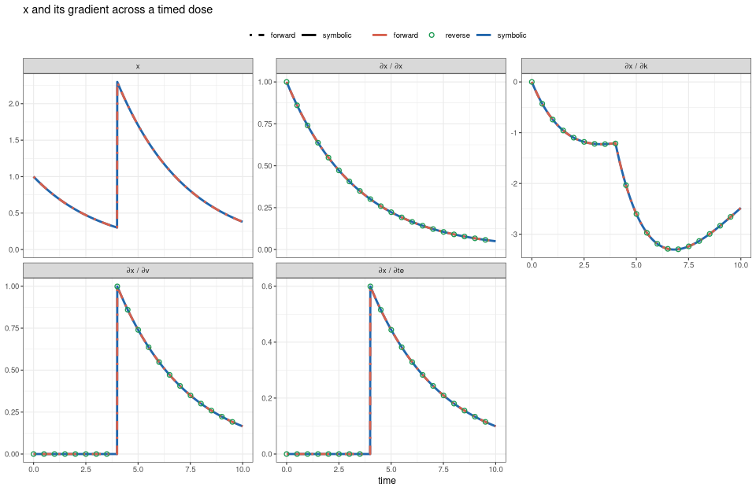

``` r
plot_dose_2 <- comparisonPlot(cmp_dose, 2L, "Second derivatives of x across a timed dose",
                              rev_dose)
plot_dose_2
```

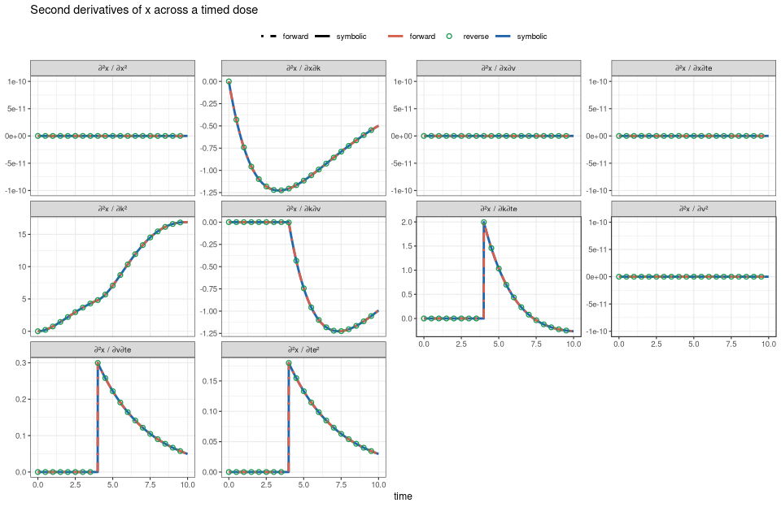

## A root event that fires three times
Each firing time sits on top of the previous one, so the saltation
corrections compose and the sensitivities pick up all three.


``` r
events_pulse <- data.frame(var = "x", time = NA, value = "v", method = "add",
                           root = "x - xc", stringsAsFactors = FALSE)
model_pulse  <- cppODE(c(x = "-k * x"), events = events_pulse, deriv = TRUE,
                       deriv2 = TRUE, modelname = "saltation_pulse")
model_pulse_r <- cppODE(c(x = "-k * x"), events = events_pulse,
                        derivMode = "forward-reverse",
                        modelname = "saltation_pulse_r")

pars_pulse  <- c(x = 1, k = 0.3, v = 1, xc = 0.4)
times_pulse <- seq(0, 12, len = 1000)
res_pulse   <- solveODE(model_pulse, times_pulse, pars_pulse, maxroot = 3L,
                        abstol = 1e-12, reltol = 1e-12, roottol = 1e-12)

xc <- sym("xc")
point_pulse <- point(list(x0, k, dose, xc),
                     pars_pulse[c("x", "k", "v", "xc")], times_pulse)

branches_pulse <- list(segment(xfun, -k * xfun(tSym), sp$Integer(0L), x0))
fires_pulse    <- list()
for (j in 1:3) {
  previous <- if (j == 1) 0 else value(fires_pulse[[j - 1]], point_pulse)
  fires_pulse[[j]] <- crossing(branches_pulse[[j]] - xc, point_pulse, previous)
  branches_pulse[[j + 1]] <- segment(xfun, -k * xfun(tSym), fires_pulse[[j]],
                                     xc + dose)
}
x_pulse <- composed(branches_pulse, fires_pulse)

cmp_pulse <- comparison(x_pulse, point_pulse, res_pulse, "x")
report(cmp_pulse, "a root event that fires three times")
```

```
#> 
#> a root event that fires three times
#>   state         max |solveODE - symbolic| = 6.15e-11
#>   first order   max |solveODE - symbolic| = 4.29e-10
#>   second order  max |solveODE - symbolic| = 2.83e-09
```

``` r
rev_pulse <- reverseSeries(x_pulse, point_pulse, res_pulse, model_pulse_r,
                           pars_pulse, "x", "x",
                           opts = list(maxroot = 3L, abstol = 1e-12,
                                       reltol = 1e-12, roottol = 1e-12))
```

```
#>   reverse 1st   max |reverse - symbolic| = 5.93e-09
#>   reverse 2nd   max |reverse - symbolic| = 3.18e-08
```

``` r
plot_pulse_1 <- comparisonPlot(cmp_pulse, 0:1, "x and its gradient over three firings",
                               rev_pulse)
plot_pulse_1
```

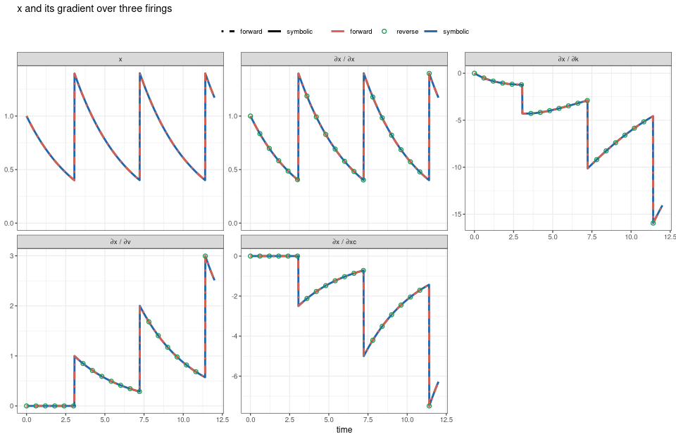

``` r
plot_pulse_2 <- comparisonPlot(cmp_pulse, 2L, "Second derivatives of x over three firings",
                               rev_pulse)
plot_pulse_2
```

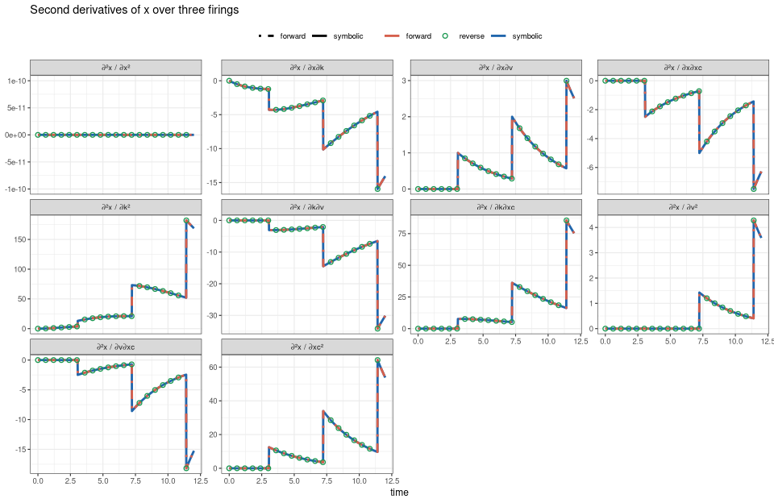

## Explicit time dependence in the right-hand side
The right-hand side depends on time itself, so the second order transport
needs the time argument of the Heun legs and not only the shifted state.


``` r
events_drift <- data.frame(var = "x", time = NA, value = "v", method = "add",
                           root = "x - xc", stringsAsFactors = FALSE)
model_drift  <- cppODE(c(x = "-k * time * x"), events = events_drift,
                       deriv = TRUE, deriv2 = TRUE, modelname = "saltation_drift")
model_drift_r <- cppODE(c(x = "-k * time * x"), events = events_drift,
                        derivMode = "forward-reverse",
                        modelname = "saltation_drift_r")

pars_drift  <- c(x = 1, k = 0.2, v = 0.5, xc = 0.3)
times_drift <- seq(0, 6, len = 1000)
res_drift   <- solveODE(model_drift, times_drift, pars_drift,
                        abstol = 1e-12, reltol = 1e-12, roottol = 1e-12)

point_drift <- point(list(x0, k, dose, xc),
                     pars_drift[c("x", "k", "v", "xc")], times_drift)
drift_before <- segment(xfun, -k * tSym * xfun(tSym), sp$Integer(0L), x0)
fire_drift   <- crossing(drift_before - xc, point_drift)
drift_after  <- segment(xfun, -k * tSym * xfun(tSym), fire_drift, xc + dose)
x_drift      <- composed(list(drift_before, drift_after), list(fire_drift))

cmp_drift <- comparison(x_drift, point_drift, res_drift, "x")
report(cmp_drift, "explicit time dependence in the right-hand side")
```

```
#> 
#> explicit time dependence in the right-hand side
#>   state         max |solveODE - symbolic| = 1.15e-11
#>   first order   max |solveODE - symbolic| = 2.46e-10
#>   second order  max |solveODE - symbolic| = 3.79e-09
```

``` r
rev_drift <- reverseSeries(x_drift, point_drift, res_drift, model_drift_r,
                           pars_drift, "x", "x",
                           opts = list(abstol = 1e-12, reltol = 1e-12,
                                       roottol = 1e-12))
```

```
#>   reverse 1st   max |reverse - symbolic| = 2.26e-09
#>   reverse 2nd   max |reverse - symbolic| = 3.49e-08
```

``` r
plot_drift_1 <- comparisonPlot(cmp_drift, 0:1, "x and its gradient, time-dependent decay",
                               rev_drift)
plot_drift_1
```

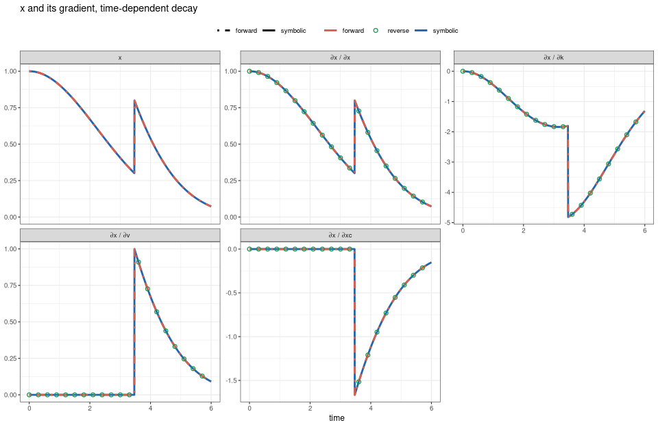

``` r
plot_drift_2 <- comparisonPlot(cmp_drift, 2L, "Second derivatives of x, time-dependent decay",
                               rev_drift)
plot_drift_2
```

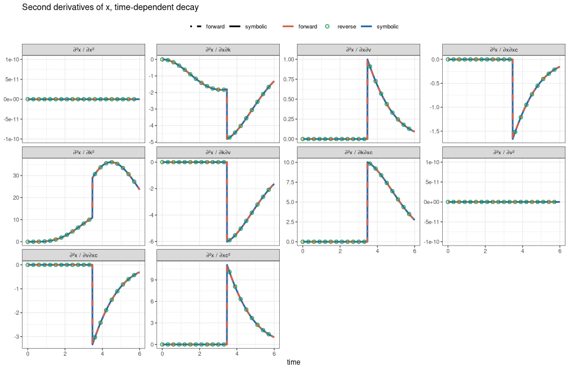

## Oscillator between two elastic walls
Each wall is a root event that turns the velocity around, and the two fire
alternately. Position stays continuous at a bounce, so everything the event
does to its sensitivities is saltation.

The wall just left holds its root at exactly zero when the solver restarts,
which must not count as the next crossing.


``` r
events_wall <- data.frame(var = c("v", "v"), time = c(NA, NA),
                          value = c("-1", "-1"),
                          method = c("multiply", "multiply"),
                          root = c("x - L", "x + L"), stringsAsFactors = FALSE)
model_wall  <- cppODE(c(x = "v", v = "-w^2 * x"), events = events_wall,
                      deriv = TRUE, deriv2 = TRUE, modelname = "saltation_wall")
model_wall_r <- cppODE(c(x = "v", v = "-w^2 * x"), events = events_wall,
                       derivMode = "forward-reverse",
                       modelname = "saltation_wall_r")

pars_wall  <- c(x = 0.2, v = 1.2, w = 1, L = 0.8)
times_wall <- seq(0, 11, len = 1000)
# Two firings per wall, so 8 bounces before the grid ends.
res_wall <- solveODE(model_wall, times_wall, pars_wall, maxroot = 4L,
                     abstol = 1e-12, reltol = 1e-12, roottol = 1e-12)

x_ini <- sym("x0"); v_ini <- sym("v0")
freq  <- sp$Symbol("w", real = TRUE, positive = TRUE)
wall  <- sp$Symbol("L", real = TRUE, positive = TRUE)

point_wall <- point(list(x_ini, v_ini, freq, wall),
                    pars_wall[c("x", "v", "w", "L")], times_wall)
oscillation <- function(t0, y0, dy0)
  segment2(xfun, -pow(freq, 2) * xfun(tSym), t0, y0, dy0)
```

From the initial state to whichever wall comes first.


``` r
approach   <- oscillation(sp$Integer(0L), x_ini, v_ini)
first_hit  <- crossing(list(approach - wall, approach + wall), point_wall)
first_side <- sign(value(approach$subs(tSym, first_hit), point_wall))
```

The energy survives the reflection, so every flight between the walls is one
arc up to a sign and a time shift. Solved once it stays small, while composing
it bounce by bounce through dsolve() nests one inverse tangent per wall.


``` r
energy <- sp$simplify(pow(sp$diff(approach, tSym), 2) + pow(freq, 2) * pow(approach, 2))
speed  <- sp$sqrt(energy - pow(freq, 2) * pow(wall, 2))
stopifnot(isTRUE(all.equal(
  value(speed, point_wall),
  first_side * value(sp$diff(approach, tSym)$subs(tSym, first_hit), point_wall))))
```

One arc, from the wall it leaves to the opposite one, in the time since
that bounce.


``` r
flight_arc  <- oscillation(sp$Integer(0L), wall, -speed)
flight_time <- crossing(flight_arc + wall, point_wall)

branches_wall <- list(approach)
fires_wall    <- list(first_hit)
side          <- first_side
for (j in 1:8) {
  branches_wall[[j + 1]] <- sp$Integer(as.integer(side)) *
    flight_arc$subs(tSym, tSym - fires_wall[[j]])
  if (j < 8) fires_wall[[j + 1]] <- fires_wall[[j]] + flight_time
  side <- -side
}
x_wall <- composed(branches_wall, fires_wall)
v_wall <- sp$diff(x_wall, tSym)

cmp_wall_x <- comparison(x_wall, point_wall, res_wall, "x")
cmp_wall_v <- comparison(v_wall, point_wall, res_wall, "v")
report(cmp_wall_x, "oscillator between elastic walls, position")
```

```
#> 
#> oscillator between elastic walls, position
#>   state         max |solveODE - symbolic| = 4.31e-10
#>   first order   max |solveODE - symbolic| = 5.67e-09
#>   second order  max |solveODE - symbolic| = 1.44e-07
```

``` r
rev_wall_x <- reverseSeries(x_wall, point_wall, res_wall, model_wall_r,
                            pars_wall, "x", c("x", "v"),
                            opts = list(maxroot = 4L, abstol = 1e-12,
                                        reltol = 1e-12, roottol = 1e-12))
```

```
#>   reverse 1st   max |reverse - symbolic| = 7.21e-09
#>   reverse 2nd   max |reverse - symbolic| = 2.05e-07
```

``` r
report(cmp_wall_v, "oscillator between elastic walls, velocity")
```

```
#> 
#> oscillator between elastic walls, velocity
#>   state         max |solveODE - symbolic| = 3.73e-10
#>   first order   max |solveODE - symbolic| = 7.87e-09
#>   second order  max |solveODE - symbolic| = 7.72e-08
```

``` r
rev_wall_v <- reverseSeries(v_wall, point_wall, res_wall, model_wall_r,
                            pars_wall, "v", c("x", "v"),
                            opts = list(maxroot = 4L, abstol = 1e-12,
                                        reltol = 1e-12, roottol = 1e-12))
```

```
#>   reverse 1st   max |reverse - symbolic| = 1.38e-08
#>   reverse 2nd   max |reverse - symbolic| = 1.50e-07
```

``` r
plot_wall_1 <- comparisonPlot(cmp_wall_x, 0:1, "Position and its gradient over 8 bounces",
                              rev_wall_x)
plot_wall_1
```

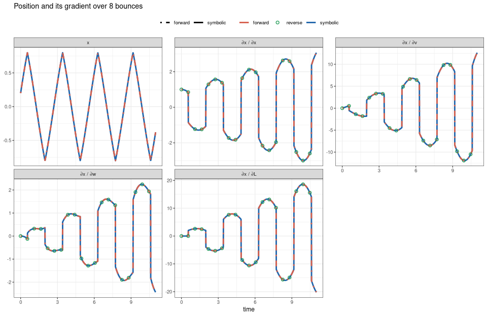

``` r
plot_wall_2 <- comparisonPlot(cmp_wall_x, 2L, "Second derivatives of the position",
                              rev_wall_x)
plot_wall_2
```

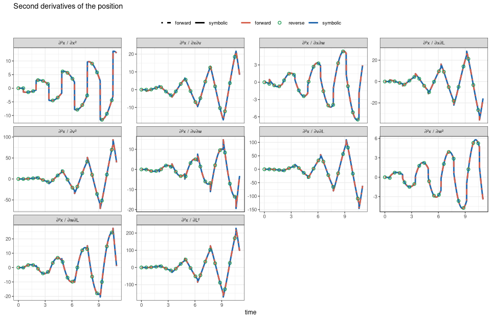

``` r
plot_wall_3 <- comparisonPlot(cmp_wall_v, 0:1, "Velocity and its gradient over 8 bounces",
                              rev_wall_v)
plot_wall_3
```

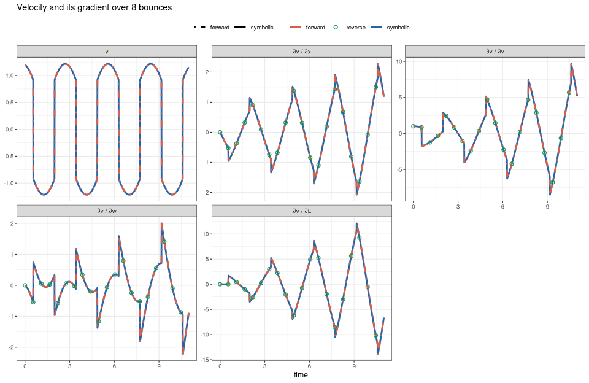

``` r
plot_wall_4 <- comparisonPlot(cmp_wall_v, 2L, "Second derivatives of the velocity",
                              rev_wall_v)
plot_wall_4
```

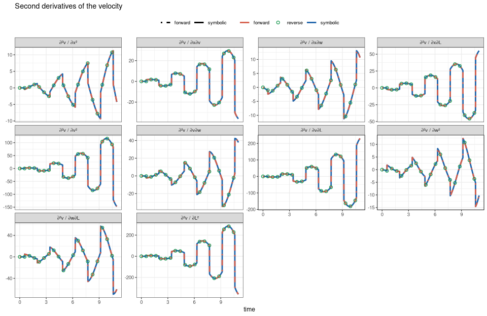

## A jump whose time and height are expressions
Nothing here is a bare parameter: the firing time is a nonlinear function of
one, and the height reads the clock and the state it lands on. Each slot
leaves different terms of the transport at zero, so only generality reaches
them.


``` r
events_expr <- data.frame(var = "x", time = "0.5*te + 0.4*te*te",
                          value = "v * time + q * x", method = "add",
                          root = NA, stringsAsFactors = FALSE)
model_expr  <- cppODE(c(x = "-k * x"), events = events_expr, deriv = TRUE,
                      deriv2 = TRUE, modelname = "saltation_expr")
model_expr_r <- cppODE(c(x = "-k * x"), events = events_expr,
                       derivMode = "forward-reverse", modelname = "saltation_expr_r")

pars_expr  <- c(x = 1, k = 0.3, v = 0.5, q = 0.4, te = 1.6)
times_expr <- seq(0, 10, len = 1000)
res_expr   <- solveODE(model_expr, times_expr, pars_expr,
                       abstol = 1e-12, reltol = 1e-12)

vv <- sym("v"); qq <- sym("q"); tev <- sym("te")
point_expr <- point(list(x0, k, vv, qq, tev),
                    pars_expr[c("x", "k", "v", "q", "te")], times_expr)
fire_expr  <- sp$Rational(1L, 2L) * tev + sp$Rational(2L, 5L) * pow(tev, 2)
expr_before <- segment(xfun, -k * xfun(tSym), sp$Integer(0L), x0)
at_fire     <- expr_before$subs(tSym, fire_expr)
expr_after  <- segment(xfun, -k * xfun(tSym), fire_expr,
                       at_fire + vv * fire_expr + qq * at_fire)
x_expr      <- composed(list(expr_before, expr_after), list(fire_expr))

cmp_expr <- comparison(x_expr, point_expr, res_expr, "x")
report(cmp_expr, "a jump whose time and height are expressions")
```

```
#> 
#> a jump whose time and height are expressions
#>   state         max |solveODE - symbolic| = 4.20e-12
#>   first order   max |solveODE - symbolic| = 5.31e-11
#>   second order  max |solveODE - symbolic| = 5.85e-10
```

``` r
rev_expr <- reverseSeries(x_expr, point_expr, res_expr, model_expr_r, pars_expr,
                          "x", "x", opts = list(abstol = 1e-12, reltol = 1e-12))
```

```
#>   reverse 1st   max |reverse - symbolic| = 1.09e-09
#>   reverse 2nd   max |reverse - symbolic| = 1.42e-08
```

``` r
plot_expr_1 <- comparisonPlot(cmp_expr, 0:1, "x and its gradient, expression-valued jump",
                              rev_expr)
plot_expr_1
```

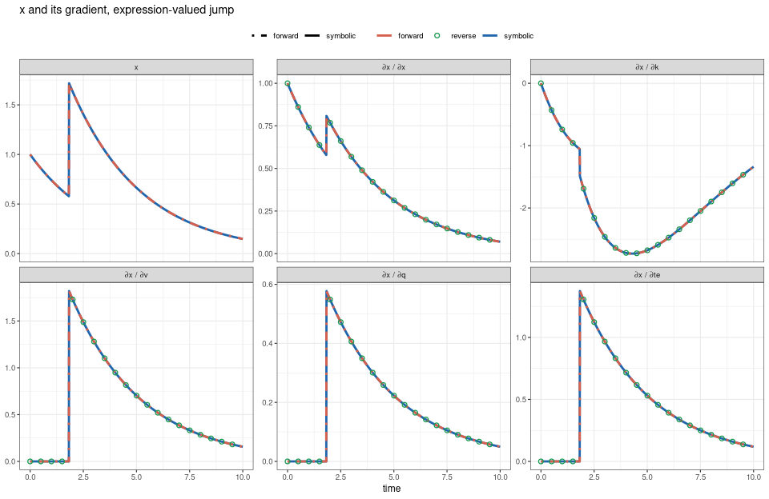

``` r
plot_expr_2 <- comparisonPlot(cmp_expr, 2L, "Second derivatives, expression-valued jump",
                              rev_expr)
plot_expr_2
```

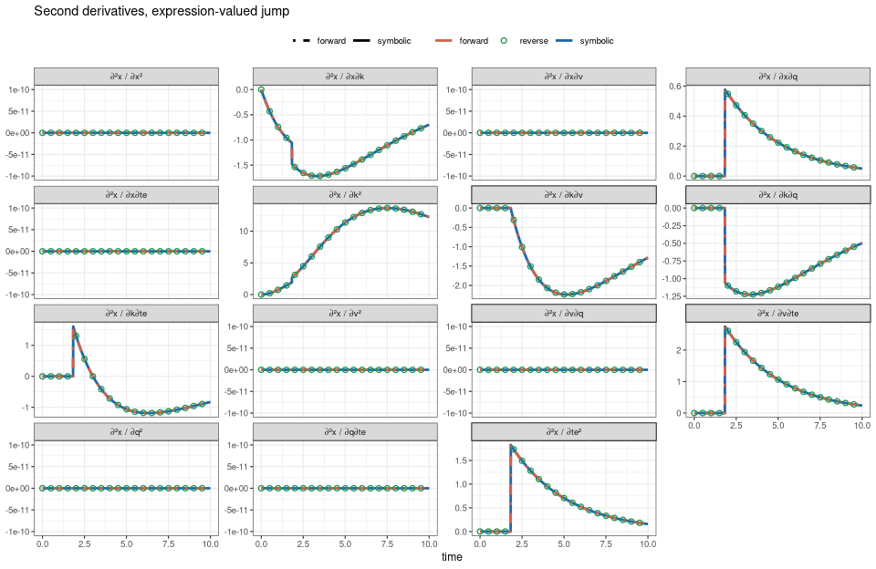

## A root nonlinear in the state and explicit in time


``` r
# ds/dx contains grad g_dot, which is grad g_t + (hess g) f + J' grad g. A root
# linear in the state and blind to the clock leaves the first two at zero, so
# this is the case that tests them. Quadratic in t, so the crossing stays
# closed form.
events_quad <- data.frame(var = "x", time = NA, value = "v * time",
                          method = "add", root = "x*x - xc - b*time",
                          stringsAsFactors = FALSE)
model_quad  <- cppODE(c(x = "r"), events = events_quad, deriv = TRUE,
                      deriv2 = TRUE, modelname = "saltation_quad")
model_quad_r <- cppODE(c(x = "r"), events = events_quad,
                       derivMode = "forward-reverse", modelname = "saltation_quad_r")

pars_quad  <- c(x = 0.5, r = 0.8, v = 0.3, xc = 1.2, b = 0.25)
times_quad <- seq(0, 4, len = 1000)
res_quad   <- solveODE(model_quad, times_quad, pars_quad,
                       abstol = 1e-12, reltol = 1e-12, roottol = 1e-12)

rr <- sym("r"); bb <- sym("b")
point_quad <- point(list(x0, rr, vv, xc, bb),
                    pars_quad[c("x", "r", "v", "xc", "b")], times_quad)
quad_before <- segment(xfun, rr, sp$Integer(0L), x0)
fire_quad   <- crossing(pow(quad_before, 2) - xc - bb * tSym, point_quad)
quad_after  <- segment(xfun, rr, fire_quad,
                       quad_before$subs(tSym, fire_quad) + vv * fire_quad)
x_quad      <- composed(list(quad_before, quad_after), list(fire_quad))

cmp_quad <- comparison(x_quad, point_quad, res_quad, "x")
report(cmp_quad, "a root nonlinear in the state and explicit in time")
```

```
#> 
#> a root nonlinear in the state and explicit in time
#>   state         max |solveODE - symbolic| = 1.78e-15
#>   first order   max |solveODE - symbolic| = 4.44e-15
#>   second order  max |solveODE - symbolic| = 6.00e-15
```

``` r
rev_quad <- reverseSeries(x_quad, point_quad, res_quad, model_quad_r, pars_quad,
                          "x", "x", opts = list(abstol = 1e-12, reltol = 1e-12,
                                                roottol = 1e-12))
```

```
#>   reverse 1st   max |reverse - symbolic| = 2.27e-13
#>   reverse 2nd   max |reverse - symbolic| = 8.18e-14
```

``` r
plot_quad_1 <- comparisonPlot(cmp_quad, 0:1, "x and its gradient, nonlinear root",
                              rev_quad)
plot_quad_1
```

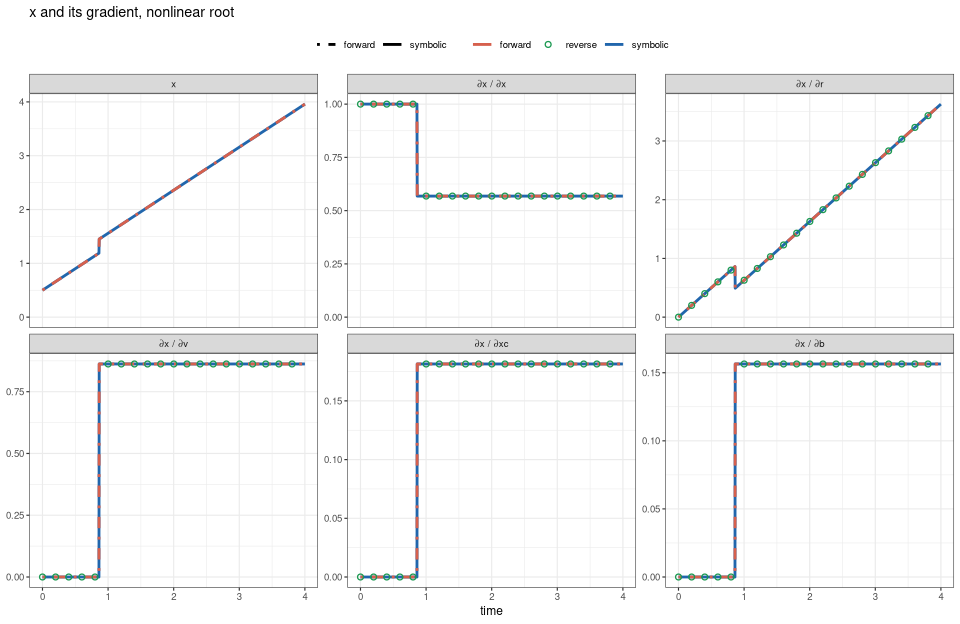

``` r
plot_quad_2 <- comparisonPlot(cmp_quad, 2L, "Second derivatives, nonlinear root",
                              rev_quad)
plot_quad_2
```

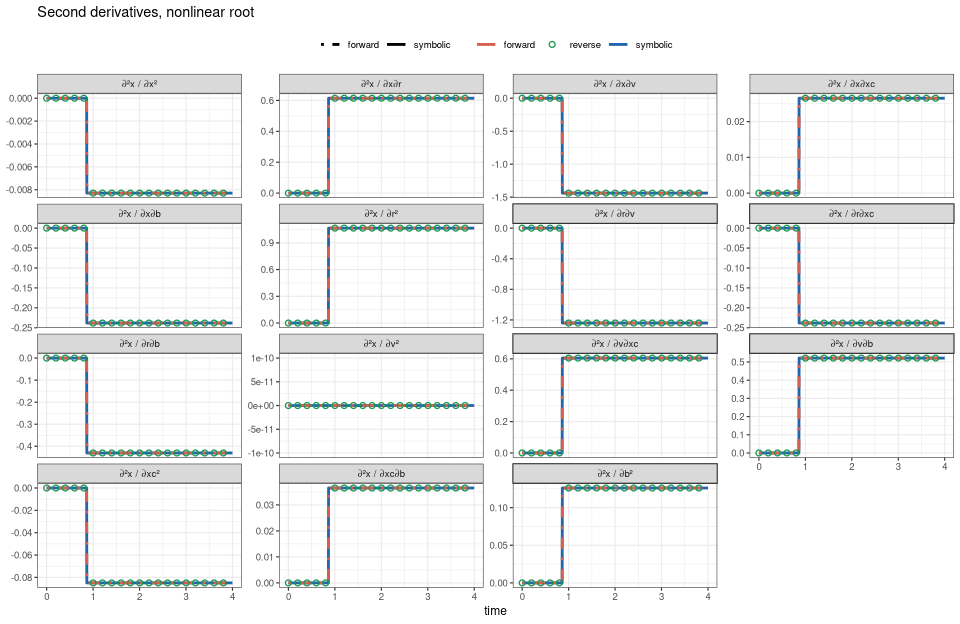

## A switch on a state that the solution crosses
Above xc the state decays, below it an inflow p < k*xc is added, so the
solution crosses x = xc once. The state is continuous there and its
right-hand side jumps by p; the sensitivities take the jump through the
saltation of the switch, whose time moves with x0, k and xc.


``` r
model_cross   <- cppODE(c(x = "-k*x + p*(x < xc)"), deriv2 = TRUE,
                        modelname = "saltation_cross")
model_cross_r <- cppODE(c(x = "-k*x + p*(x < xc)"), derivMode = "forward-reverse",
                        modelname = "saltation_cross_r")

pars_cross  <- c(x = 2, k = 0.5, p = 0.3, xc = 1)
times_cross <- seq(0, 8, len = 1000)
res_cross   <- solveODE(model_cross, times_cross, pars_cross,
                        abstol = 1e-12, reltol = 1e-12, roottol = 1e-12)

pp <- sym("p")
point_cross  <- point(list(x0, k, pp, xc), pars_cross[c("x", "k", "p", "xc")],
                      times_cross)
cross_before <- segment(xfun, -k * xfun(tSym), sp$Integer(0L), x0)
fire_cross   <- crossing(cross_before - xc, point_cross)
cross_after  <- segment(xfun, -k * xfun(tSym) + pp, fire_cross, xc)
x_cross      <- composed(list(cross_before, cross_after), list(fire_cross))

cmp_cross <- comparison(x_cross, point_cross, res_cross, "x")
report(cmp_cross, "a switch on a state, crossed")
```

```
#> 
#> a switch on a state, crossed
#>   state         max |solveODE - symbolic| = 2.80e-12
#>   first order   max |solveODE - symbolic| = 2.81e-11
#>   second order  max |solveODE - symbolic| = 1.72e-10
```

``` r
rev_cross <- reverseSeries(x_cross, point_cross, res_cross, model_cross_r,
                           pars_cross, "x", "x",
                           opts = list(abstol = 1e-12, reltol = 1e-12,
                                       roottol = 1e-12))
```

```
#>   reverse 1st   max |reverse - symbolic| = 2.93e-10
#>   reverse 2nd   max |reverse - symbolic| = 2.03e-09
```

``` r
plot_cross_1 <- comparisonPlot(cmp_cross, 0:1, "x and its gradient across a switch",
                               rev_cross)
plot_cross_1
```

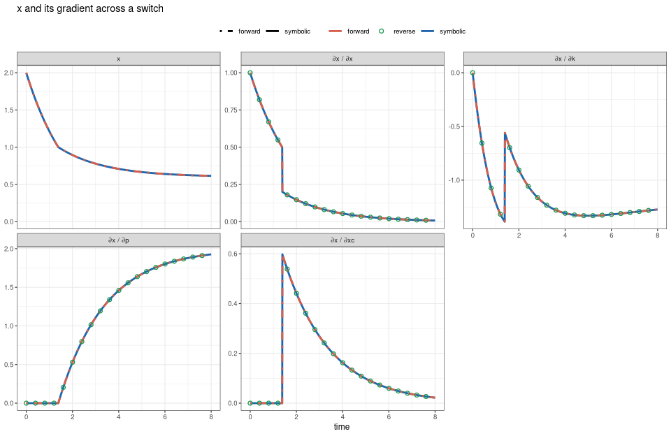

``` r
plot_cross_2 <- comparisonPlot(cmp_cross, 2L, "Second derivatives of x across a switch",
                               rev_cross)
plot_cross_2
```

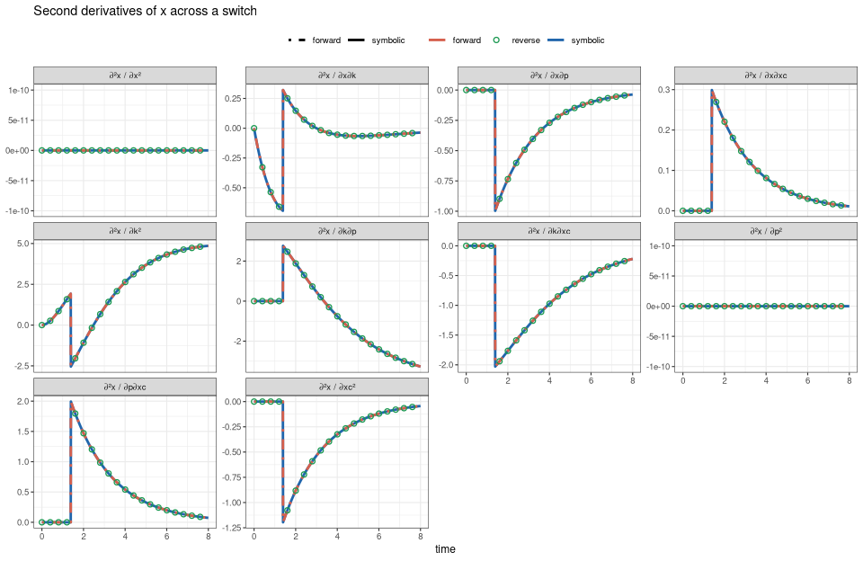

## Sliding along a switching surface
The same switch with an inflow that fades, p*exp(-r*time). While it exceeds
k*xc, both branches push the solution onto x = xc and it slides along the
surface; it leaves where the inflow falls to k*xc. During the slide x = xc,
so the sensitivities are those of xc alone, and after the exit they start
from there with the exit time's dependence on p, r, k and xc.


``` r
model_slide   <- cppODE(c(x = "-k*x + p*exp(-r*time)*(x < xc)"), deriv2 = TRUE,
                        modelname = "saltation_slide")
model_slide_r <- cppODE(c(x = "-k*x + p*exp(-r*time)*(x < xc)"),
                        derivMode = "forward-reverse",
                        modelname = "saltation_slide_r")

pars_slide  <- c(x = 2, k = 1, p = 4, r = 0.3, xc = 1)
times_slide <- seq(0, 10, len = 1000)
res_slide   <- solveODE(model_slide, times_slide, pars_slide,
                        abstol = 1e-12, reltol = 1e-12, roottol = 1e-12)

rs <- sym("r")
point_slide  <- point(list(x0, k, pp, rs, xc),
                      pars_slide[c("x", "k", "p", "r", "xc")], times_slide)
slide_before <- segment(xfun, -k * xfun(tSym), sp$Integer(0L), x0)
slide_enter  <- crossing(slide_before - xc, point_slide)
slide_exit   <- crossing(pp * sp$exp(-rs * tSym) - k * xc, point_slide)
slide_after  <- segment(xfun, -k * xfun(tSym) + pp * sp$exp(-rs * tSym),
                        slide_exit, xc)
x_slide      <- composed(list(slide_before, xc, slide_after),
                         list(slide_enter, slide_exit))

cmp_slide <- comparison(x_slide, point_slide, res_slide, "x")
report(cmp_slide, "sliding along a switching surface")
```

```
#> 
#> sliding along a switching surface
#>   state         max |solveODE - symbolic| = 7.26e-12
#>   first order   max |solveODE - symbolic| = 4.84e-11
#>   second order  max |solveODE - symbolic| = 9.26e-10
```

``` r
rev_slide <- reverseSeries(x_slide, point_slide, res_slide, model_slide_r,
                           pars_slide, "x", "x",
                           opts = list(abstol = 1e-12, reltol = 1e-12,
                                       roottol = 1e-12))
```

```
#>   reverse 1st   max |reverse - symbolic| = 6.89e-10
#>   reverse 2nd   max |reverse - symbolic| = 1.28e-08
```

``` r
plot_slide_1 <- comparisonPlot(cmp_slide, 0:1, "x and its gradient, entering and leaving a slide",
                               rev_slide)
plot_slide_1
```

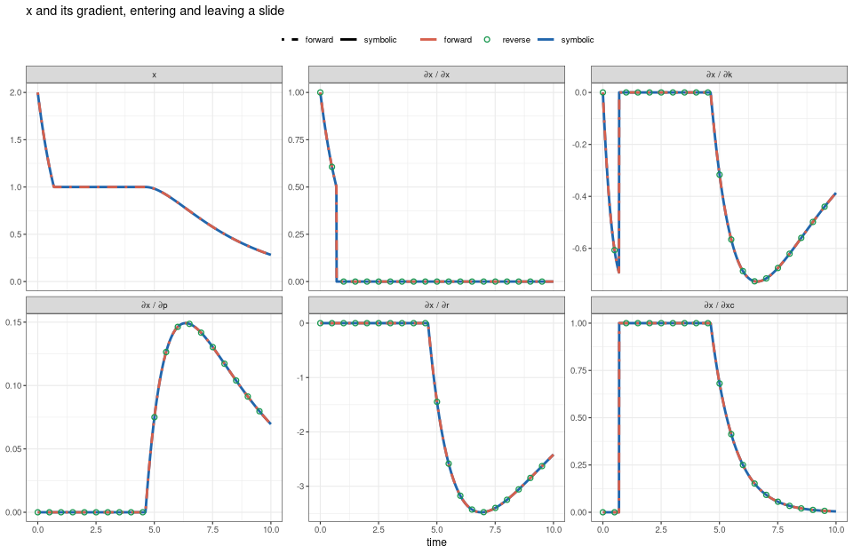

``` r
plot_slide_2 <- comparisonPlot(cmp_slide, 2L, "Second derivatives of x over a slide",
                               rev_slide)
plot_slide_2
```

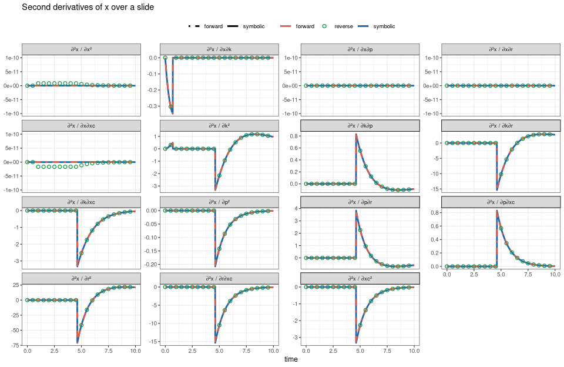

